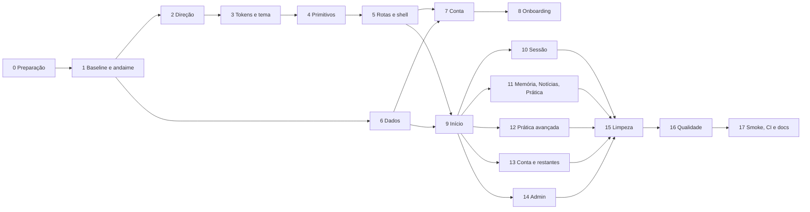

# Plano de refatoração e revamp de UI/UX do Prosa

> **Status:** plano. Nada deste documento foi implementado ainda.
> **Data:** 26 de outubro de 2026.
> **Escopo:** o aplicativo Expo em `mobile/` (web primeiro, via React Native Web). A API em `src/`, as migrações em `migrations/` e os serviços em `services/` não mudam.
> **Para quem:** agentes (Kiro e sub-agentes) e pessoas que vão executar o trabalho. Cada task da seção 14 pode ser executada sem ler o resto do documento, desde que se leiam as seções que ela cita.

## Sumário

0. Como os agentes usam este documento
1. Resumo
2. Diagnóstico medido
3. Requisitos confirmados
4. Precedência e conflitos entre skills
5. Skills: quando, por quê e como
6. Direção visual
7. Tokens
8. Primitivos
9. Arquitetura alvo
10. Inventário: o destino de cada arquivo
11. Redesign rota por rota
12. Camada de dados
13. Estratégia de testes
14. Tarefas passo a passo
15. Métricas de saída
16. Riscos e decisões abertas
17. Documentação produzida
18. Registro de execução

---

## 0. Como os agentes usam este documento

### 0.1 Papéis

| Papel | Quem | O que faz | O que não faz |
|---|---|---|---|
| Executor | Kiro em modo execução | Edita arquivos, roda comandos, escreve testes, atualiza a documentação | Commit ou push sem pedido explícito. Editar `src/`, `migrations/`, `services/`, `secrets/` |
| Investigador | Sub-agente `context-gatherer` (só leitura) | Mapeia o código antes de cada task: importadores, props, efeitos, strings fixas, testIDs necessários. Faz a Avaliação A da critique da Impeccable | Editar |
| Revisor | Sub-agente `semantic_reviewer` | Revisa o diff de cada task e entrega um veredito | Aprovar com teste vermelho |
| Documenter da Impeccable | O executor, inline, seguindo `.agents/skills/impeccable/reference/degraded/documenter.md` | Escreve `DESIGN.md` e `.impeccable/design.json` a partir do código construído | Transformar defeito em regra |
| Finish reviewer da Impeccable | Um sub-agente `context-gatherer` novo, sem histórico, com o texto de `reference/degraded/finish-reviewer.md` | Revisa o resultado contra o contrato de direção | Ver o raciocínio do executor |

O Kiro não carrega os agentes `.toml` de `.agents/skills/impeccable/agents/`. Os papéis da Impeccable rodam com os textos de `reference/degraded/`. Cada substituição vira uma linha no Registro de execução (seção 18).

### 0.2 O ciclo de cada task

1. Ler a task inteira na seção 14 e as seções que ela cita.
2. Disparar um `context-gatherer` sobre os arquivos da task (em paralelo quando forem áreas independentes). Pedir: quem importa cada arquivo, props, efeitos, chamadas de API, strings fixas em português, onde entram testIDs.
3. Ler as referências de skill que a task lista (seção 5.6). Antes de qualquer edição de UI, ler `.agents/skills/impeccable/reference/craft-floor.md`.
4. Implementar em incrementos pequenos. Depois de cada incremento: `npx tsc --noEmit`, `npx expo lint` e os specs da task.
5. Olhar o render em 375 px e 1280 px, nos temas claro e escuro, num lote só. Corrigir tudo o que a olhada mostrou antes de olhar de novo.
6. Rodar o `semantic_reviewer` sobre o diff e corrigir o que ele apontar.
7. Rodar `node scripts/ui-metrics.mjs` em `mobile/` (criado na Task 1), guardar o JSON em `docs/qa/metrics/` e escrever a entrada da task na seção 18.
8. Fechar com a Demo da task: o que a pessoa consegue ver ou fazer agora.

### 0.3 Definição de pronto (vale para toda task)

- `npx tsc --noEmit` e `npx expo lint` limpos em `mobile/`.
- `npm test` na raiz continua verde (54 arquivos de teste, sem rede).
- Os specs Playwright da task passam nos projetos `mobile` e `desktop`.
- `node .agents/skills/design-taste-frontend/scripts/lint.mjs --app mobile/src` sem FAIL novo.
- Nenhum `testID` novo fora da convenção da seção 13.4.
- Uma entrada na seção 18 com: o que mudou, decisões tomadas, arquivos apagados, métricas antes e depois, caminho dos prints.

### 0.4 Regras fixas

- **Expo muda a cada SDK.** Antes de usar qualquer API do Expo ou do React Native, abrir `https://docs.expo.dev/versions/v57.0.0/` e o índice `https://docs.expo.dev/llms.txt` (regra de `mobile/AGENTS.md`). Nunca responder de memória.
- **Instalação.** Pacotes do ecossistema Expo entram com `npx expo install <pacote>`. Os demais entram com versão exata (`npm install --save-exact`). Cada instalação é anotada no registro.
- **Segredos.** Nunca ler nem imprimir valores de `secrets/runtime.env`. Para saber se uma chave existe, listar só o nome e se está vazia.
- **Apagar.** Um arquivo só é apagado depois que um grep mostra zero importadores. Cada arquivo apagado entra no registro.
- **Rotas.** Todo arquivo em `mobile/src/app/` vira rota. Testes, helpers e componentes nunca ficam ali.
- **Testes da raiz.** Onze arquivos de `test/` importam módulos de `mobile/src/lib/` com caminho explícito `.ts`: `chunks`, `breakpoint`, `dictation`, `hands-free`, `listen-pace`, `reconstruction`, `retention`, `session-clock` (dois testes), `stop-recorder` e `xp-rules`. Esses módulos ficam no caminho atual. Se um deles precisar mudar de pasta, o caminho antigo vira um arquivo de reexportação.
- **RTK.** O arquivo `.agents/rules/antigravity-rtk-rules.md` é para o Antigravity. Não usar o prefixo `rtk` aqui.
- **Idioma.** Documentação em português do Brasil. Código e identificadores em inglês, como o projeto já faz. Texto de interface sempre pelo i18n (`useCopy`).
- **Git.** Sem commit, push, `reset --hard` ou `clean` sem pedido explícito. Quando houver commit, adicionar arquivos pelo nome.
- **Backend.** Nenhuma mudança em `src/`. Se a interface precisar de algo que a API não entrega, a task para e registra a lacuna na seção 16.

---

## 1. Resumo

O redesign troca o mundo atual (terracota e creme, Newsreader nos títulos, botões 3D com borda inferior grossa, gamificação com quatro cores) por um produto de toque macio, no espírito de Linear, Arc e Things:

- Uma **moldura** tingida de azul acinzentado segura a navegação. O trabalho fica numa **folha** branca de cantos de 16 px, recuada 8 px da borda da janela. A profundidade vem de um degrau de tom, sem sombra em repouso.
- Um **único acento** (petróleo, `#1B6C80` no claro) marca só o que avança ou o que é dado: o minuto atual da sessão, a régua dos vinte minutos, a palavra sendo lida, a série principal de um gráfico. O botão primário é quase preto.
- **IBM Plex Sans** na interface e **Literata** só no texto que a pessoa estuda (história, notícia). As duas cobrem latim, grego e cirílico. O japonês usa a fonte do sistema como reserva.
- **Vidro** apenas no que flutua sobre conteúdo que rola: barra superior e barra de abas no celular, folhas, menus, toasts. Painéis em repouso são opacos.
- O **movimento** é resposta: toque com escala 0,97 em 120 ms, folhas com mola, toasts. Há um único momento autoral, o fecho da sessão.
- O **elenco** (os gênios em vinil) continua. Cada papel (Leitura, Memória, Fala, Diário) ganha um tom pálido estável atrás do retrato.

Por baixo:

- Tokens com **uma fonte de verdade** (`src/design/tokens.ts`). Um script gera as variáveis CSS e o mapa do Tailwind.
- Uma biblioteca de **primitivos** acessíveis, com `testID`, estados completos e tema claro, escuro e do sistema.
- **Grupos de rotas** com uma guarda declarativa pura e testada, no lugar dos `router.replace` espalhados.
- **Um shell** só, no lugar de `AppFrame`, `layout/*` e da navegação duplicada.
- Uma **camada de dados** tipada (`src/api/`, zod e TanStack Query) no lugar do `lib/api.ts` de 2167 linhas.
- As telas grandes viram **máquinas de estado puras** testadas e componentes pequenos.

Os testes rodam no Playwright sobre o export estático: uma suíte com API simulada para cada PR, um smoke contra a stack real, a11y com axe em todas as rotas e regressão visual em container Linux.

---

## 2. Diagnóstico medido

Os números abaixo vêm de leitura direta do repositório em 26/10/2026 (scripts Node só de leitura e sub-agentes de investigação).

### 2.1 Tamanho e concentração

| Medida | Valor |
|---|---|
| Arquivos em `mobile/src` (`.ts`, `.tsx`, `.css`) | 185 |
| Linhas | 25.635 |
| Arquivos com mais de 400 linhas | 11 |

| Arquivo | Linhas | Problema |
|---|---|---|
| `lib/api.ts` | 2167 | Monólito de `fetch` com validação manual e token passado em toda função |
| `lib/messages.ts` | 1225 | 608 chaves por idioma, sem checagem de paridade pt/en |
| `lib/progress.ts` | 685 | Store próprio que regrava o JSON inteiro a cada mudança |
| `app/(session)/daily.tsx` | 671 | Orquestra a sessão de 20 minutos, nove `useEffect` |
| `services/audio/AudioService.ts` | 642 | Singleton de áudio, 15 importadores |
| `components/home/daily-news.tsx` | 630 | Leitor de notícia com níveis, áudio, blocos e ditado |
| `app/(onboarding)/quiz.tsx` | 561 | Quiz com muito português fixo no código |
| `components/placement/placement-screen.tsx` | 535 | Nivelamento com uma cópia local de `fill()` |
| `app/admin.tsx` | 534 | Painel de operação com textos fixos |
| `app/settings.tsx` | 526 | Perfil, idioma, tema, segurança, lembrete e elenco numa tela |
| `app/account.tsx` | 470 | Entrar, criar, verificar e-mail e 2FA numa tela só |

### 2.2 Estilo e tokens

- **As cores existem em três lugares:** `src/design/tokens.ts` (paletas `lightPalette` e `darkPalette`), `src/global.css` (blocos `:root.light` e `:root.dark`) e `src/theme/ThemeContext.tsx` (`themeVars()` injeta as mesmas variáveis com `vars()` do NativeWind).
- **Camadas de alias legados:** `surface`, `onSurface`, `primaryContainer` e mais 20 nomes no estilo Material em `tokens.ts`. `ember`, `moss`, `sand`, `rose`, `canvas` e `cardHover` em `global.css` e `tailwind.config.js`. Três cores de sidebar fixas e sem tema no `tailwind.config.js` (`#1C1917`, `#FFF8F1`, `#F8D9C8`).
- **Uso de estilo:** `className` em 1639 lugares de 93 arquivos, `style={` 91 vezes em 39 arquivos, `StyleSheet.create` em 8 arquivos. Há cerca de 200 hex fixos em 16 arquivos fora dos tokens (`profile.tsx`, `today-card.tsx`, `right-rail.tsx`, `focus-shell.tsx`, `srs-stage.tsx`, `flag.tsx`, `theme-switch.tsx`, `dev/ui.tsx` e outros).
- **`global.css`:** importa fontes do Google por URL (rede extra no web) e força `!important` em classes internas do React Native Web (`#root [class*="css-text"] { display: inline-block !important }`). Também reescreve `.text-[11px]` e quatro `tracking-*`.
- **O vidro atual** (`session/glass-sheet.tsx`) usa rgba de zinco frio (`rgba(24,24,27,0.94)`), que não conversa com a paleta quente.
- **O botão** `ui/button.tsx` simula 3D com `border-b-4` e `border-primaryEdge`.
- **Tema:** só claro e escuro, padrão claro. `useColorScheme` é ignorado, apesar de `app.json` declarar `userInterfaceStyle: "automatic"`.
- **Fontes:** carrega Newsreader 400/600, Nunito 500/700/800 e Source Sans 3 400/600. Quatro pacotes instalados nunca são usados: `@expo-google-fonts/fraunces`, `inter`, `playfair-display` e `plus-jakarta-sans`.
- **Cores da marca em `app.json` e `+html.tsx`:** `primaryColor #9A3412`, `themeColor #9A3412`, `backgroundColor #FFF8F1`, splash `#FFF8F1`, ícone adaptativo `#FFF8F1`, meta `theme-color #FFF8F1`.

### 2.3 Componentes duplicados

| Função | Versões existentes | Uso |
|---|---|---|
| Botão | `ui/button.tsx` (3D, 5 variantes) e `shell/chunk-button.tsx` (pílula, 4 tons) | 8 e 11 importadores |
| Painel | `ui/card.tsx` e `shell/panel.tsx` (`Panel`, `PanelHead`, `Field`, `SoftInput`) | 5 e 3 |
| Folha | `ui/sheet.tsx` e `session/glass-sheet.tsx` | 3 e 6 |
| Barra de progresso | `ui/progress-bar.tsx` e `session/progress-bar.tsx` (morta) | 4 e 0 |
| Número em destaque | `ui/stat-card.tsx`, `ui/stat-pill.tsx`, `admin/stat.tsx` | 2, 3 e 1 |
| Shell | `shell/app-frame.tsx` (333 linhas, 24 importadores) e `layout/*` (`AppShell`, `Sidebar`, `RightRail`, `FocusShell`, `PublicShell` morto) | — |
| Navegação | `ITEMS` em `app-frame.tsx` (com i18n) e `NAV_ITEMS` em `sidebar.tsx` (português fixo) | — |
| Campo de texto | `ui/text-field.tsx` (usado só em `dev/ui`) e `SoftInput` | 22 arquivos usam `TextInput` cru |
| `fill()` de modelo | Três cópias idênticas em `measure-panel.tsx`, `placement-card.tsx` e `placement-screen.tsx` | — |
| `useTheme` | `hooks/use-theme.ts` (modelo do Expo) e `theme/ThemeContext.tsx` (o real, 41 importadores) | — |

### 2.4 Código morto (zero importadores vivos)

- Restos do modelo do Expo: `components/animated-icon.tsx`, `animated-icon.web.tsx`, `animated-icon.module.css`, `app-tabs.tsx`, `app-tabs.web.tsx`, `external-link.tsx`, `hint-row.tsx`, `themed-text.tsx`, `themed-view.tsx`, `web-badge.tsx`, `ui/collapsible.tsx`, `constants/theme.ts`, `hooks/use-theme.ts`, `hooks/use-color-scheme.ts`, `hooks/use-color-scheme.web.ts`.
- Do próprio produto: `guide/welcome-sheet.tsx`, `home/streak-flame.tsx`, `onboarding/cognate-preview.tsx`, `layout/public-shell.tsx`, `layout/index.ts`, `session/progress-bar.tsx`, `session/interleaving-container.tsx`, `services/interleaving-engine.ts` (só o container morto importa), `lib/learner-profile.ts`, `design/cast.ts`.
- `app/(tabs)/_layout.tsx` é um `Tabs` com uma tela e a barra escondida (`tabBarStyle: { display: "none" }`).

### 2.5 Dados e estado

- **API:** 87 caminhos distintos em `/api/v1` mais `/health`. A maioria das funções chama `fetch` direto e pula o `apiFetch` que traduz erro de rede. A validação é manual. Algumas mensagens de erro estão fixas em português ("A conta não voltou da API.", "A frase não voltou desmontada.").
- **TanStack Query** está instalado e persistido em MMKV (`prosa.query.v1`, 14 dias), mas há um único `useQuery` no app (`(session)/daily.tsx`) e nenhum `useMutation`. O resto usa `useState` com `useEffect`.
- **Boot:** `lib/query.tsx` faz três coisas. Hidrata progresso, sessão, jornada e guia. Chama `refreshSession()` e, se falhar, `wipeDeviceStudy`. Roda `flushReviews()` a cada 15 segundos.
- **Chaves MMKV (no web viram `localStorage` com prefixo `prosa\`):** `prosa.session.v1`, `prosa.progress.v1`, `prosa.journey.v1`, `prosa.guide.v1`, `prosa.theme.v1`, `prosa.locale.v1`, `prosa.cast.v1`, `prosa.narrator.v1`, `prosa.listen-rate.v1`, `prosa.type.v1`, `prosa.focus.v1`, `prosa.xp.v1`, `prosa.onboarding.v1`, `prosa.query.v1`, `prosa.audio.index.v1`, `prosa.audio.v1.*`, `prosa.news.v4.<userId>`. `prosa.guest.v1` é apagada no boot.
- **Segurança:** no web, o token Bearer fica em `localStorage`, sem criptografia. Mudar isso exige mudança de contrato na API, fora do escopo. Fica registrado como risco na seção 16.

### 2.6 Navegação

- `app/_layout.tsx` usa um único `Stack` com `Stack.Protected guard={open}`. Os redirecionamentos são dois `useEffect` com `router.replace`, e um deles tem uma lista fixa de caminhos isentos (`/start`, `/settings`, `/guide`, `/placement`, `/paywall`, `/quiz`).
- `(onboarding)` e `(session)` não têm `_layout.tsx`. Por isso `Stack.Screen name="(session)"` e `name="(onboarding)"` não casam com rota nenhuma. As rotas reais são `(session)/daily` e `(onboarding)/quiz`, e ficam fora do `Stack.Protected`, protegidas só pelo efeito de redirecionamento. Confirmar o aviso do Expo Router em tempo de execução na Task 5.
- `dev/ui` está declarada como pública no `Stack`, mas `isPublicPath()` não a inclui. Quem não tem sessão é mandado para `/account`.
- Todo o `Stack` usa `animation: "fade"`, inclusive entre destinos de mesmo nível.

### 2.7 Texto e acessibilidade

- **i18n:** 80 chaves em `COPY` (dentro de `i18n.ts`) mais 608 em `MESSAGES`, por idioma. `useCopy()` cria um objeto novo a cada render.
- **Português fixo fora de `messages.ts`:** uma varredura achou 55 props literais, 106 linhas de texto em JSX e 235 outros literais. Exemplos: "Elenco Pedagógico" em `(tabs)/index.tsx`, "Operação do dia." em `admin.tsx`, "Deseja sair da lição?" em `focus-shell.tsx`, "Aprender/Praticar/Memória/Notícias/Perfil" em `sidebar.tsx`, "Tema", "Claro" e "Escuro" em `theme-switch.tsx`.
- **Kicker (rótulo acima do título):** `PageMasthead` exige a prop `kicker` e tem 18 importadores. `PanelHead`, `placement-card.tsx` e `start.tsx` também usam (este último com numeração `01 / 05` em caixa alta espaçada).
- **A11y:** `accessibilityRole` aparece 221 vezes em 64 arquivos, `accessibilityLabel` 102 vezes em 48 arquivos. **`testID` aparece zero vezes.**
- **Mojibake:** uma varredura UTF-8 de 186 arquivos em `mobile/src` e `mobile/assets` achou zero ocorrências. Os "Lição" vistos antes eram só a exibição do PowerShell. Não há correção a fazer.

### 2.8 Elenco

- `design/minds.ts` define 16 mentes, quatro por papel (`reading`, `memory`, `speech`, `journal`), com os campos `ink` e `paper`.
- **Esses campos nunca são lidos na interface.** As mentes aparecem só como retratos PNG via `components/cast/figure.tsx` (`mobile/assets/cast/<id>.png`).
- As cores definidas cairiam em faixas que o redesign evita: Feynman `#C2410C` (terracota), Lovelace `#4C1D95` (violeta), Tesla `#1E1B4B` (índigo), Hypatia `#5B3A8C` (roxo).

### 2.9 Testes e ambiente

- **Testes atuais:** os 54 arquivos de `test/` na raiz são lógica pura com `node:test` via `tsx`. Não há testes de interface.
- **Smoke existente:** `.cursor/skills/prosa-qa/scripts/smoke.mjs` testa contratos da API, CORS, cadastro com código via Mailpit e se as rotas do Expo respondem. Ele carrega Playwright de forma opcional.
- **Prints manuais:** `.tmp-qa/` tem 13 capturas em 375 px e 1280 px.
- **Ambiente em 26/10/2026:**
  - Node v24.14.1, npm 11.11.0, Docker 29.4.3, Compose v5.1.3.
  - O container `prosa-api` estava parado (falha de DNS do Redis no boot). `docker start prosa-api` resolveu; `/health` respondeu `{"status":"ok","schema":"029_news_native"}`.
  - Postgres, Redis, Edge-TTS e Mailpit estavam saudáveis.
- **Correio:** o `secrets/runtime.env` tem Mailjet configurado, e `resolveMailChannel` em `src/services/mailer.ts` dá prioridade ao Mailjet sobre o SMTP. Hoje as cartas saem para caixas reais e o Mailpit não recebe nada. O smoke precisa de um override do Compose (Task 17).
- **CORS:** a API aceita `http://localhost:8081`, `http://127.0.0.1:8081`, a origem de `APP_PUBLIC_URL` e as de `CORS_ORIGINS` (`src/security/origins.ts`).
- **Dependências que já entraram numa tentativa anterior de execução:** `@playwright/test@1.64.1` e `@axe-core/playwright@4.14.0` (exatas, em `devDependencies` de `mobile/package.json`), mais o Chromium 1248 do Playwright. O `npm audit` acusa 14 vulnerabilidades (7 moderadas, 6 altas, 1 crítica) que já existiam e não vêm desses pacotes. **Não rodar `npm audit fix --force`**: ele quebra os pinos do SDK 57.

---

## 3. Requisitos confirmados

Respostas dadas pelo dono do produto nas rodadas de perguntas.

| # | Pergunta | Resposta | O que isso obriga |
|---|---|---|---|
| 1 | Quanto o visual muda | **b. Redesign completo** | Conteúdo, funções, elenco e textos ficam. O mundo terracota e creme sai. Um `DESIGN.md` novo vira a fonte de verdade visual |
| 2 | Como o E2E fala com o backend | **c. Híbrido** | Suíte inteira com API simulada. Um conjunto `@smoke` contra a stack real, com cadastro via Mailpit, que pula geração quando não há chave do Gemini |
| 3 | Escopo e ordem | **b. Todas as rotas, em fases** | Cerca de 30 rotas redesenhadas e cobertas |
| 4 | Sensação do mundo novo | **b. Produto de toque macio** (Linear, Arc, Things) | Superfícies neutras, profundidade sutil e vidro, sans nítida, mola, denso mas calmo |
| 5 | Plataforma e tema | **a. Web primeiro** | Desenho e testes no React Native Web em 375 e 1280. Claro, escuro e um modo novo "sistema". Nativo com checagem de paridade |
| 6 | Profundidade da refatoração | **a. Só front-end** | Design system, primitivos, shells, telas quebradas, camada de dados tipada. A API não muda |
| 7 | Referências | **b. Só as skills** | Taste, Impeccable, `emil-design-eng`, `apple-design` e a documentação do Expo SDK 57 e do Playwright. Os zips da raiz não entram |
| 8 | Onde o Playwright roda | **a. Export estático** | `expo export --platform web` servido pelo `webServer` do Playwright. GitHub Actions roda a suíte simulada em todo PR e o smoke manualmente ou à noite |
| 9 | Documentação | **a. pt-BR em `docs/`** | Este arquivo, `docs/09-design-system.md`, `docs/10-testes-e2e.md`, atualização de `docs/06-aplicativo.md`, `docs/07-desenvolvimento.md` e do README |

A segunda rodada foi respondida como "1b, 2a, 6a". Isso foi lido pela posição das perguntas daquela rodada: 4 = b, 5 = a, 6 = a. A resposta 2 da primeira rodada continua sendo "c" (híbrido).

**Pedido original:** rodar o aplicativo, refazer a UI/UX com estética moderna, refatorar com boas práticas para ficar escalável, implementar E2E completo com Playwright e documentar o processo. O plano deve usar as skills Playwright, Impeccable, Kowalski e Taste.

---

## 4. Precedência e conflitos entre skills

As skills às vezes discordam. Quando isso acontece, vale a ordem abaixo, da mais forte para a mais fraca:

1. **Verdade do produto e decisões do dono** (seção 3). Inclui o pedido explícito de "profundidade sutil e vidro".
2. **Limites da plataforma.** O que o Expo SDK 57, o React Native 0.86 e o React Native Web 0.21 permitem de fato.
3. **Acessibilidade.** WCAG 2.2 AA: contraste, foco, alvos de toque, movimento reduzido, leitor de tela.
4. **Proibições absolutas da Impeccable** (`reference/craft-floor.md`, "Refuse"). O kicker acima de título é a única que "nenhum brief recupera".
5. **O mundo visual comprometido** (`DESIGN.md`, depois da Task 2). O próprio `craft-floor.md` diz que o mundo comprometido vence os padrões da categoria.
6. **Regras da casa da Taste para telas de app** (`references/app-screens.md`, §13).
7. **Regras de movimento do Kowalski** (`animate-expo`, `review-animations/STANDARDS.md`).
8. Hábito pessoal do agente. Nunca é critério.

### 4.1 Conflitos conhecidos e como ficam

| Tema | O que cada fonte diz | Decisão |
|---|---|---|
| **Vidro** | O dono pediu "profundidade sutil e vidro". Taste (telas de app) proíbe vidro e blur, e o `inspect.mjs --app` dá FAIL `glass` em painel borrado. A Impeccable proíbe "vidro como decoração", mas aceita "como efeito específico". `apple-design`: materiais em regiões estruturais e barras, nunca vidro sobre vidro, sólido quando `prefers-reduced-transparency`. `animate-expo`: nunca animar a intensidade do blur | Vidro **só no que flutua sobre conteúdo que rola**: barra superior e barra de abas no celular, folhas, menus, popovers, toasts. Painéis em repouso são opacos. iOS 26+ usa `GlassView` (`expo-glass-effect`). Web usa `backdrop-filter`. Android usa superfície opaca. O `inspect.mjs` roda com `--allow glass` e a justificativa entra no relatório |
| **Kicker / eyebrow** | Impeccable: proibição absoluta. Taste em modo app: só WARN no lint e ignorado no inspect | Vale o mais estrito. **Todo kicker sai.** `PageMasthead` perde a prop. O que o kicker dizia ou entra no título, ou some |
| **Numeração 01 / 02** | Impeccable: só quando a sequência é informação. Taste: FAIL `micro-label` para rótulo minúsculo em caixa alta espaçada | No onboarding, "Passo 2 de 5" em caixa normal, no componente `Stepper`. O `01 / 05` some |
| **Fontes** | Impeccable: IBM Plex e Newsreader estão na lista de "parou de procurar" para Persuade e Experience. Operate e Read podem usar fontes de trabalho. Taste: o estilo `framed-sheet` entrega IBM Plex Sans, e o `inspect` dá FAIL `font-not-dealt` se outra fonte renderizar | IBM Plex Sans na interface (Operate). Literata no texto de estudo (Read). O paywall (Persuade) usa as mesmas fontes, porque a regra da Taste para um pedido que mistura página e app é "uma paleta e uma tipografia" |
| **Raio de card** | Impeccable: cards entre 12 e 16 px. Taste `framed-sheet`: card 8, controle 6, folha 16 | Vale o mundo comprometido (prioridade 5 sobre o piso genérico): card 8, controle 6, folha 16, pílula 999 |
| **Botão primário** | Taste: preenchimento quase preto. Acento só em dados e em no máximo um controle. O app atual pinta todo botão de terracota | Primário quase preto (`#1D1F20`), invertido no escuro. O acento fica com os dados e com o estado selecionado |
| **Título de tela** | Taste: h1 entre 18 e 32 px, um substantivo, saudação só em home pessoal, sem emoji. App atual: display de 48 px | h1 de 24 px (28 no desktop da Home). A Home é pessoal, então pode saudar, mas a saudação traz o fato do dia ("Bom dia, Ana. Faltam 12 minutos da prosa de hoje.") |
| **Cores de gamificação** | App atual: ofensiva âmbar, XP azul, Pro violeta. Taste: uma cor de dado, status só para status, violeta proibido | Os tokens `streak`, `xp` e `pro` saem. Contagens em tinta, o elemento principal em acento, Pro como pílula neutra com ícone de coroa |
| **Sombra** | Taste: painel em repouso sem sombra; o que flutua pode ter. Impeccable: sombra com deslocamento e desfoque; declarar a elevação uma vez (borda ou sombra) | Painel com borda de 1 px e sem sombra. Menu, popover, toast e diálogo com sombra (tokens na seção 7.6). A borda 3D do botão sai |
| **Movimento de tela** | Taste: tela de app não tem entrada animada. Impeccable: um momento autoral. `animate-expo`: o gate de frequência decide; abas nunca deslizam | Nenhuma entrada animada em tela. Movimento é resposta (toque, folha, toast, troca de etapa). O momento autoral é o fecho da sessão |
| **Troca entre destinos** | `animate-expo`: "Tab switches never slide", `animation: 'none'`. App atual: `fade` em tudo | Destinos de mesmo nível com `animation: "none"`. Empilhar um detalhe usa o padrão da plataforma. Movimento reduzido usa `fade` |
| **Toast** | `ask-sonner` é só React DOM. `animate-expo` tem uma receita de toast para React Native | Não instalar o `sonner`. Um primitivo `Toast` próprio segue os padrões dele (4000 ms, até 3 visíveis, pausa com a aba oculta, deslizar para dispensar) e a receita do `animate-expo` |
| **Hover** | `mobile-native` e `emil-design-eng`: hover só com `(hover: hover) and (pointer: fine)` | No Tailwind 3, ligar `future.hoverOnlyWhenSupported`. Confirmar na Task 4 que o NativeWind respeita a flag no web |
| **Mesma cor de status em subida e descida** | Taste: a cor diz bom ou ruim, não para cima ou para baixo. Zero em cinza | Toda variação (acurácia, retenção, Prosa Score) declara sua direção boa. Zero e indefinido em cinza |

---

## 5. Skills: quando, por quê e como

As skills ficam em `.agents/skills/` (versões em `skills-lock.json`). "Kowalski" é o conjunto de Emil Kowalski (`emilkowalski/skills`). "Taste" é `design-taste-frontend`. Não há skill de Playwright instalada; ele segue a documentação oficial (5.5).

### 5.1 Mapa geral

| Skill | Papel no projeto | Entra nas tasks |
|---|---|---|
| Impeccable | Dona do processo de design: contexto do produto, direção visual, contrato de direção, `DESIGN.md`, critique, audit, harden, polish, detector | 1, 2, 4, 7 a 14 (por superfície), 16, 17 |
| Taste (`design-taste-frontend`) | Regras medidas de telas de app: sorteio de estilo, tokens de partida, shell, gráficos, tabelas, estados, inspetor no navegador | 2, 3, 4, 5, 9, 11, 14, 16 |
| Kowalski: `animate-expo` | Constrói todo movimento em React Native (Reanimated 4, Gesture Handler, haptics) | 4, 5, 7, 8, 10, 12 |
| Kowalski: `review-animations` | Revisa cada diff com movimento. Só roda por chamada explícita | 4, 8, 10, 12, 16 |
| Kowalski: `improve-animations` | Auditoria de movimento do app inteiro e planos de correção | 16 |
| Kowalski: `find-animation-opportunities` | Acha onde movimento ajuda e onde não deve existir. No máximo 5 a 7 sugestões | 2, 16 |
| Kowalski: `emil-design-eng` | Filosofia de detalhe e o formato obrigatório de revisão (tabela Antes, Depois, Por quê) | 4, 16 |
| Kowalski: `apple-design` | Materiais, molas, haptics, movimento e transparência reduzidos | 4, 10, 16 |
| Kowalski: `mobile-native` | Faz o build web parecer instalado no celular: viewport, toque, `dvh`, áreas seguras, `theme-color` | 3, 5, 16 |
| Kowalski: `break-ui` | Dados de pior caso: nomes longos, números enormes, listas vazias e com mil itens | 6, 7 a 14, 16 |
| Kowalski: `animation-performance` | Diagnóstico de travada no CSS do web | 16 (só se houver travada no web) |
| Kowalski: `animation-vocabulary` | Nomes certos para efeitos na documentação | 17 |
| Kowalski: `ask-sonner` | Só os princípios de toast. A biblioteca não entra (React DOM) | 4 |
| Kowalski: `prototype` | Comparar 2 a 5 variantes de um componente quando a escolha travar. Só por chamada explícita | 2 ou 4, opcional |
| Kowalski: `pick-ui-library` | Não entra: a lista dela é só web e o projeto não ganha bibliotecas de UI | — |
| Kowalski: `animate` (web) | Só para o CSS global do web (`global.css`) | 3 |
| Kowalski: `write-swift` | Não entra: não há módulo nativo em Swift | — |
| Playwright (documentação oficial) | E2E, a11y, visual, smoke | 1, 3 a 17 |

### 5.2 Impeccable

**Versões:** skill 4.7.0, engine 0.1.16 (`scripts/VERSION`). O binário do Windows já está no repositório: `.agents/skills/impeccable/scripts/bin/windows-x64/impeccable.exe`. O launcher acha esse arquivo antes de tentar baixar qualquer coisa.

**Comando base no PowerShell** (rodar sempre na raiz do repositório):

```powershell
& ".agents\skills\impeccable\scripts\impeccable.cmd" <verbo> [opções]
```

Neste documento, `impeccable <verbo>` é abreviação dessa linha.

#### 5.2.1 Arquivos que a Impeccable lê e escreve

| Arquivo | Quem escreve | Conteúdo |
|---|---|---|
| `PRODUCT.md` (raiz) | `init` (Task 2) | A verdade do produto: usuários, propósito, posicionamento, restrições, plataforma. Sem nada visual |
| `DESIGN.md` (raiz) | Documenter (Tasks 4 e 16) | O sistema visual no formato DESIGN.md do Google Stitch: frontmatter YAML com tokens e as oito seções canônicas na ordem |
| `.impeccable/design.json` | Documenter, junto com o `DESIGN.md` | Sidecar `schemaVersion: 2`: rampas tonais, sombras, movimento, breakpoints, componentes em HTML/CSS e a narrativa |
| Briefs de superfície (`impeccable surface-brief write`) | Executor (Task 2 e uma por superfície) | O `## Direction contract` de cada rota, com THESIS, OWN-WORLD, STORY, FIRST VIEWPORT, FORM e a linha FINISH |
| `.impeccable/critique/*` | `critique-storage write` | Snapshot de cada critique, para tendência e para o polish herdar as prioridades |
| `.impeccable/review/*` | Executor | Capturas para o finish reviewer: `desktop.png`, `mobile.png`, `user-<largura>.png` |
| `.impeccable/config.local.json` | Já existe | Só `{"hook":{"consent":"accepted"}}`. Sem `buildPath` |

Os briefs de superfície são lidos e escritos **só** pelo verbo `surface-brief`. Nunca editar à mão; o formato no disco não é documentado.

#### 5.2.2 Plataforma e modo

- **Plataforma em `PRODUCT.md`: `web`.** O `init.md` diz que "mobile web continua `web`". O app é React Native, mas a decisão de produto é web primeiro com paridade nativa, e não uma linguagem que se adapta por sistema. Com `web`:
  - vale o `audit.md`;
  - o detector roda;
  - a critique usa as duas avaliações, A e B.
- `ios.md` e `android.md` (as duas citam React Native e Expo) são lidos à mão na Task 16, para a paridade nativa.
- O `impeccable doctor` pode acusar `workspace-platform-native-evidence` e sugerir um `PRODUCT.md` filho em `mobile/`. Resposta: registrar e não criar, porque a decisão é web.

**Modo por superfície** (gravado no brief de cada uma):

| Modo | Superfícies |
|---|---|
| Operate | `/`, `/memory`, `/practice`, `/daily`, `/start`, `/quiz`, `/placement`, `/duel`, `/persona`, `/prose`, `/exam`, `/score`, `/pairs`, `/life`, `/org`, `/dossier`, `/settings`, `/profile`, `/account`, `/reset`, `/admin` |
| Read | `/news` (artigo), a etapa de leitura da sessão, `/guide`, `/dossier/:token`, `/cert/:token` |
| Persuade | `/paywall` |

Superfícies Operate e Read são sempre construídas a partir do código (`new-work.md`: "An Operate or Read surface is code-led"). O paywall, Persuade, também segue a partir do código: sem geração de imagem neste ambiente, esse é o único caminho, e isso é dito numa linha no registro.

#### 5.2.3 Comandos usados, em ordem

| Comando | Task | Quando e por quê | Como | Saída |
|---|---|---|---|---|
| `impeccable context` | Início de cada sessão de trabalho | Carrega `PRODUCT.md`, `DESIGN.md`, o brief da superfície e as orientações nativas. Uma vez por sessão; não repetir | `impeccable context --target "mobile/src/app/(app)/index.tsx"` (aspas por causa dos parênteses) | Diretivas. Hoje vem `NO_PRODUCT_MD`. Como o Kiro não é um harness com hook, deve vir `MANUAL_DETECTOR_REQUIRED` |
| `init` | 2 | Não existe `PRODUCT.md`, e toda outra etapa depende dele | Ler `docs/01-visao-do-produto.md`, o README e as rotas. Fazer **uma** rodada de no máximo três perguntas ao dono (usuário principal e situação; o mecanismo que só o Prosa tem; restrições que nunca mudam). Gravar só fatos confirmados. Copiar `<!-- impeccable:product-schema 1 -->` literalmente | `PRODUCT.md` com `## Platform` = `web` |
| new-work (substituir o mundo) | 2 | O pedido é redesign completo: "replace the old visual world rather than polishing it" | Listar 7 candidatos do mundo cultural de quem estuda idiomas, cobrindo pelo menos 3 famílias de material. Rodar `impeccable concept-seed --scope direction --mode operate` (obrigatório antes de qualquer código). Montar o payload e servir a página de decisão. **O brief do dono, "toque macio", é fixo e vence o sorteio**; o sorteio só decide o que o brief deixou aberto (topologia, movimento de assinatura, rituais) | Direção escolhida pelo dono |
| `serve-question` | 2 | Apresentar a decisão visualmente | `impeccable serve-question --schema`, depois `--start --payload .impeccable/decision.json`. Abrir a URL. Rodar `--wait --key <chave>` como processo em segundo plano (`control_pwsh_process`) e consultar a saída até sair. Código 3 = repetir; 4 = página fechada sem resposta (perguntar uma vez no chat); 2 ao iniciar = sem navegador (perguntar no chat) | `ANSWER` em JSON |
| `surface-brief write` | 2 e cada task de superfície | Gravar o contrato de direção antes do código | `impeccable surface-brief write "mobile/src/app/(app)/index.tsx" .impeccable/tmp/brief-home.md`. Reler com `surface-brief read` | Brief gravado |
| `detect` | Fim de cada task de UI | O Kiro não roda o hook do detector, então a varredura é manual | `impeccable detect --json mobile/src/app mobile/src/components`. Código 0 = limpo, 2 = achados. `--scope type` ou `--scope layout` em typeset e layout | JSON de achados |
| `critique` | Baseline (Task 1) e reavaliação (Task 16) | Mede a saúde do design com as 10 heurísticas de Nielsen | Avaliação A e Avaliação B em **dois sub-agentes isolados e paralelos** (o Kiro tem sub-agentes, então rodar inline seria uma execução degradada). Persistir com `critique-storage write`. Fechar com 2 a 4 perguntas ao dono | Relatório no chat e snapshot em `.impeccable/critique/` |
| `audit` | 1 (baseline) e 16 | Qualidade técnica: a11y, performance, tema, responsivo, integridade | Seguir `reference/audit.md`. Não corrigir durante o audit, só documentar | Nota de 0 a 20 e achados P0 a P3 |
| `shape` | Antes de cada superfície grande (7, 8, 10, 13, 14) | Fechar o brief da superfície antes do código | Entrevista em rodadas de 2 ou 3 perguntas: propósito, pessoas, conteúdo real com faixas mínima, típica e máxima, estados | Brief no chat (o `shape` não escreve arquivo) |
| `harden` | 6 a 14 | Erros, i18n, estouro de texto, casos de borda, toque duplo | Seguir `reference/harden.md`, com os dados de pior caso do `break-ui` | Código |
| `clarify` | 7 a 15 | Texto de interface: ações com verbo e objeto, erros com causa e saída | Seguir `reference/clarify.md`. Mensagens completas e traduzíveis, sem pedaços concatenados | Código e chaves novas em `messages.ts` |
| `layout`, `typeset` | 9 a 14, quando a critique pedir | Ritmo, agrupamento, hierarquia tipográfica | Duas avaliações isoladas mais `detect --scope layout` ou `--scope type` | Código |
| `onboard` | 8 e 9 | Primeiro uso e estados vazios | Seguir `reference/onboard.md`: mostrar uma vez, Pular sempre visível, chegar rápido ao primeiro valor | Código |
| `animate` | 10 e 12 | A tese de movimento da superfície | Escrever antes a tese (momento focal, continuidade, resposta, orçamento). Implementar com `animate-expo` | Código |
| `adapt` | 16 | Paridade entre 375, 768 e 1280 e com o nativo | `reference/adapt.md` no web e `adapt.native.md` para a paridade nativa | Código |
| `optimize` | 16 | Medir antes e depois: tamanho do bundle, fontes, LCP, INP, CLS no build estático | Lighthouse no build estático e checagem das fontes carregadas | Relatório e código |
| `polish` | Fim de cada fase (9, 14, 16) | Passada final sem redesenho escondido | `impeccable critique-storage latest "<alvo>" --json` herda as prioridades. Fecha com `critique-storage close` só quando todas as prioridades caírem | Código |
| `document` (via documenter) | 4 e 16 | Gravar o mundo construído | O documenter lê o código construído ("the build wins") e escreve `DESIGN.md` e `.impeccable/design.json`. Na Task 4 é a primeira versão; na 16, a final | `DESIGN.md` e sidecar |
| `doctor` | 17 | Conferir se os artefatos batem com a versão instalada | `impeccable doctor --json` | Relatório |

**Comandos que não entram e por quê:**

| Comando | Motivo |
|---|---|
| `live`, `generate` | Precisam de servidor de desenvolvimento com HMR e injeção de variantes HTML. O Metro do Expo com React Native Web não é o alvo desses modos |
| `overdrive` | Fora do registro Operate |
| `bolder`, `quieter`, `colorize`, `delight`, `distill` | Só se a critique da Task 16 recomendar |
| Comp-led e `component-review` | Exigem geração de imagem e superfície Persuade ou Experience |

#### 5.2.4 Notas e regras da Impeccable que este plano adota

- **Critique:** nota total de 0 a 40 (dez heurísticas de 0 a 4). Faixas: 36 a 40 excelente, 28 a 35 bom, 20 a 27 aceitável, 12 a 19 ruim, 0 a 11 crítico.
- **Audit:** nota de 0 a 20. Faixas: 18 a 20 excelente, 14 a 17 bom, 10 a 13 aceitável, 6 a 9 ruim, 0 a 5 crítico.
- **Severidade:** P0 bloqueia a tarefa; P1 é grave, inclui violação de WCAG AA e só sai depois de corrigido; P2 é menor; P3 é acabamento.
- **Carga cognitiva:** no máximo 4 opções em cada ponto de decisão. Um primário, um ou dois secundários, o resto num menu.
- **Proibições do `craft-floor.md` que se aplicam aqui:**
  - kicker ou eyebrow acima de título (absoluta);
  - texto em gradiente;
  - vidro como decoração;
  - borda colorida lateral acima de 1 px em card, item de lista ou alerta;
  - sombra dura deslocada (o botão 3D atual);
  - sparkline, anel de progresso ou retângulo com sombra fazendo papel de conteúdo;
  - monoespaçada como fantasia;
  - emoji no lugar de ícone;
  - grade de cards iguais com ícone, título e texto como estrutura de página;
  - card dentro de card;
  - modal para tarefa que não precisa de interrupção.
- **Verificações do `craft-floor.md` no resultado construído:**
  - contraste de texto e placeholder de pelo menos 4,5:1, e 3:1 para texto grande;
  - mais espaço acima do título do que abaixo;
  - medida de leitura de 65 a 75 caracteres;
  - espaçamento entre letras nunca abaixo de -0,04 em;
  - estados de hover, desabilitado, carregando, erro e vazio;
  - foco de teclado visível;
  - superfícies do navegador com tema: seleção de texto, cursor de texto, barra de rolagem, anel de foco, deslocamento do sublinhado, algarismos tabulares;
  - copy na língua do produto.
- **Primeiro viewport:** o `FIRST VIEWPORT` do contrato descreve exatamente a composição. O finish reviewer audita contra ele.

### 5.3 Taste (`design-taste-frontend`)

**Por que entra:** é a única fonte com números medidos de telas de produto reais: densidade, raio, tamanho de título, linhas de tabela, gráficos, estados. E traz um inspetor que mede o render num navegador de verdade. **Qual corrida:** a de telas de app (`references/app-screens.md`), lida inteira antes de começar. A corrida de página do `SKILL.md` não vale aqui.

#### 5.3.1 O sorteio do estilo (Task 2)

```powershell
# 1. Ver as opções para o tipo "workspace" (homes pessoais e de equipe)
node .agents/skills/design-taste-frontend/scripts/draw.mjs --app --kind workspace `
  --brief "Prosa: sessão diária de vinte minutos para estudar um idioma através de outro, com história, memória espaçada, fala e diário" `
  --screens home,list,detail,settings --options 3

# 2. Fixar o estilo escolhido (gera o sheet e .taste-skill/direction.json)
node .agents/skills/design-taste-frontend/scripts/draw.mjs --app --kind workspace `
  --brief "<o mesmo brief>" --screens home,list,detail,settings --style framed-sheet
```

**Notas sobre o sorteio:**
- **Por que `framed-sheet`:** é o único dos sete estilos cuja assinatura é uma moldura tingida com uma folha branca recuada. É literalmente a estrutura do Arc e a calma do Linear que o dono pediu. O `--style` aceita qualquer um dos sete ids, mesmo fora da lista do tipo. A razão vai numa linha no relatório, como a skill exige.
- **`--options` precisa de número:** passar `--options 3`. Sem número, a skill lê 1 e corrige para 2.
- **Arquivos gerados:**
  - `.taste-skill/direction.json` (`kind: "app"`): a partir dele, o `lint.mjs` e o `inspect.mjs` passam a usar as regras de app sozinhos.
  - Histórico em `~/.taste-skill/history.json`.
- **Gitignore:** `.taste-skill/` entra no `.gitignore` da raiz.
- **Escolher a face antes de construir** (§2.3 da referência): uma das três maneiras do sheet de dar identidade.
  - **Escolha:** a moldura tingida com um degrau de matiz do mundo do produto (o azul acinzentado da tinta).
  - **Elemento de assinatura:** a régua dos vinte minutos (seção 6.4).

#### 5.3.2 A corrida de uma tela de app, mapeada para as tasks

| Passo da referência | O que fazer no Prosa | Task |
|---|---|---|
| 2.1 Inventariar dados e trabalhos | Por tela: os objetos (lição, carta, palavra, notícia, sessão, mente), magnitudes reais (uma conta nova tem 0 cartas e 1 lição; uma conta de 90 dias tem cerca de 600 cartas), quem abre e com que frequência (uma vez por dia, sessão de 20 minutos), o próximo trabalho. Os dados de exemplo ficam em `e2e/fixtures/` com asserções de que os totais batem | 6 e cada task de tela |
| 2.2 A pergunta da tela | Uma linha por tela (seção 11). Ela decide o que é maior, o que vem primeiro e o que fica de fora | 7 a 14 |
| 2.3 Estilo | `framed-sheet`, com a face escolhida | 2 |
| 2.4 Shell vazio primeiro | Moldura, barra superior, folha e a aritmética da grade escrita num comentário | 5 |
| 2.5 Dados | Números com separador, decimais fixos por métrica, sinal em toda variação, unidade menor e cinza, algarismos tabulares, alinhamento à direita | 7 a 14 |
| 2.6 Estados | Vazio, zero, carregando, erro em cada bloco. Hover, selecionado, foco, desabilitado em cada linha e controle | 7 a 14 |
| 2.7 Checagem | `lint.mjs --app`, `inspect.mjs --app` e as sete perguntas escritas sobre os prints | Cada task de tela e 16 |
| 2.8 Relatório | Estilo e semente, face, elemento de assinatura, a pergunta de cada tela, regras liberadas com motivo, dados de exemplo a trocar | 2 e 16 |

#### 5.3.3 Lint e inspetor

```powershell
# Lint estático (lê .tsx). Código 1 = há FAIL.
node .agents/skills/design-taste-frontend/scripts/lint.mjs --app mobile/src

# Inspetor no navegador, contra o build estático de inspeção (Task 1)
node .agents/skills/design-taste-frontend/scripts/inspect.mjs http://127.0.0.1:4174/ `
  --app --widths 1440,1280,375 --allow glass --out .taste-skill/inspect/home
```

**Navegador:**
- O inspetor procura Chrome, Edge ou Brave nos caminhos padrão do Windows.
- Se não achar, apontar `$env:CHROME_PATH` para o Chromium do Playwright: `$env:LOCALAPPDATA\ms-playwright\chromium-1248\chrome-win\chrome.exe`. Conferir o caminho exato na Task 1.

**Telas com sessão:**
- O inspetor abre um perfil novo, sem login, e cairia em `/account`.
- Para medir telas com sessão, a Task 1 cria o **build de inspeção** (`npm run build:web:inspect`, servido em `127.0.0.1:4174`). Ele embute a sessão de demonstração e as fixtures da seção 13.
- Esse build nunca vai para produção: a seção 13.9 descreve as travas.

**Regras do inspetor em modo app que mais importam aqui:**

| Id | Nível | O que mede | Como o Prosa atende |
|---|---|---|---|
| `no-title` | FAIL | Tela sem h1 | `Text variant="title"` renderiza `role="heading"` com `aria-level={1}`. Confirmar na Task 4 que o React Native Web gera `<h1>` |
| `font-not-dealt` | FAIL | A fonte sorteada não renderiza em pelo menos 10% do texto em 1100 px ou mais | Registrar as fontes no `useFonts` com nomes que começam por `IBM Plex Sans` (ex.: `"IBM Plex Sans"`, `"IBM Plex Sans Medium"`), porque o inspetor compara pelo prefixo |
| `glass` | FAIL | Painel borrado | Liberado com `--allow glass` só para as barras e folhas flutuantes. Painel em repouso nunca borra |
| `sidebar-phone` | FAIL | Sidebar ocupando mais de 30% num celular | No celular a navegação vira barra superior e barra de abas |
| `placeholder-data` | FAIL | Lorem, Acme, John Doe, `example.com` | Fixtures com nomes verossímeis em `.test` |
| `tiny-text` | FAIL | Mais de dois blocos abaixo de 11 px | Piso de 12 px |
| `heavy-shadow` | FAIL | Sombra de painel que parece flutuar | Painel sem sombra |
| `contrast` | FAIL abaixo de 2,6:1, WARN abaixo do exigido | Contraste | Tabela de contraste da seção 7.1, verificada por teste |
| `palette-terracotta`, `palette-claude`, `palette-purple` | FAIL | Terracota, creme com terracota, violeta ou índigo | O mundo novo sai dessas faixas, inclusive nos tons do elenco |
| `ragged-row`, `panel-void`, `below-fold` | WARN | Cards de uma linha com bases diferentes, faixa vazia num card, blocos abaixo da dobra | Cada um corrigido ou defendido em uma frase |
| `app-title-size`, `kpi-size` | WARN | h1 acima de 34 px, número de 48 px ou mais | h1 de 24 a 28 px, números de até 32 px |
| `tabular`, `numeric-align` | WARN | Algarismos proporcionais, números alinhados à esquerda | `Text numeric` liga `tabular-nums` e alinhamento à direita em colunas |
| `no-data-hue` | WARN | Gráfico sem cor no dado principal | A série principal sempre em acento |
| `radius-mix` | WARN | Mais de três raios de painel | Dois raios de painel: 16 (folha) e 8 (card) |

**As sete perguntas escritas sobre os prints** (§2.7 da referência), respondidas por tela na entrada do registro:
1. A pergunta da tela é respondida pela maior coisa nela, e ela é lida primeiro?
2. Todo bloco toca as bordas da tela? Há faixa morta, card que para antes, célula órfã?
3. A cor está só em dado, status e na ação primária? A face escolhida aparece no primeiro viewport?
4. Os números batem e se alinham dígito por dígito? Fatos repetidos são a mesma variável?
5. Todo zero parece zero e todo ausente parece um traço?
6. Cada amostra de legenda é igual à marca que explica?
7. No celular, a navegação está dobrada e cada bloco ainda responde à sua pergunta?

Três rodadas no máximo. Corrigir as três piores, inspecionar de novo, olhar de novo.

**Os assets da Taste não entram como código:**
- `assets/app.css` e `assets/charts.js` são para HTML. As regras deles são portadas para os primitivos (seção 8).
- Os gráficos são desenhados com `react-native-svg` seguindo o §6 da referência:
  - uma série por gráfico;
  - 3 a 5 linhas de grade horizontais;
  - sem eixo y desenhado;
  - de 4 a 7 marcas no eixo y em passos redondos;
  - linhas retas de 2 px;
  - barras com cantos retos;
  - anotação de 1 px no evento que importa.

### 5.4 Kowalski

#### 5.4.1 `animate-expo` (constrói o movimento)

**Por que esta e não `animate`:** o app é React Native. As animações rodam no Reanimated 4 e precisam ficar no runtime de UI. A `animate` é para web e só cobre o `global.css`.

**Sequência obrigatória, aplicada a cada movimento** (a resposta de cada passo vai num comentário curto ou no registro):

1. **Deve animar?** Pelo gate de frequência.

   | Frequência | Decisão | No Prosa |
   |---|---|---|
   | Mais de 100 vezes por dia | Nada | Troca de destino na navegação, abrir teclado, rolar, alternar em Ajustes |
   | Dezenas por dia | Quase imperceptível, menos de 150 ms, ou nada | Toque em botão, escolha de opção na revisão, virar carta |
   | Ocasional | Animação padrão | Folhas, toasts, troca de etapa da sessão, passos do onboarding |
   | Raro | Orçamento de encanto | Fecho da sessão, primeiro dia concluído, selo novo |

2. **Propósito em uma palavra:** resposta, consistência espacial, indicação de estado, evitar mudança brusca, explicação ou encanto (só no raro).
3. **A ferramenta mais barata que serve:**
   - transição CSS do Reanimated para mudança de estado sem gesto (toque, alternância);
   - `entering` e `exiting` para montar e desmontar;
   - `useSharedValue` com `Gesture` para o que o dedo toca;
   - opções nativas do stack do Expo Router para troca de tela;
   - `presentation: "formSheet"` para folha que é uma tela.
4. **Propriedades:** só `transform` e `opacity`. A exceção é um elemento absoluto e sem filhos, como o indicador de aba. Nunca `scale(0)`: começar de 0,95 a 0,97 com opacidade 0. Nunca animar a intensidade de blur nem `elevation` no Android.
5. **Tempo ou mola:**
   - **Se houve dedo, mola:**
     - assentar sem passar do ponto: `{ duration: 400, dampingRatio: 1 }`;
     - voltar depois de arrastar: `{ duration: 400, dampingRatio: 0.8, velocity }`;
     - folha: `{ duration: 300, dampingRatio: 0.8, velocity }`.
   - **Sem dedo, curva:**
     - entrar e sair: `Easing.bezier(0.23, 1, 0.32, 1)`;
     - movimento na tela: `Easing.bezier(0.77, 0, 0.175, 1)`;
     - folha: `Easing.bezier(0.32, 0.72, 0, 1)`.
   - **Nunca `ease-in` em UI.**
6. **Fora da thread de JS:**
   - nunca `setState` num gesto;
   - `scheduleOnRN` (de `react-native-worklets`) no lugar do `runOnJS`, e nunca por quadro;
   - valores compartilhados com `.get()` e `.set()`, nunca lidos no render;
   - função chamada de um worklet começa com `'worklet'`.
7. **Toque, não hover:** escala de 0,97 em 100 a 150 ms no `onPressIn`, e o comando no `onPressOut`. Alvo mínimo de 44 por 44 (`hitSlop` quando o visual é menor). `pressRetentionOffset` para o dedo que escorrega.
8. **Haptics:**
   - `selectionAsync` para valores que passam de passo;
   - `impactAsync(Light)` quando algo encaixa ou um arrasto se confirma;
   - `impactAsync(Medium)` para ação destrutiva;
   - `notificationAsync(Success ou Error)` para o resultado.
   - Sempre no mesmo quadro do visual, um por ação, nunca como único sinal.
9. **Movimento reduzido:** `useReducedMotion()` e `ReduceMotion.System`. Menos e mais suave, não zero: ficam opacidade e cor, saem deslocamento, escala e passar do ponto. Troca de tela vira `fade`.

**Receitas usadas** (`animate-expo/RECIPES.md`):

| Receita | Uso no Prosa | Valores |
|---|---|---|
| PressableScale | Todo `Button`, `IconButton`, `ListRow`, `Chip` | `transitionDuration: "120ms"`, curva `cubic-bezier(0.23, 1, 0.32, 1)`, escala 0,97, `hitSlop={12}`, `pressRetentionOffset={16}` |
| Folha arrastável | `Sheet` (palavra, gramática, guia, curso) | `activeOffsetY([-10, 10])`. Fecha se a projeção passa de 40% da altura (`withSpring(altura, { duration: 300, dampingRatio: 1, overshootClamping: true })`). Senão volta (`withSpring(0, { duration: 300, dampingRatio: 0.8 })`) com haptic leve. Resistência elástica 0,55 acima do topo |
| Lista entrando | Só listas curtas não virtualizadas (resultado do diário) | `FadeInDown.duration(250).delay(index * 40)`. Nunca em linha de `FlatList` |
| Indicador de aba | `Tabs` e `Segmented` | `withTiming(x, { duration: 250, easing: EASE_IN_OUT })` e a largura também. `selectionAsync` no toque |
| Toast | `Toast` | `FadeInDown.duration(300).easing(EASE_OUT)` e `FadeOutDown.duration(250)`. Em baixo, a 16 px das bordas mais a área segura |
| Transições de tela | `_layout.tsx` dos grupos | Destinos de mesmo nível: `animation: "none"`. Detalhe: `default`. Tarefa abandonável: `presentation: "modal"`. Movimento reduzido: `fade` |

**Setup a conferir:**
- `GestureHandlerRootView` já envolve o app.
- O Reanimated 4 exige a New Architecture.
- O Expo Go não serve para julgar sensação.
- Conferir `CADisableMinimumFrameDurationOnPhone` no `app.json` para 120 Hz no iOS.

#### 5.4.2 `review-animations` (revisa)

- **Chamada:** só explícita (`disable-model-invocation: true`). O executor lê `SKILL.md` e `STANDARDS.md` e revisa o diff das Tasks 4, 8, 10, 12 e 16.
- **Saída obrigatória:**
  - uma tabela única com as colunas Antes, Depois e Por quê, citando `arquivo:linha`;
  - o veredito agrupado por impacto;
  - a decisão final, **Block** ou **Approve**.
- **Bloqueia na hora:**
  - `transition: all`;
  - `scale(0)`;
  - `ease-in` em UI;
  - animação em ação de teclado ou de alta frequência;
  - mais de 300 ms em UI sem motivo;
  - origem no centro em popover;
  - keyframes em toast;
  - propriedade de layout animada;
  - falta de movimento reduzido;
  - hover sem gate;
  - entrada e saída simétricas numa ação de segurar.

#### 5.4.3 `improve-animations` (audita o app inteiro)

- **Quando:** Task 16, depois que todas as telas estão no mundo novo.
- **Como:**
  1. Recon da pilha e do mapa de frequência.
  2. Auditoria nas 8 categorias: propósito e frequência, curva e duração, física e origem, interrupção, performance, acessibilidade, coesão e tokens, oportunidades perdidas.
  3. Nível `standard`, com até 4 sub-agentes.
- **Regra dura:** a skill nunca altera código-fonte. Ela grava planos em `plans/NNN-slug.md` na raiz, com o modelo `PLAN-TEMPLATE.md`: Status, Commit, Severity, Category, Estimated scope, Problem, Target, Repo conventions to follow, Steps, Boundaries, Verification. O executor aplica os planos depois, um por vez.

#### 5.4.4 `find-animation-opportunities`

- **Quando:**
  - Task 2, para fechar a tese de movimento do contrato.
  - Task 16, para revisar.
- **Saída:**
  - Tabela de oportunidades com as colunas #, Local, Hoje, Propósito, Frequência, Movimento sugerido. **No máximo 5 a 7.**
  - Os candidatos rejeitados (2 a 5) e a pergunta do gate que derrubou cada um.

#### 5.4.5 `emil-design-eng`

- **Quando:** antes de construir os primitivos (Task 4) e na revisão de detalhes (Task 16).
- **O que traz:**
  - a filosofia: detalhes invisíveis se somam; beleza é alavanca;
  - o formato obrigatório de revisão, a tabela Antes, Depois, Por quê;
  - **atraso de tooltip:** só no primeiro; os seguintes abrem na hora;
  - **popover:** abre a partir do gatilho;
  - **blur:** `filter: blur(2px)` para disfarçar uma troca cruzada;
  - **tempo assimétrico:** devagar onde a pessoa decide, rápido onde o sistema responde.

#### 5.4.6 `apple-design`

- **Quando:** Tasks 4, 10 e 16.
- **Materiais:**
  - regiões estruturais com material mais denso;
  - nunca vidro claro sobre vidro claro;
  - com `prefers-reduced-transparency: reduce`, superfície sólida;
  - com `prefers-contrast: more`, quase sólida e com borda.
- **Molas:**

  | Interação | Amortecimento | Resposta |
  |---|---|---|
  | Reposicionar | 1,0 | 0,4 |
  | Folha | 0,8 | 0,3 |

  Usar 0,8 só depois de gesto com impulso.
- **Projeção:** 0,998.
- **Haptics:** causalidade, harmonia (visual, som e haptic no mesmo quadro) e utilidade.
- **Movimento reduzido:** troca cruzada de opacidade.

#### 5.4.7 `mobile-native`

- **Por que entra:** o build web roda no navegador do celular, e emulação não reproduz os problemas que esta skill trata.
- **Quando:** Task 3 (CSS base e `+html.tsx`), Task 5 (shell) e Task 16 (aparelho real).
- **Base aplicada** (seção 7.12 detalha):
  - `viewport` com `viewport-fit=cover` e `interactive-widget=resizes-content`;
  - `-webkit-tap-highlight-color: transparent`;
  - `overscroll-behavior: none` em `html` e `body`, e `contain` nos roláveis internos;
  - campos com no mínimo 16 px;
  - `touch-action: manipulation` em botões;
  - `user-select: none` em controles e nunca no `body`;
  - `100dvh` no shell;
  - `env(safe-area-inset-*)`;
  - dois `theme-color` (claro e escuro);
  - todo `:hover` dentro de `(hover: hover) and (pointer: fine)`.
- **Proibido:** `user-scalable=no` e `maximum-scale=1`.
- **Verificação:** em aparelho real pela rede local (Task 16).

#### 5.4.8 `break-ui`

- **Quando:** a Task 6 cria os conjuntos de dados. Cada task de tela testa com eles.
- **Conjuntos:** `demo` (normal), `worst` (pior caso), `empty`, `one` (toda contagem em 1), `huge` (mais de mil itens).
- **Pior caso, a partir do `CATALOG.md`:**
  - nome Aleksandra Wiśniewska-Kowalczyk;
  - e-mail `bartholomew.fitzgerald@northwind-industries-holdings.test`;
  - títulos de notícia de 140 caracteres;
  - palavra alemã `Benachrichtigungseinstellungen`;
  - cirílico e japonês;
  - contagens 0, 1 e 1.284;
  - nulos.
- **Onde aparece:** os conjuntos entram nas fixtures do Playwright (`mockApi(page, { dataset: "worst" })`) e no build de inspeção (`?data=worst`).
- **Saída por tela:** tabela com as colunas #, Severidade (quebrado, feio, frágil), Campo, Valor, O que acontece, Correção.
- **Regras:**
  - nunca truncar número, valor ou data;
  - truncar no meio e-mails e caminhos;
  - quebrar o texto que identifica;
  - `Intl.NumberFormat` e `Intl.PluralRules`.

#### 5.4.9 `ask-sonner`, `prototype`, `animation-performance`, `animation-vocabulary`

- **`ask-sonner`:** só os padrões viram decisão do primitivo `Toast`:
  - 4000 ms;
  - no máximo 3 visíveis;
  - distância de 16 px no celular e 32 px no desktop;
  - pausa com a aba oculta;
  - deslizar para dispensar;
  - um único `Toaster`.
- **`prototype`:** opcional, só por chamada explícita. Quando uma decisão de componente travar na Task 2 ou 4 (por exemplo, a régua dos vinte minutos em linha ou em segmentos):
  - rota temporária `/dev/prototypes/<slug>`, com 2 a 5 variantes nomeadas por direção;
  - tabela de escolha;
  - a rota é apagada depois.
- **`animation-performance`:** só se houver travada no CSS do web. A saída diz a causa, o antes e o depois, e se a verificação veio do código ou precisa de gravação em aparelho.
- **`animation-vocabulary`:** nomes certos dos efeitos em `docs/09-design-system.md`.

### 5.5 Playwright (documentação oficial)

**Versões:** `@playwright/test` 1.64.1 e `@axe-core/playwright` 4.14.0, exatas, já em `mobile/package.json`. Imagem para regressão visual: `mcr.microsoft.com/playwright:v1.64.1-noble`.

**Por que Playwright:**
- O React Native Web renderiza DOM de verdade, e `testID` vira `data-testid`, o atributo padrão do Playwright.
- Um só executor cobre E2E, a11y (axe), visual (`toHaveScreenshot`), relógio (`page.clock`), tema (`emulateMedia`) e rede (`page.route`).

**Recursos usados e onde estão na documentação:**

| Recurso | Uso | Documentação |
|---|---|---|
| `webServer` | Gera o export e sobe o servidor estático antes dos testes | playwright.dev/docs/test-webserver |
| `projects` | `unit`, `mobile`, `desktop`, `visual`, `smoke` | playwright.dev/docs/test-projects |
| Fixtures (`test.extend`) | `mockApi`, `signedIn`, `theme`, `stubs`, `dataset` | playwright.dev/docs/test-fixtures |
| `page.route` e `route.fulfill` | API simulada, com resposta ao preflight `OPTIONS` | playwright.dev/docs/mock |
| `page.addInitScript` | Semear `localStorage` e trocar áudio, microfone e voz antes do app | playwright.dev/docs/api/class-page |
| `page.clock` | Relógio da sessão (20 min) e do duelo (120 s) | playwright.dev/docs/clock |
| `page.emulateMedia` | `colorScheme`, `reducedMotion`, `media: "print"` | playwright.dev/docs/emulation |
| `toHaveScreenshot` | Regressão visual | playwright.dev/docs/test-snapshots |
| `@axe-core/playwright` | Varredura WCAG em toda rota | playwright.dev/docs/accessibility-testing |
| Tags e `--grep` | `@smoke`, `@visual`, `@a11y`, `@slow` | playwright.dev/docs/test-annotations |
| Trace viewer | Depurar falhas do CI (`trace: "on-first-retry"`) | playwright.dev/docs/trace-viewer |
| UI mode e codegen | Escrever e depurar localmente | playwright.dev/docs/test-ui-mode, /codegen |

**Regras de escrita de teste:**
- **Localizadores, nesta ordem:** papel e nome acessível (`getByRole`), rótulo (`getByLabel`), texto visível, e `getByTestId` só para estrutura sem nome.
- **Esperas:** nunca `waitForTimeout`. Usar asserções que esperam sozinhas (`await expect(...).toBeVisible()`).
- Cada teste começa limpo: `localStorage` novo, mocks novos, sem depender de outro teste.

### 5.6 O que ler antes de cada task

| Task | Leitura obrigatória antes de começar |
|---|---|
| 1 | Este documento, seções 2, 9 e 13. `docs/06-aplicativo.md`. Documentação do Playwright: test-webserver, test-projects, mock, test-fixtures |
| 2 | `impeccable/SKILL.md`, `reference/init.md`, `reference/new-work.md`, `reference/mode-operate.md`, `reference/mode-read.md`. `design-taste-frontend/references/app-screens.md` inteiro. `find-animation-opportunities/SKILL.md` |
| 3 | `reference/craft-floor.md`. `app-screens.md` §9. `mobile-native/SKILL.md`. Expo: `expo-font`, `expo-system-ui`, `useColorScheme` |
| 4 | `craft-floor.md`. `emil-design-eng/SKILL.md`. `animate-expo/SKILL.md` e `RECIPES.md`. `apple-design/SKILL.md`. `ask-sonner/API.md` (só padrões). Expo: `expo-glass-effect`, `expo-haptics` |
| 5 | `app-screens.md` §3, §4 e §12. Expo Router: grupos, `Stack.Protected`, layouts. `animate-expo` (transições de tela) |
| 6 | `reference/harden.md`. `break-ui/SKILL.md` e `CATALOG.md`. `docs/04-api.md` |
| 7 a 14 | `craft-floor.md`. `app-screens.md` (seções da tela). `reference/shape.md`, `harden.md`, `clarify.md`. `animate-expo` quando houver movimento. `review-animations` no fim |
| 15 | `reference/extract.md`. ESLint flat config |
| 16 | `reference/critique.md`, `audit.md`, `polish.md`, `adapt.native.md`, `ios.md`, `android.md`. `improve-animations/*`. `mobile-native` §11 |
| 17 | `reference/document.md`, `reference/doctor.md`. GitHub Actions do Playwright (playwright.dev/docs/ci-intro) |

### 5.7 Skills instaladas que não entram

| Skill | Por que não |
|---|---|
| `ui-ux-pro-max` | Paletas e estilos genéricos que batem de frente com as proibições da Impeccable e da Taste. `docs/06-aplicativo.md` já registra que uma "paleta infantil da skill de UI" foi rejeitada |
| `extract-design-system` | Extrai tokens de um site no ar. O mundo novo nasce da direção, não de um site |
| `brainstorming` (superpowers) | O levantamento de requisitos já foi feito (seção 3). O fluxo dele escreve outro documento de design em `docs/superpowers/`, que competiria com este |
| `ai-image-generation` | O produto já tem as imagens de verdade (o elenco em PNG). Não há imagem gerada a produzir. Sem chave, a Impeccable também segue a partir do código |
| `pick-ui-library` | A lista é só React DOM. Nenhuma biblioteca de UI nova entra |
| `write-swift` | Não há módulo nativo |
| Corrida de página da Taste | Todas as superfícies são telas de app. O paywall segue as regras de app mais o modo Persuade da Impeccable |

---

## 6. Direção visual

> Esta é a **hipótese de trabalho**. Ela entra na Task 2 como o brief fixo do dono. A Task 2 roda o `concept-seed` da Impeccable e o `draw.mjs` da Taste, e o dono confirma na página de decisão. Se a confirmação mudar algum valor, a seção 7 é atualizada antes da Task 3 e a mudança vai para o registro.

### 6.1 Estrela-guia

**"A mesa de estudo arrumada."** A moldura é a mesa: um tom frio de azul acinzentado que some depois do primeiro minuto. A folha é o caderno aberto: branca, recuada da borda, com cantos de 16 px. Em cima da folha só fica o que a pessoa estuda hoje. A tinta (petróleo) marca o que avança: o minuto atual, a palavra lida, a série de hoje. Todo o resto é cinza bem resolvido.

**Características:**
- Uma moldura, uma folha, um acento.
- Superfícies planas em repouso. Sombra só no que flutua.
- Densidade média: linhas de 48 px, controles de 32 px no desktop e 44 px no toque.
- Tipografia de trabalho (IBM Plex Sans) e tipografia de leitura (Literata) com tarefas separadas.
- Movimento como resposta, nunca como entrada de tela.
- O elenco em vinil como as pessoas do produto, com um tom pálido por papel.

### 6.2 O que sai do mundo antigo

| Antigo | Por que sai |
|---|---|
| Creme `#FBF6EF` com terracota `#C2410C` | É uma das quatro aparências padrão de interface gerada que a Impeccable manda evitar. O inspetor da Taste reprova (`palette-claude`, `palette-terracotta`) |
| Newsreader 600 como display e Nunito na interface | Newsreader está na lista de fontes de "parou de procurar". Nunito arredondada não combina com produto nítido |
| Botão 3D com `border-b-4` | É a sombra dura deslocada que a Impeccable reprova fora de um mundo neobrutalista |
| Gamificação em quatro cores (âmbar, azul, verde, violeta) | Viola a regra de uma cor de dado. O violeta é proibido |
| Kicker laranja acima de cada título | Proibição absoluta da Impeccable |
| Títulos de 48 px | Tela de app usa títulos de 18 a 32 px |
| Vidro de zinco frio só nas folhas | Paleta que não conversa com o resto e sem regra de uso |

### 6.3 O que fica (verdade do produto)

- **O elenco:** 16 mentes, quatro papéis, retratos PNG em `mobile/assets/cast/`, falas e bios bilíngues.
- **A ordem da sessão:** revisão, ouvir, leitura, fala, diário, fecho. O relógio de 20 minutos e a escuta alongada.
- **Todas as funções e rotas da seção 11**, com os textos de `messages.ts` (só os kickers somem).
- **Idiomas:**
  - estudo em `en`, `es`, `de`, `ru`, `fr`, `it`, `ja`;
  - apoio nesses mesmos mais `pt`;
  - nunca estudar um idioma por ele mesmo; português não é alvo.
- **Planos:** a edição grátis guarda um par e a lição de hoje; a Pro guarda histórico, tema, mais pares e geração contínua.

### 6.4 Elemento de assinatura: a régua dos vinte minutos

A Taste pede "um elemento que só este produto tem". No Prosa é a sessão de 20 minutos desenhada como uma régua horizontal com seis trechos proporcionais às fases (`sessionPhases()` em `lib/session-clock.ts`).

| Estado do trecho | Visual |
|---|---|
| Fase concluída | Preenchimento `ink` a 16% |
| Fase atual | Contorno de 1 px em `accent` e preenchimento `accentSoft`. O minuto atual é uma linha vertical de 1 px em `accent` |
| Fase futura | Trilho `raised` |
| Rótulo | Nome da fase em `small`, cinza. O tempo restante em `kpi` com algarismos tabulares |

**Onde aparece:**
1. Na Home, como o bloco principal: responde a "quanto falta da prosa de hoje?".
2. No topo da sessão, compacta (12 px de altura).
3. No fecho, preenchida, como o momento autoral.

**Componente:** `SessionRuler`, em `src/features/session/components/session-ruler.tsx`. Recebe as fases e o segundo atual, desenha com `View` e larguras em `flex` (sem SVG), tem rótulo acessível ("Revisão concluída. Leitura, 4 de 6 minutos.") e `testID="session-ruler"`.

### 6.5 Movimento: a tese

| Parte | Decisão |
|---|---|
| Momento focal | O fecho da sessão. A régua termina de encher, o resumo sobe (opacidade e 8 px) e os números contam até o valor final em 640 ms com algarismos tabulares. Uma vez por dia, no orçamento de encanto |
| Continuidade | Uma folha sobe de onde foi chamada (palavra, gramática). Um toast entra e sai pela mesma borda |
| Resposta | Toque com escala 0,97 em 120 ms. Escolha na revisão com cor e haptic de seleção |
| Orçamento | Nenhuma entrada animada de tela. Nenhum movimento em troca de destino, teclado, rolagem ou ajuste. Toda animação de UI fica abaixo de 300 ms, exceto o fecho |

### 6.6 Modo escuro

- **Cena física:** quem estuda à noite, no celular, antes de dormir, ou no notebook com pouca luz. Por isso o escuro é de primeira classe e o padrão é seguir o sistema.
- **Sem azul-marinho nem ardósia** (regra da Taste): fundo neutro de `#101112`.
- **Elevação por luminosidade:** moldura `#101112`, folha `#17181A`, poço `#1F2123`.
- **No escuro, o primário inverte:** preenchimento claro e rótulo escuro.

---

## 7. Tokens

**Fonte única:** `mobile/src/design/tokens.ts`. Nenhum outro arquivo escreve um valor de cor, tamanho ou tempo à mão. O script `mobile/scripts/generate-tokens.ts` lê esse arquivo e gera:

| Arquivo gerado | Quem usa |
|---|---|
| `src/design/generated/tokens.css` | `global.css` faz `@import`. Contém `:root.light { ... }` e `:root.dark { ... }` com as variáveis CSS |
| `src/design/generated/tailwind-theme.cjs` | `tailwind.config.js` faz `require`. Contém `colors`, `fontFamily`, `fontSize`, `borderRadius`, `boxShadow`, `zIndex` apontando para as variáveis |
| `src/design/generated/theme-vars.ts` | `ThemeProvider` passa para `vars()` do NativeWind no nativo |

O script roda com Node 24 sem dependências (remoção de tipos nativa): `node scripts/generate-tokens.ts`. Ele entra antes de `start`, `web`, `build:web` e `lint` em `mobile/package.json`. Um teste (Task 3) gera para uma pasta temporária e falha se o resultado diferir do que está no repositório.

**Nomes:** as classes do Tailwind usam o nome do token (`bg-sheet`, `text-muted`, `border-border`). As variáveis CSS usam kebab-case (`--accent-soft`). No JavaScript, `palette.accentSoft`.

### 7.1 Cores: superfícies, linhas e texto

Os contrastes foram calculados pela fórmula da WCAG 2.x em 26/10/2026. O teste de tokens da Task 3 recalcula todos e falha abaixo do mínimo da coluna "Exigido".

| Token | Claro | Escuro | Papel | Onde |
|---|---|---|---|---|
| `frame` | `#F2F5F7` | `#101112` | Chão tingido do shell: sidebar, barra superior, fundo atrás da folha | `AppShell`, `FocusShell`, `PublicShell` |
| `sheet` | `#FFFFFF` | `#17181A` | A folha de trabalho. Cards, campos e diálogos também usam esta cor | Conteúdo de toda tela, `Card`, `Field`, `Dialog` |
| `raised` | `#F4F6F8` | `#1F2123` | Um degrau de tom: poços, trilhos, linhas de chave e valor, esqueleto | `Well`, trilho de `Progress`, `Skeleton`, `SessionRuler` futura |
| `active` | `#E9EDF0` | `#27292C` | Item ativo da navegação, linha selecionada, hover | `NavItem` ativo, `ListRow` selecionada |
| `border` | `#E8EAEC` | `#2A2C2F` | Borda de painel (1,21:1 sobre `sheet` no claro; 1,27:1 no escuro). Também é a grade dos gráficos | `Card`, folha, tabelas |
| `rule` | `#F0F1F2` | `#202224` | Divisor entre linhas, um passo mais claro que `border` | `ListRow`, `Table` |
| `control` | `#CDCED1` | `#45484C` | Borda de controle decorativa (chip, segmentado), um passo mais forte que `border` | `Chip`, `Segmented` |
| `controlStrong` | `#868B90` | `#6B7075` | Borda de campo e caixa de seleção. Precisa de 3:1 (WCAG 1.4.11): 3,44:1 e 3,14:1 no claro (sheet e frame); 3,55:1 e 3,78:1 no escuro | `Field`, `OtpField`, `Checkbox`, `Switch` desligado |
| `ink` | `#131416` | `#F3F4F5` | Texto primário | Títulos, corpo, números |
| `muted` | `#5D5F60` | `#B4B7BA` | Texto secundário | Descrições, rótulos, metadados |
| `faint` | `#6B6B6B` | `#96999C` | Placeholder e terciário. É o cinza mais claro que ainda dá 4,5:1 | `placeholderTextColor`, carimbos de hora |
| `scrim` | `rgba(16,17,18,0.32)` | `rgba(0,0,0,0.56)` | Fundo atrás de diálogo e folha modal | `Dialog`, `Sheet` |

**Contrastes medidos (texto sobre superfície):**

| Texto | sobre `sheet` | sobre `frame` | sobre `raised` | sobre `active` | Exigido |
|---|---|---|---|---|---|
| `ink` claro | 18,43 | 16,83 | 17,01 | 15,66 | 4,5 |
| `muted` claro | 6,42 | 5,86 | 5,93 | 5,45 | 4,5 |
| `faint` claro | 5,33 | 4,87 | 4,92 | 4,53 | 4,5 |
| `ink` escuro | 16,13 | 17,17 | 14,67 | 13,24 | 4,5 |
| `muted` escuro | 8,82 | 9,38 | 8,02 | 7,24 | 4,5 |
| `faint` escuro | 6,20 | 6,60 | 5,64 | 5,09 | 4,5 |

### 7.2 Cores: ação, acento e status

| Token | Claro | Escuro | Papel | Contraste medido |
|---|---|---|---|---|
| `primary` | `#1D1F20` | `#F3F4F5` | Preenchimento do botão primário (quase preto; invertido no escuro). Um por tela | — |
| `onPrimary` | `#FFFFFF` | `#131416` | Rótulo sobre o primário | 16,55 / 16,74 |
| `accent` | `#1B6C80` | `#5BB3C8` | O único matiz: dado principal, fase atual, palavra lida, aba e chip selecionados, anel de foco, links dentro do texto de estudo | Sobre `sheet`: 5,99 / 7,38 |
| `onAccent` | `#FFFFFF` | `#0B1E23` | Texto sobre o acento cheio (raro: o selo "agora") | 5,99 / 7,13 |
| `accentSoft` | `#E3F0F3` | `#15343C` | Fundo de selecionado e de seleção de texto | `accent` sobre ele: 5,14 / 5,49 |
| `accentInk` | `#0E4A59` | `#A8DCE8` | Texto sobre `accentSoft` | 8,41 / 8,86 |
| `positive` | `#1E7B4F` | `#3FC07A` | Status bom (acerto, sincronizado, retenção alta) | `sheet` 5,25 / 7,64. **Não usar sobre `active` no claro** (4,46) |
| `negative` | `#C4242A` | `#E5566F` | Status ruim (erro, vencido, falha) | `sheet` 5,78 / 4,98. **Não usar sobre `active` no escuro** (4,09) |
| `warning` | `#92400E` | `#E3A447` | Atenção (cota perto do fim, revisão atrasada) | `sheet` 7,09 / 8,18 |

**Pílulas de status** (fundo pálido com tinta escura do mesmo matiz, altura 20 px, texto 12 px a 500):

| Pílula | Fundo claro | Tinta clara | Contraste | Fundo escuro | Tinta escura | Contraste |
|---|---|---|---|---|---|---|
| `pill-positive` | `#DCFAE5` | `#04250E` | 14,77 | `#172A1D` | `#3FC07A` | 6,52 |
| `pill-negative` | `#FFEDEA` | `#831C1E` | 8,63 | `#2C1A20` | `#E5566F` | 4,62 |
| `pill-warning` | `#FFFBEB` | `#92400E` | 6,84 | `#2B2312` | `#E3A447` | 7,15 |
| `pill-neutral` | `#EBEDEE` | `#353736` | 10,21 | `#27292C` | `#D6D8DA` | 10,21 |

### 7.3 Cores: gráficos e elenco

**Gráficos** (marcas, não texto, então o mínimo é 3:1 sobre `sheet`):

| Token | Claro | Escuro | Uso |
|---|---|---|---|
| `chart-1` | `#1B6C80` (= `accent`) | `#5BB3C8` | A série principal: hoje, o período atual, as palavras em risco |
| `chart-2` | `#2F70BB` (5,05) | `#6FA0E0` (6,58) | Segunda série, só quando a pergunta exige comparação |
| `chart-3` | `#A86F0C` (4,25) | `#D19A3A` (7,10) | Terceira série. Âmbar fora da faixa de terracota |
| `grid` | = `border` | = `border` | Linhas de grade (3 a 5, horizontais) |

**Tons do elenco** (identidade, não dado). Um por papel. Os matizes ficam a pelo menos 60° um do outro e fora das faixas proibidas pela Taste (terracota e creme de 6° a 62°, violeta e índigo de 244° a 295°):

| Token | Papel | Claro | Escuro | Matiz | `ink` sobre o tom |
|---|---|---|---|---|---|
| `cast-reading` | Leitura | `#E6EEF7` | `#1A2533` | Azul, cerca de 212° | 15,74 / 14,06 |
| `cast-memory` | Memória | `#E3F2EA` | `#182A21` | Verde, cerca de 148° | 15,93 / 13,70 |
| `cast-speech` | Fala | `#EEF3DD` | `#252A17` | Verde-amarelo, cerca de 74° | 16,24 / 13,41 |
| `cast-journal` | Diário | `#F7E6EA` | `#2E1C22` | Rosa, cerca de 346° | 15,33 / 14,61 |

Os campos `ink` e `paper` de `design/minds.ts` saem (nunca foram lidos pela interface). O tom vem do papel (`slot`), não da mente. Assim, trocar Einstein por Platão mantém a cor da Leitura. A API tem a própria cópia das mentes em `src/services/minds.ts`, que não muda.

### 7.4 Tipografia

**Famílias** (instaladas com `npx expo install @expo-google-fonts/ibm-plex-sans @expo-google-fonts/literata`; a Task 3 confere os nomes exportados):

| Chave no `useFonts` | Arquivo | Classe Tailwind | Uso |
|---|---|---|---|
| `IBM Plex Sans` | `IBMPlexSans_400Regular` | `font-sans` | Todo texto de interface |
| `IBM Plex Sans Medium` | `IBMPlexSans_500Medium` | `font-medium` | Rótulos, botões, nav ativa |
| `IBM Plex Sans SemiBold` | `IBMPlexSans_600SemiBold` | `font-semibold` | Títulos de tela e de seção |
| `Literata` | `Literata_400Regular` | `font-reading` | Texto de estudo: história, notícia, frase da fala |
| `Literata SemiBold` | `Literata_600SemiBold` | `font-reading-strong` | Palavra-alvo dentro do texto de estudo |

**Detalhes das famílias:**
- **Reserva:** `"IBM Plex Sans", "Noto Sans JP", "Hiragino Sans", "Yu Gothic UI", system-ui, sans-serif`. O japonês cai na fonte do sistema.
- **Peso:** no Android, `fontWeight` não escolhe arquivo de fonte personalizada. Por isso cada peso é uma família. O primitivo `Text` traduz a prop `weight` para a família.
- **Nome registrado:** começa com `IBM Plex Sans` para o inspetor da Taste reconhecer a fonte sorteada (regra `font-not-dealt`).
- **Algarismos tabulares:** a Task 3 confere se o Plex Sans muda a largura dos dígitos com `tabular-nums` (`fontVariant: ["tabular-nums"]` no React Native). Se não mudar, a regra da Taste manda trocar de fonte, e isso volta para a Task 2.
- **Saem:** Newsreader, Nunito e Source Sans 3, os quatro pacotes que nunca foram usados (`fraunces`, `inter`, `playfair-display`, `plus-jakarta-sans`) e o `@import` do Google Fonts em `global.css`. As fontes passam a vir só do `expo-font`, que no export estático gera `@font-face` com preload.

**Escala** (oito tamanhos; a Taste pede de 4 a 9):

| Variante (`<Text variant>`) | Tamanho / linha | Peso | Espaçamento | Uso |
|---|---|---|---|---|
| `display` | 28 / 34 | 600 | -0,02 em | Só a saudação da Home no desktop e o título do fecho da sessão |
| `title` | 22 / 28 (24 / 30 a partir de 1024 px) | 600 | -0,01 em | O h1 de cada tela (`role="heading"`, `aria-level={1}`) |
| `section` | 16 / 22 | 600 | 0 | Título de card e de seção (h2) |
| `subsection` | 14 / 20 | 600 | 0 | Título interno (h3), cabeçalho de grupo |
| `body` | 14 / 20 | 400 | 0 | Texto de interface, células, itens de lista |
| `bodyLarge` | 16 / 24 | 400 | 0 | Linha de apoio sob o título, frase de estado vazio, descrições no celular |
| `label` | 14 / 20 | 500 | 0 | Rótulo acima do campo, rótulo de botão `md`, nav |
| `small` | 12 / 16 | 400 | 0 | Metadados, legenda, ajuda do campo, marcas de eixo. Piso de 12 px |
| `kpi` | 24 / 28 | 400 | -0,01 em | Números de resumo, sempre tabulares |
| `kpiLead` | 32 / 36 | 400 | -0,02 em | O número que responde à pergunta da tela (1,33 vez os irmãos). No máximo um por tela |
| `reading` | 18 / 30 | 400 (Literata) | 0 | Texto de estudo, medida máxima de 68 caracteres |
| `phrase` | 22 / 32 | 400 (Literata) | -0,01 em | A frase única da etapa de fala e do sombreamento |
| `input` | 16 / 24 | 400 | 0 | Todo campo de texto. Abaixo de 16 px o iOS dá zoom no campo |

**Regras de tipografia:**
- Tudo em caixa normal de frase. Nenhum rótulo em caixa alta espaçada. Os `tracking-[0.22em]` e `uppercase` atuais saem.
- Números em algarismos tabulares em tabela, número de resumo, relógio, duelo e placar.
- Medida de leitura de 60 a 75 caracteres (`maxWidth` de 68 ch na história e na notícia).
- `text-wrap: balance` nos títulos e `pretty` no texto, só no web (CSS em `global.css`).
- O tamanho grande de texto (`prosa.type.v1` = `large`) multiplica a escala por 1,125 através de uma variável CSS no web e de `PixelRatio`/`allowFontScaling` no nativo. Nunca uma segunda tabela de tamanhos.

### 7.5 Espaço, tamanho e grade

**Base de 4 px.** As classes do Tailwind seguem o padrão (`1` = 4 px).

| Token | Valor | Uso |
|---|---|---|
| `space.gutter` | 16 (celular) / 24 (a partir de 1024) | Margem lateral do conteúdo dentro da folha |
| `space.gap` | 16 / 24 | Espaço único entre cards, no horizontal e no vertical (a Taste pede um só valor) |
| `space.cardPad` | 16 / 20 | Respiro interno do card |
| `space.section` | 32 / 48 | Entre seções de uma tela |
| `space.titleTop` | 24 / 32 | Do topo da folha até o h1 |
| `space.fieldGap` | 16 | Entre campos |
| `space.labelGap` | 8 | Rótulo até o campo |
| `space.formTop` | 24 | Descrição até o primeiro rótulo |
| `size.sidebar` | 228 | Largura da sidebar (a partir de 1024) |
| `size.topBar` | 48 (desktop) / 52 + área segura (celular) | Barra superior |
| `size.tabBar` | 56 + área segura | Barra de abas no celular e no tablet |
| `size.sheetInset` | 8 | Recuo da folha nas bordas direita e de baixo da janela (só a partir de 1024) |
| `size.content` | 1152 | Largura máxima do conteúdo na folha. Centrado na área ao lado da sidebar |
| `size.reading` | 68 ch | Medida da história e da notícia |
| `size.control` | 32 (desktop) / 44 (toque) | Altura de botão e filtro em barra de ferramentas |
| `size.field` | 40 (desktop) / 48 (toque) | Altura de campo de formulário |
| `size.row` | 48 | Linha simples. Linha de duas linhas: 64 |
| `size.navRow` | 34 (área de toque de 32) | Item da sidebar |
| `size.hit` | 44 | Alvo mínimo de toque (`hitSlop` quando o visual é menor) |
| `size.icon` | 16 (nav e inline) / 20 (botões, abas) / 24 (estados vazios) | Ícones |

**Aritmética da grade no desktop de 1280 px:**
- A folha tem 1280 - 228 (sidebar) - 8 (recuo) = **1044 px**.
- A área de conteúdo tem 1044 - 2 × 24 = **996 px**.
- Duas colunas de (996 - 24) / 2 = **486 px**, ou três de (996 - 2 × 24) / 3 = **316 px**.
- Em 1440 px, a folha tem 1204 px e o conteúdo fica limitado a 1152 px, centrado.
- Esses números vão num comentário no `AppShell` (regra da Taste, §2.4).

**Faixas** (`lib/breakpoint.ts`, que já tem teste na raiz e não muda):

| Faixa | Largura | Shell |
|---|---|---|
| `mobile` | abaixo de 768 | Barra superior com nome da tela e menu, mais barra de abas embaixo. Sem recuo da folha |
| `tablet` | 768 a 1023 | Barra superior e barra de abas. Tabelas com 4 ou 5 colunas |
| `laptop` | 1024 a 1279 | Sidebar de 228 px, folha recuada |
| `desktop` | 1280 ou mais | Igual ao laptop, conteúdo até 1152 px |

### 7.6 Raio, borda, elevação e camadas

| Token | Valor | Uso |
|---|---|---|
| `radius.chip` | 999 | Pílulas, chips, avatares |
| `radius.control` | 6 | Botões, campos, segmentado |
| `radius.card` | 8 | Cards, poços, linhas selecionadas, retrato do elenco |
| `radius.sheet` | 16 | A folha, a `Sheet` (cantos de cima no celular) e o diálogo |
| `border.width` | 1 | Toda borda. Nunca 2 px ou mais, exceto o indicador de aba (2) e o anel de foco (2) |
| `focus.ring` | 2 px `accent`, deslocamento de 2 px | Todo controle com foco de teclado. 5,99:1 sobre `sheet` no claro, 7,38:1 no escuro |

Cada superfície declara a elevação **uma vez**: borda **ou** sombra, nunca as duas. Painéis em repouso usam borda.

| Token | Claro | Escuro | Uso |
|---|---|---|---|
| `shadow.none` | — | — | Painéis, cards, folha |
| `shadow.popover` | `0 4px 16px rgba(16,17,18,0.10), 0 1px 2px rgba(16,17,18,0.06)` | `0 4px 16px rgba(0,0,0,0.40)` | Menu, popover, tooltip |
| `shadow.toast` | `0 8px 24px rgba(16,17,18,0.14)` | `0 8px 24px rgba(0,0,0,0.48)` | Toast |
| `shadow.dialog` | `0 16px 40px rgba(16,17,18,0.18)` | `0 16px 40px rgba(0,0,0,0.56)` | Diálogo, folha modal |

No React Native as sombras usam a prop `boxShadow` (já é a regra de `docs/06-aplicativo.md`). Nunca usar `shadow*`. Nunca animar `elevation` no Android.

| Camada (`zIndex`) | Valor | Elemento |
|---|---|---|
| `z.base` | 0 | Conteúdo |
| `z.sticky` | 10 | Barra superior, cabeçalho de tabela |
| `z.nav` | 20 | Barra de abas |
| `z.scrim` | 30 | Fundo de modal |
| `z.sheet` | 40 | Folha e diálogo |
| `z.popover` | 50 | Menus |
| `z.toast` | 60 | Toasts |
| `z.tooltip` | 70 | Tooltip |

### 7.7 Vidro

| Token | Claro | Escuro |
|---|---|---|
| `glass.fill` | `rgba(255,255,255,0.72)` | `rgba(23,24,26,0.78)` |
| `glass.blur` | `blur(20px) saturate(180%)` | `blur(20px) saturate(140%)` |
| `glass.edge` | `rgba(19,20,22,0.08)` (1 px) | `rgba(255,255,255,0.08)` (1 px) |
| `glass.solid` (reserva) | = `sheet` | = `sheet` |

**Regras do vidro:**
- **Onde pode:**
  - barra superior e barra de abas no celular, só quando o conteúdo rola por baixo;
  - `Sheet`, `Menu`, `Popover`, `Toast`.
- **Onde nunca:** cards, painéis, a folha, a sidebar, nem sobre o retrato do elenco ou qualquer imagem.
- **Plataforma:**
  - iOS 26 ou mais: `GlassView` de `expo-glass-effect` com `glassEffectStyle="regular"`;
  - web: `backdrop-filter`;
  - Android: `glass.solid`, porque blur é caro e a skill proíbe animar a intensidade.
- **Sem transparência:** com `prefers-reduced-transparency: reduce` (web) ou com a opção de reduzir transparência do sistema (nativo), usar `glass.solid`.
- **Sem animar opacidade no `GlassView`:** a documentação do Expo avisa que opacidade 0 faz o efeito sumir. Para aparecer e sumir, usar `animate` e `animationDuration` do próprio `glassEffectStyle`.
- **Texto sobre vidro:** sempre `ink`, e o preenchimento nunca abaixo de 0,72. A Task 16 confere com prints sobre conteúdo escuro rolando por baixo.

### 7.8 Movimento

| Token | Valor | Uso |
|---|---|---|
| `motion.press` | 120 ms | Escala de toque |
| `motion.quick` | 160 ms | Cor de hover, troca de estado de chip, ícone |
| `motion.state` | 200 ms | Mudança de estado de componente (campo com erro, switch) |
| `motion.stage` | 240 ms | Troca de etapa da sessão: opacidade e 8 px de deslocamento vertical |
| `motion.tabIndicator` | 250 ms | Indicador de aba e de segmentado |
| `motion.toastIn` / `toastOut` | 300 / 250 ms | Toast. A saída é cerca de 20% mais rápida |
| `motion.celebrate` | 640 ms | Fecho da sessão (único acima de 300 ms) |
| `ease.out` | `cubic-bezier(0.23, 1, 0.32, 1)` | Entrar e sair. É o padrão |
| `ease.inOut` | `cubic-bezier(0.77, 0, 0.175, 1)` | Movimento na tela (indicador) |
| `ease.sheet` | `cubic-bezier(0.32, 0.72, 0, 1)` | Folha sem gesto |
| `ease.linear` | `linear` | Progresso contínuo, relógio |
| `spring.settle` | `{ duration: 400, dampingRatio: 1 }` | Assentar sem passar do ponto |
| `spring.snapBack` | `{ duration: 400, dampingRatio: 0.8 }` | Voltar depois de arrastar (com a velocidade do gesto) |
| `spring.sheet` | `{ duration: 300, dampingRatio: 0.8 }` | Folha arrastada |
| `scale.press` | 0,97 | Toque em qualquer elemento pressionável |
| `scale.enter` | 0,96 | Início de entrada de popover e toast (com opacidade 0) |
| `stagger.step` / `stagger.max` | 40 / 240 ms | Só listas curtas não virtualizadas |
| `reduced` | Deslocamento e escala viram 0. Opacidade e cor ficam (150 ms) | `useReducedMotion()` e `ReduceMotion.System` |

**Proibido:** `ease-in` em UI, `transition: all`, `scale(0)`, animação em ação de teclado, entrada animada de tela, deslizar entre destinos de mesmo nível.

### 7.9 Ícones

- **Mantém:** `components/shell/icon.tsx` (35 caminhos SVG, `viewBox` 0 0 24 24, traço com cantos redondos).
- **Muda:**
  - traço padrão de 1,75 para **1,5**;
  - tamanho padrão de 24 para **20**;
  - cor padrão `muted`, que vira `ink` quando ativo;
  - saem os nomes duplicados `mark` (igual a `star`) e `close` (igual a `x`).
- **Nunca:** ícone dentro de quadrado ou círculo tingido, nem emoji no lugar de ícone.

### 7.10 Superfícies do navegador (só web, em `global.css`)

| Item | Claro | Escuro |
|---|---|---|
| `::selection` | Fundo `accentSoft`, texto `ink` (15,82:1) | Fundo `accentSoft`, texto `ink` (12,01:1) |
| `caret-color` | `accent` | `accent` |
| Barra de rolagem | `scrollbar-color: #C5C9CD transparent; scrollbar-width: thin` | `scrollbar-color: #3A3D41 transparent` |
| Foco | `:focus-visible { outline: 2px solid var(--accent); outline-offset: 2px }` | Igual |
| Sublinhado de link | `text-underline-offset: 3px; text-decoration-thickness: 1px` | Igual |
| `color-scheme` | `light` | `dark` |

### 7.11 Tema: claro, escuro e sistema

- **Preferência:** `"system" | "light" | "dark"`. O padrão passa a ser `"system"`.
- **Chave nova:** `prosa.theme.v2`.
- **Migração de `prosa.theme.v1`:**
  - `"dark"` vira `"dark"`.
  - `"light"` vira `"system"`, porque o código antigo gravava `"light"` para todo mundo que nunca escolheu.
  - Ausente vira `"system"`.
  - Quem tinha escolhido claro de propósito passa a seguir o sistema. Essa troca é a decisão D3 da seção 16.
- **Esquema resolvido:**
  - nativo: `useColorScheme()` do React Native, mais `Appearance.addChangeListener`;
  - web: `matchMedia("(prefers-color-scheme: dark)")` com ouvinte.
- **NativeWind:** `colorScheme.set(preference)`; ele aceita `"system"`.
- **No web:**
  - classe `light` ou `dark` em `<html>`, mais `style.colorScheme`;
  - em `+html.tsx`, duas metas `theme-color`: `#F2F5F7` com `media="(prefers-color-scheme: light)"` e `#101112` com `media="(prefers-color-scheme: dark)"`;
  - quando a pessoa força um tema, o JS reescreve as duas com a cor do tema escolhido.
- **Sem flash:** um script inline em `+html.tsx`, antes do bundle, lê `localStorage["prosa\\prosa.theme.v2"]` e aplica a classe.
- **`app.json`:**
  - `primaryColor` e `web.themeColor` passam a `#1B6C80`;
  - `backgroundColor`, splash e ícone adaptativo passam a `#F2F5F7`;
  - entra `"ios": { "infoPlist": { "CADisableMinimumFrameDurationOnPhone": true } }` se a Task 3 confirmar que o SDK não liga isso sozinho.
- **Seletor:** `theme/theme-switch.tsx` vira um `Segmented` com Sistema, Claro e Escuro, sem hex fixo e com textos do i18n.

### 7.12 Base de celular no web (`+html.tsx` e `global.css`)

```html
<meta name="viewport" content="width=device-width, initial-scale=1, viewport-fit=cover, interactive-widget=resizes-content" />
```

```css
html { -webkit-tap-highlight-color: transparent; -webkit-text-size-adjust: 100%; overscroll-behavior: none; }
body, #root { min-height: 100dvh; }
input, textarea, select { font-size: 16px; }
[role="button"], button, a { touch-action: manipulation; -webkit-user-select: none; user-select: none; }
@media (prefers-reduced-motion: reduce) { /* opacidade e cor ficam; deslocamento sai */ }
@media (prefers-reduced-transparency: reduce) { .glass { backdrop-filter: none; background: var(--sheet); } }
```

- O `meta` atual tem `shrink-to-fit=no`, que sai.
- `user-select: none` nunca vai no `body`.
- Os `!important` sobre `[class*="css-text"]` saem na Task 15, depois que o primitivo `Text` resolver o espaçamento entre palavras. Até lá ficam, porque sem eles o React Native Web junta as palavras.

### 7.13 Mapa de migração dos tokens antigos

Durante as Tasks 3 a 14, um shim em `tailwind.config.js` mantém os nomes antigos apontando para os novos. Assim as telas que ainda não migraram continuam inteiras. A Task 15 apaga o shim, e uma regra de lint proíbe os nomes antigos.

| Antigo (classe ou chave) | Novo | Observação |
|---|---|---|
| `bg-paper`, `palette.surface`, `palette.paper` | `bg-sheet` (conteúdo) ou `bg-frame` (só o shell) | — |
| `bg-card`, `surfaceBright` | `bg-sheet` com `border border-border`, pelo primitivo `Card` | — |
| `bg-sunken`, `bg-sand`, `bg-canvas`, `bg-cardHover`, `tertiaryContainer`, `outlineVariant` | `bg-raised` | — |
| `border-line`, `outline` | `border-border`. Divisores entre linhas: `border-rule` | — |
| `text-ink`, `text-sandInk`, `onSurface`, `onTertiaryContainer` | `text-ink` | — |
| `text-muted`, `onSurfaceVariant` | `text-muted`. Placeholder: `palette.faint` | — |
| `bg-primary`, `bg-ember` (botões) | `Button variant="primary"`, que vira quase preto | — |
| `text-onPrimary`, `text-onEmber` | `text-onPrimary` | — |
| `text-primary`, `text-ember` | Kicker: **apagar**. Link de ação: `TextAction` (tinta com sublinhado). Destaque de dado: `text-accent` | Decidir caso a caso, pelo papel |
| `bg-primarySoft`, `bg-emberSoft`, `primaryContainer` | `bg-accentSoft` (estado selecionado) ou `bg-raised` (fundo decorativo, que geralmente sai) | — |
| `success`, `moss`, `secondary` | `positive` | — |
| `successSoft`, `mossSoft`, `secondaryContainer` | `pill-positive-bg` | — |
| `danger`, `roseInk`, `error` | `negative` | — |
| `dangerSoft`, `roseSoft`, `errorContainer` | `pill-negative-bg` | — |
| `streak`, `streakEdge`, `onStreak` | Número em `ink`, ícone `flame` em `muted` | Gamificação sem cor |
| `xp`, `xpEdge`, `onXp`, `xpSoft` | Número em `ink`. Barra de meta em `accent` | — |
| `pro`, `proEdge`, `onPro` | `Pill tone="neutral"` com ícone `crown` | Violeta proibido |
| `*Edge` (todos) | Saem | Sem botão 3D |
| `sidebar`, `sidebarInk`, `sidebarMuted` | Saem | A sidebar usa `frame` |
| `inverseSurface`, `inverseOnSurface`, `inversePrimary` | Saem | O primário já inverte no escuro |
| `font-display`, `font-displayItalic` | `Text variant="title"` ou `"display"` | — |
| `font-label` | `font-medium` | — |
| `font-heavy` | Sai (sem peso 800) | — |
| `font-sans` (Nunito) | `font-sans` (IBM Plex Sans) | — |
| `font-reading` (Newsreader Text) | `font-reading` (Literata) | — |
| `text-display` (48), `text-h1`, `text-headline` (36) | `variant="title"` (22/24). Só a Home e o fecho usam `display` (28) | O shim aponta os nomes antigos para os tamanhos novos |
| `text-h2` (24), `text-h3` (18) | `section` (16) ou `kpi` (24), pelo papel | — |
| `text-reading` (20) | `reading` (18/30) | — |
| `text-[11px]`, `text-[9px]` | `small` (12) | Piso de 12 |
| `tracking-widest`, `tracking-[0.22em]`, `uppercase` | Saem | Caixa de frase |
| `rounded-[28px]`, `rounded-3xl`, `rounded-[36px]`, `rounded-[24px]` | `rounded-card` (8) ou `rounded-sheet` (16) | — |
| `rounded-full` em botão grande | `rounded-control` (6). Pílula só em chip | — |
| `motion.press/short/medium/celebrate/emphasized` (120/200/320/500/500) | Tabela 7.8 | — |

---

## 8. Primitivos

Todos ficam em `mobile/src/ui/` e são exportados por `mobile/src/ui/index.ts`. As telas importam só de `@/ui`. Nenhuma tela usa `TextInput`, `Pressable` estilizado ou `Text` do React Native direto (a regra de lint da Task 15 garante isso).

### 8.1 Contrato comum

Todo primitivo:
- aceita `testID` e deriva os ids internos, como `${testID}-input`, `${testID}-error` e `${testID}-label`;
- declara `accessibilityRole` e o `accessibilityState` certos (`disabled`, `busy`, `selected`, `checked`, `expanded`);
- tem alvo de toque de pelo menos 44 por 44, com `hitSlop` quando o visual é menor;
- mostra anel de foco visível no web (`focus.ring`) e segue a ordem de tabulação do DOM;
- respeita `useReducedMotion()`;
- não tem nenhum texto fixo: rótulos chegam por props, que vêm do `useCopy()`;
- não tem nenhum hex: só tokens;
- no web, gateia o hover com `(hover: hover) and (pointer: fine)`;
- tem estados de padrão, hover, pressionado, foco, desabilitado, carregando e erro, onde fizer sentido;
- aparece na galeria `/dev/ui` com todas as variantes nos dois temas;
- tem um spec de galeria (seção 13.6).

### 8.2 Tabela de primitivos

| Primitivo | Arquivo | Props principais | Visual (tokens) | A11y e comportamento | Substitui |
|---|---|---|---|---|---|
| `Text` | `ui/text.tsx` | `variant` (seção 7.4), `tone` (`ink`, `muted`, `faint`, `accent`, `positive`, `negative`, `warning`, `onPrimary`), `weight`, `numeric` (tabular), `align`, `numberOfLines`, `level` (1 a 3 para títulos) | Família e tamanho da escala. `numeric` liga `fontVariant: ["tabular-nums"]` | `title` vira `role="heading"` com `aria-level={1}`, e `section` vira nível 2. Resolve no web o espaço entre palavras que hoje depende do `!important` em `global.css` | `Text` cru, `themed-text`, `keepWords` em títulos |
| `Button` | `ui/button.tsx` (reescrito) | `variant` (`primary`, `secondary`, `ghost`, `danger`), `size` (`sm` 32, `md` 40, `lg` 48; no toque o mínimo vira 44), `loading`, `disabled`, `icon`, `iconRight`, `fullWidth`, `onPress`, `label` | `primary`: fundo `primary`, rótulo `onPrimary`. `secondary`: fundo `sheet`, borda `controlStrong`, rótulo `ink`. `ghost`: sem fundo, rótulo `ink`, hover `active`. `danger`: texto `negative` com borda (destrutivo nunca é preenchido). Raio 6 | `role="button"`. `busy` durante `loading`, com o rótulo mantido e um spinner de 16 px. **Desliga enquanto `loading`** (a regra atual do `ChunkButton` contra clique duplo). Escala 0,97 em 120 ms no `onPressIn` | `ui/button.tsx` 3D, `shell/chunk-button.tsx` |
| `IconButton` | `ui/icon-button.tsx` | `icon`, `label` (obrigatório, vira o nome acessível), `size` (32 ou 40), `variant` (`ghost`, `secondary`) | Ícone de 20 px | Tooltip no web com o mesmo `label` | Botões de ícone soltos em `app-frame.tsx`, `focus-shell.tsx` |
| `TextAction` | `ui/text-action.tsx` | `label`, `onPress`, `tone` (`ink`, `muted`, `negative`) | `label` com peso 500 e sublinhado de 1 px com deslocamento de 3 px no hover e no foco | `role="link"` quando navega, `"button"` quando age | Os vários `Pressable` com `text-ember` (Esqueci a senha, Reenviar, Voltar) |
| `Card` | `ui/card.tsx` (reescrito) | `padding` (`none`, `sm` 12, `md` 16/20), `onPress` (vira pressionável), `selected`, `header` (título e ação à direita) | Fundo `sheet`, borda `border`, raio 8, sem sombra. `selected`: borda `accent` de 1,5 px | Pressionável: `role="button"` e escala 0,99 (cards são grandes; 0,97 seria demais) | `ui/card.tsx`, `shell/panel.tsx#Panel`, os `rounded-3xl border bg-card px-6 py-6` repetidos nas telas |
| `Well` | `ui/well.tsx` | `children` | Fundo `raised`, raio 8, linhas de chave e valor de 32 px | — | Caixas `bg-sunken` |
| `Surface` | `ui/surface.tsx` | `tone` (`frame`, `sheet`, `raised`) | Só o fundo | — | `View` com `bg-paper` |
| `Glass` | `ui/glass.tsx` (+ `glass.ios.tsx`) | `children`, `edge` (`top`, `bottom`, `none`) | Seção 7.7. iOS usa `GlassView`, web usa `backdrop-filter`, Android é sólido | Detecta `prefers-reduced-transparency` no web e `AccessibilityInfo.isReduceTransparencyEnabled()` no iOS | Os rgba de `session/glass-sheet.tsx` |
| `Sheet` | `ui/sheet.tsx` (reescrito) | `open`, `onClose`, `title` (obrigatório, vira o nome acessível), `children`, `footer`, `size` (`auto`, `tall`), `testID` | **Celular:** folha de baixo, cantos de cima de 16, vidro, alça de 36 por 4 px. **A partir de 1024:** painel lateral direito de 420 px ou diálogo central, conforme `variant`. Fundo `scrim` | Arrastar para fechar (seção 5.4.1). `Esc` fecha. Prende o foco dentro e devolve ao gatilho ao fechar. `accessibilityViewIsModal`. Nunca abre sozinho | `ui/sheet.tsx`, `session/glass-sheet.tsx` |
| `Dialog` | `ui/dialog.tsx` | `open`, `title`, `description`, `confirmLabel`, `cancelLabel`, `tone` (`default`, `danger`), `onConfirm`, `onCancel` | Centrado, 400 px, raio 16, `shadow.dialog`, sem vidro | `role="alertdialog"` quando `danger`. O foco começa em Cancelar quando é destrutivo. O texto diz o objeto e a consequência ("Sair da prosa de hoje? O progresso desta etapa fica salvo.") | Confirmações soltas em `focus-shell.tsx` e `admin.tsx` |
| `Field` | `ui/field.tsx` | `label` (obrigatório e sempre visível), `hint`, `error`, `value`, `onChangeText`, `kind` (`text`, `email`, `password`, `number`, `search`, `multiline`), `autoComplete`, `textContentType`, `maxLength`, `disabled`, `testID` | Altura 40/48, fundo `sheet`, borda `controlStrong`, raio 6, texto `input` (16 px), placeholder `faint`. Erro: borda `negative`, mensagem `small` em `negative` abaixo | Rótulo ligado ao campo (`nativeID` e `aria-labelledby`). `aria-invalid` e `aria-describedby` para a dica e o erro. Placeholder só como exemplo, nunca no lugar do rótulo. `password` tem o botão de mostrar e ocultar, com rótulo próprio | `ui/text-field.tsx`, `shell/panel.tsx#SoftInput`, os 22 arquivos com `TextInput` cru |
| `OtpField` | `ui/otp-field.tsx` | `length` (6), `value`, `onChange`, `onComplete`, `error`, `label` | Seis caixas de 44 por 52, números tabulares em `kpi` | Um único `TextInput` invisível por baixo (para colar, ler SMS e o leitor de tela ler como um campo só). `autoComplete="one-time-code"`, `inputMode="numeric"`. Colar "12 34 56" normaliza com `normalizeOtp()` | Os quatro campos de código de `account.tsx` e `reset.tsx` |
| `Select` | `ui/select.tsx` | `label`, `options`, `value`, `onChange` | Gatilho igual ao `Field`. Lista em `Popover` no desktop e em `Sheet` no celular | `role="combobox"`, setas do teclado e `Enter` | Seletores feitos à mão em `course-switcher.tsx` e `settings.tsx` |
| `Segmented` | `ui/segmented.tsx` | `options`, `value`, `onChange`, `label` | Trilho `raised` de 36 px. O ativo é uma pílula `sheet` de 28 px com borda `border`. Largura igual à das opções (cheia só abaixo de 480 px) | `role="radiogroup"` com `radio`. Setas trocam. Indicador anima 250 ms em `ease.inOut` (receita do `animate-expo`). `selectionAsync` | `theme-switch.tsx`, `admin/segment.tsx`, o seletor de nível de `account.tsx` |
| `Tabs` | `ui/tabs.tsx` | `tabs`, `value`, `onChange` | Abas com sublinhado de 2 px em `ink` sobre uma regra cheia de 1 px `border`. Rótulo `label`; o inativo em `muted` | `role="tablist"`, `tab`, `tabpanel`. Setas trocam. No celular rolam na horizontal dentro da própria linha | Abas soltas em `memory.tsx` e `admin.tsx` |
| `Switch` | `ui/switch.tsx` | `label`, `description`, `value`, `onValueChange` | 32 por 18. Ligado em `positive` (a Taste manda verde ou quase preto, nunca o acento) | `role="switch"` com `checked`. A linha inteira é tocável | `Switch` cru em `settings.tsx` |
| `Checkbox` / `Radio` | `ui/checkbox.tsx`, `ui/radio-group.tsx` | `label`, `checked`, `onChange` | 18 px, borda `controlStrong` de 1,5 px, raio 3 | Papéis nativos | Seletores de interesse do quiz |
| `Chip` | `ui/chip.tsx` | `label`, `selected`, `onPress`, `icon` | 32 px (44 no toque), pílula, borda `control`. Selecionado: fundo `accentSoft`, tinta `accentInk` | `role="checkbox"` em filtros múltiplos, `"radio"` em escolha única | `ui/badge.tsx#Chip`, os chips de tema da notícia e de interesse |
| `Pill` | `ui/pill.tsx` | `tone` (`positive`, `negative`, `warning`, `neutral`), `label`, `icon` | 20 px, texto `small` a 500, cores da seção 7.2. `flex: none; white-space: nowrap` | Texto lido como está; nunca só cor | `ui/badge.tsx#Badge`, o selo Pro |
| `ListRow` | `ui/list-row.tsx` | `title`, `subtitle`, `leading` (ícone, avatar, bandeira), `trailing` (valor, pílula, chevron, ação), `onPress`, `selected` | 48 px (64 com subtítulo). Divisor `rule`. Hover `active` só no web. Selecionado com fundo `active` | Pressionável com `role="button"` ou `link`. O alvo é a linha inteira | `shell/action-row.tsx`, linhas de lista espalhadas |
| `Table` | `ui/table.tsx` | `columns` (`align`, `width`, `numeric`), `rows`, `onRowPress`, `empty` | Cabeçalho `small` cinza em caixa de frase, sem faixa, uma regra `border` abaixo. Linhas de 44 px com regra `rule`. Números alinhados à direita e tabulares. **Abaixo de 640 px vira lista de duas linhas** (regra da Taste) | `role="table"` no web. O cabeçalho fica visível ao rolar | Tabelas de `admin.tsx` |
| `KpiStrip` | `ui/kpi-strip.tsx` | `items` (`label`, `value`, `unit`, `delta`, `deltaGood`) | **Um** container dividido por linhas de 1 px, sem um card por número. Rótulo `small` acima, valor `kpi`, unidade menor e cinza. No celular vira grade de duas colunas | Delta com sinal no texto e cor pela direção boa; zero em cinza | `ui/stat-card.tsx`, `ui/stat-pill.tsx`, `admin/stat.tsx`, `right-rail.tsx` |
| `Progress` | `ui/progress.tsx` | `value` (0 a 1), `max`, `labelStart`, `labelEnd`, `tone` (`accent`, `ink`) | Trilho `raised` de 8 px, arredondado, preenchimento na razão real. Zero sem toco. As duas pontas rotuladas | `role="progressbar"` com `aria-valuenow`, `min` e `max` | `ui/progress-bar.tsx`, `session/progress-bar.tsx` |
| `SessionRuler` | `features/session/components/session-ruler.tsx` | `phases`, `elapsed`, `compact` | Seção 6.4 | Rótulo acessível com a fase e os minutos | `day-trail.tsx` (trilha vertical) e o progresso da sessão em `focus-shell.tsx` |
| `Skeleton` | `ui/skeleton.tsx` | `width`, `height`, `lines` | Barras `raised` planas no tamanho real do conteúdo. **Sem brilho animado** (regra da Taste). Rótulos e cabeçalhos aparecem na hora | `accessibilityLabel` com "carregando" do i18n e `busy` no bloco pai | Telas vazias de carregamento, como o `View` com "Carregando Prosa" |
| `EmptyState` | `ui/empty-state.tsx` | `title`, `body`, `action` | Mantém o quadro e o cabeçalho do bloco. Uma frase e uma ação no lugar dos dados. Caixa de 1 px tracejada só em espaço vazio de construção | — | Mensagens vazias soltas |
| `InlineError` | `ui/inline-error.tsx` | `message`, `lastGoodAt`, `onRetry` | Dentro do bloco que falhou. Uma frase com o que falhou e quando os dados estavam bons, mais um `TextAction` "Tentar de novo". Ícone pequeno em `negative` | `role="alert"`. O foco vai para ele quando é erro de formulário | Erros soltos em texto `text-ember` ou `roseInk` |
| `Toast` / `Toaster` | `ui/toast.tsx` | API imperativa `toast.show({ message, tone, action })` com um `Toaster` montado uma vez em `_layout` | Vidro, raio 8, `shadow.toast`, texto `body`. Embaixo no centro no celular (16 px mais a área segura); embaixo à direita no desktop (32 px) | `accessibilityLiveRegion="polite"`. 4000 ms, no máximo 3 empilhados, pausa com a aba oculta, deslizar para dispensar | Nada equivalente hoje |
| `Avatar` / `CastPortrait` | `ui/avatar.tsx`, `features/cast/cast-portrait.tsx` | `mindId`, `size` (32, 48, 96, 160), `slot` | Retrato PNG sobre o tom do papel (`cast-*`), raio 8 (retrato não é pessoa real, então não é círculo) | `accessibilityLabel` com o nome e o papel | `cast/figure.tsx` (o carregamento por `require` continua) |
| `Flag` | `ui/flag.tsx` (movido de `shell/`) | `code`, `size` | Os SVG atuais. A borda passa ao token `border` e o fundo branco fixo sai | `role="image"` com o nome do idioma | `shell/flag.tsx` |
| `Icon` | `ui/icon.tsx` (movido de `shell/`) | `name`, `size` (16, 20, 24), `tone` | Seção 7.9 | Decorativo por padrão (`accessibilityElementsHidden`) | `shell/icon.tsx` |
| `Tooltip` | `ui/tooltip.tsx` (+ `.web.tsx`) | `content`, `children` | Fundo `ink`, texto `sheet`, 12 px, raio 6 | Atraso de 400 ms só no primeiro; os vizinhos abrem na hora | `ui/tooltip*.tsx` (o `#ffffff` fixo sai) |
| `Popover` / `Menu` | `ui/popover.tsx`, `ui/menu.tsx` | `trigger`, `items`, `align` | Vidro, `shadow.popover`, raio 8, itens de 36 px | Abre a partir do gatilho (origem no gatilho), entra em 160 ms com escala 0,96. `Esc` fecha. Setas navegam | Menus de conta em `app-frame.tsx` |
| `PageHeader` | `ui/page-header.tsx` | `title`, `description`, `actions` | h1 `title`, linha de apoio `bodyLarge` em `muted` (uma frase sobre o dado ou o objeto, nunca sobre a interface), ações à direita | **Sem kicker** | `shell/page-masthead.tsx` (18 importadores), `layout/page.tsx` |
| `Stepper` | `ui/stepper.tsx` | `steps`, `current` | "Passo 2 de 5" em `small` e uma barra `Progress` | `aria-current="step"` | `start.tsx` (`01 / 05`) |
| `Kbd` | `ui/kbd.tsx` | `keys` | Caixa de 20 px, borda `control`, texto `small` | Só no desktop, nunca no toque | Novo: atalhos da sessão (espaço para ouvir, setas na revisão) |

### 8.3 Hooks de UI

| Hook | Arquivo | O que faz |
|---|---|---|
| `useBreakpoint` | `ui/hooks/use-breakpoint.ts` (movido de `hooks/`) | Faixa atual pela largura (usa `lib/breakpoint.ts`) |
| `usePointer` | `ui/hooks/use-pointer.ts` | `"fine"` ou `"coarse"` no web, para alturas de 32 contra 44 |
| `useReducedMotionPref` | `ui/hooks/use-reduced-motion.ts` | Junta a preferência do sistema com a do app (`prosa.focus.v1`), se ela existir |
| `useHaptics` | `ui/hooks/use-haptics.ts` | Substitui `lib/haptics.ts#tap`. Tipos `selection`, `light`, `medium`, `success`, `error`. Não faz nada no web. Nunca é o único sinal |
| `useFocusOnError` | `ui/hooks/use-focus-on-error.ts` | Leva o foco ao erro (o efeito que hoje está dentro de `account.tsx`) |

### 8.4 Galeria `/dev/ui`

- **Arquivo:** `src/app/(public)/dev/ui.tsx` (reescrito).
- **Disponível em:** `__DEV__` ou no build com `EXPO_PUBLIC_DEV_UI=1`. Nos outros casos redireciona para `/`.
- **Conteúdo:** cada primitivo em todas as variantes e estados, mais as fixtures de pior caso: rótulos longos, alemão, cirílico e japonês.
- **Uso:** é a página que o `inspect.mjs` mede primeiro (Task 4) e a base dos screenshots dos primitivos.
- **Marcação:** a raiz de cada amostra recebe `data-ui` no web, para o lint da Taste tratar como fragmento de interface.

---

## 9. Arquitetura alvo

### 9.1 Pastas

```text
mobile/
  e2e/                          Playwright (seção 13)
    specs/<área>/*.spec.ts
    fixtures/                   test.extend: mockApi, signedIn, theme, stubs, dataset
    mocks/                      tabela de rotas da API simulada + respostas
    data/                       conjuntos demo, worst, empty, one, huge
    helpers/                    serve-dist.mjs, mailpit.ts, axe.ts, storage.ts
    __screenshots__/            baselines visuais (gerados só no container Linux)
  tests/unit/                   testes puros executados pelo projeto "unit" do Playwright
  scripts/
    generate-tokens.ts          tokens.ts -> CSS, Tailwind, vars
    ui-metrics.mjs              métricas da seção 15
    check-prod-bundle.mjs       garante que o build de produção não leva fixtures
  src/
    app/                        só rotas (Expo Router)
      _layout.tsx               fontes, providers, Toaster, guarda
      +html.tsx                 meta, theme-color, script anti-flash
      +not-found.tsx            novo
      (public)/                 sem sessão
        account.tsx  reset.tsx  cert/[token].tsx  dossier/[token].tsx  dev/ui.tsx
      (app)/                    com sessão e AppShell
        _layout.tsx             AppShell (sidebar, barras)
        index.tsx  memory.tsx  news.tsx  practice.tsx  profile.tsx  settings.tsx
        guide.tsx  paywall.tsx  admin.tsx  duel.tsx  persona.tsx  prose.tsx
        exam.tsx  score.tsx  pairs.tsx  life.tsx  org.tsx  dossier/index.tsx
      (focus)/                  com sessão e FocusShell, sem navegação
        _layout.tsx
        daily.tsx  start.tsx  quiz.tsx  placement.tsx
    api/                        camada de dados (seção 12)
      http.ts  errors.ts  keys.ts  schemas/<domínio>.ts  <domínio>.ts
    features/<área>/            uma pasta por área do produto
      screens/                  a tela (importada pela rota)
      components/               peças só desta área
      hooks/                    useQuery, useMutation e estado da tela
      model/                    lógica pura (máquinas de estado, cálculos)
    ui/                         primitivos (seção 8)
    design/                     tokens.ts, minds.ts, generated/
    navigation/                 resolve-route.ts, nav-items.ts
    theme/                      ThemeProvider, useTheme, theme-switch
    lib/                        stores e lógica pura que já existem (seção 10.6)
    services/audio/             AudioService (mantido)
    i18n/                       i18n.ts, messages.pt.ts, messages.en.ts, fill.ts
```

**Regras de dependência** (checadas por `eslint-plugin-import` ou por `no-restricted-imports` na Task 15):

| Camada | Pode importar de | Nunca importa de |
|---|---|---|
| `app/` | `features/*/screens`, `ui`, `navigation`, `theme` | `api` direto |
| `features/<a>/screens` | `features/<a>/*`, `ui`, `api`, `lib`, `i18n`, `theme` | `features/<b>/components` (o compartilhado sobe para `ui` ou `features/shared`) |
| `ui/` | `design`, `theme`, `i18n` (só tipos), `react-native` | `api`, `features`, `lib/session` |
| `api/` | `zod`, `lib/session` (só `getSession`), `i18n` (mensagens de erro) | `ui`, `features` |
| `lib/` (puro) | Outros módulos puros | React e `react-native` nos módulos que a raiz testa |

### 9.2 Rotas e guarda

**Grupos em vez de lista fixa.** Os parênteses não entram na URL. Mover `account.tsx` para `(public)/account.tsx` mantém `/account`. Nenhuma URL muda. A única mudança visível é que `/dev/ui` passa a ser pública de verdade, só nos builds de desenvolvimento.

**A guarda vira função pura** em `src/navigation/resolve-route.ts`:

```ts
export type RouteGroup = "public" | "app" | "focus";

export interface RouteInput {
  ready: boolean;              // stores hidratados
  signedIn: boolean;
  journeyDone: boolean;        // journeyFinished(user.id)
  group: RouteGroup;           // grupo da rota atual
  pathname: string;
}

/** Devolve para onde ir, ou null para ficar. Nunca chama o router. */
export function resolveRoute(input: RouteInput): "/account" | "/start" | "/" | null;
```

| Situação | Resultado |
|---|---|
| `ready` falso | `null` (o layout mostra o esqueleto do shell) |
| Sem sessão e grupo `app` ou `focus` | `/account` |
| Com sessão, jornada não concluída, grupo `app` | `/start` |
| Com sessão, jornada não concluída, grupo `focus` | `null` (o `/start` e o `/placement` ficam acessíveis) |
| Com sessão e rota `/account` | `/` se a jornada terminou, senão `/start` |
| Qualquer outro caso | `null` |

- **Sem lista de isenções:** `/settings`, `/guide` e `/paywall` hoje são isentas por lista. Com a tabela, essa isenção vira decisão de produto: durante a jornada, a pessoa vai a `/start`. A Task 5 confirma isso com o dono (decisão D4, seção 16).
- **Uso:**
  - `_layout.tsx` de cada grupo chama `resolveRoute` e devolve `<Redirect href=... />`;
  - `Stack.Protected` continua no layout raiz como segunda trava;
  - a função tem testes no projeto `unit`, com uma linha de teste por linha da tabela.

**Transições** (seção 5.4.1):

| Onde | Opção |
|---|---|
| Entre destinos de `(app)` (Início, Prática, Memória, Notícias, Perfil) | `animation: "none"` |
| Entrar num detalhe (`/duel`, `/persona`, `/exam`...) | Padrão da plataforma |
| Entrar em `(focus)` | `presentation: "fullScreenModal"` no nativo. No web, troca direta |
| Movimento reduzido | `fade` |

### 9.3 Shell

| Componente | Arquivo | Conteúdo |
|---|---|---|
| `AppShell` | `features/shell/app-shell.tsx` | **A partir de 1024:** moldura `frame`, sidebar de 228 px (marca e nome do produto no topo, seletor de curso logo abaixo, destinos, utilidades no rodapé), folha `sheet` recuada 8 px com raio 16. **Abaixo de 1024:** barra superior de vidro com o nome da tela, a bandeira do curso e o menu de conta, mais a barra de abas de vidro com 5 destinos |
| `FocusShell` | `features/shell/focus-shell.tsx` | Sem navegação. Barra superior com fechar (com `Dialog` de confirmação), a `SessionRuler` compacta e o tempo restante. Rodapé opcional de ação |
| `PublicShell` | `features/shell/public-shell.tsx` | Moldura com a marca no topo. Folha centrada de 480 px para conta e redefinição; de 760 px para certificado e dossiê |
| `NavItem` | `features/shell/nav-item.tsx` | Linha de 34 px, ícone de 16 px em `muted`, rótulo `body`. Ativo: pílula `active` com raio 8 e rótulo e ícone em `ink`. Sem barra lateral colorida |
| `nav-items.ts` | `navigation/nav-items.ts` | **Uma** definição dos destinos, com rótulos do i18n e ícone. Usada pela sidebar, pela barra de abas e pelo menu |

**Destinos** (barra de abas no celular, cinco no máximo):

| Destino | Rota | Ícone | Rótulo pt | Rótulo en |
|---|---|---|---|---|
| Início | `/` | `home` | Início | Home |
| Prática | `/practice` | `practice` | Prática | Practice |
| Memória | `/memory` | `memory` | Memória | Memory |
| Notícias | `/news` | `news` | Notícias | News |
| Você | `/profile` | `user` | Você | You |

Na sidebar, depois desses vêm Ajustes, Como usar e, só para admin, Administração. A sessão diária (`/daily`) não é um destino: é a ação principal da Home e um botão fixo no topo da sidebar ("Abrir a prosa de hoje"). Hoje ela é um item de menu (`navLesson`).

**Quem sai:**
- `shell/app-frame.tsx`, com o cabeçalho antigo, `AccountMenu`, `MobileMenu` e `ITEMS`;
- `layout/sidebar.tsx`, com os `NAV_ITEMS` em português fixo;
- `layout/right-rail.tsx` e `layout/rail-context.tsx`. A coluna da direita só volta onde houver um fluxo secundário estável (regra da Taste, §3.4). Na Home, o elenco vira um bloco da própria tela.
- Durante a migração, `AppFrame` vira um adaptador de uma linha que renderiza o conteúdo dentro do layout do grupo. Assim os 24 importadores não quebram. Ele sai na Task 15.

### 9.4 Providers e boot

Ordem em `src/app/_layout.tsx`:

```text
GestureHandlerRootView
  SafeAreaProvider
    ThemeProvider            (sistema/claro/escuro, vars, classe no <html>)
      QueryProvider          (QueryClient + persister MMKV; só o cliente, sem efeitos de boot)
        AppBootstrap         (hidrata stores, refreshSession, syncFirstDay, flush de revisões)
          RouteGuard         (resolveRoute + Redirect)
            Stack
          Toaster
```

**`AppBootstrap`** (`src/features/shell/app-bootstrap.tsx`) recebe o que hoje está espalhado em `lib/query.tsx`:
- `hydrateProgress`, `hydrateSession`, `hydrateJourney`, `hydrateGuide`;
- apagar `prosa.guest.v1`;
- `refreshSession()`. Se falhar com a sessão presente, `wipeDeviceStudy`;
- `bindProgressLang` e `dropForeignGlosses`;
- `syncFirstDay`;
- `flushReviews()` agora e a cada 15 s, só com sessão. Também ao voltar ao primeiro plano (`AppState`) e ao voltar a rede, em vez de só no intervalo.

`useProgressReady()` continua com o mesmo nome e a mesma resposta. O `FirstDaySync` sai, porque o `AppBootstrap` observa a sessão.

**Fontes:** carregam com `useFonts` no layout raiz. Enquanto não carregam, a tela fica no `frame` com o esqueleto do shell, nunca em branco.

### 9.5 Estado

| Estado | Onde fica | Muda? |
|---|---|---|
| Sessão (`prosa.session.v1`) | `lib/session.ts` | As funções `signIn`, `signUp` e outras passam a chamar `api/auth.ts`. O formato no disco não muda |
| Progresso (`prosa.progress.v1`) | `lib/progress.ts` | O formato `version: 2` com `lanes` continua. A escrita passa a ter debounce de 250 ms (hoje regrava o JSON inteiro a cada mudança) |
| Jornada, guia, elenco, narrador, ritmo, XP | Os stores atuais em `lib/` | Só mudam os importadores |
| Tema | `theme/ThemeContext.tsx` | `prosa.theme.v2` com migração (seção 7.11) |
| Dados do servidor | TanStack Query | Seção 12. Persistência só nas consultas marcadas `meta.persist` |
| Estado de tela | `features/<a>/model/*` (máquinas puras) mais `useReducer` | Novo |

### 9.6 Texto (i18n)

- **Divisão:** `lib/messages.ts` vira `src/i18n/messages.pt.ts` e `messages.en.ts`, com tipo `Messages` derivado do pt. O en é tipado como `Record<keyof Messages, string | fn>`, então chave faltando quebra o `tsc`.
- **Funções:** `useCopy()` passa a devolver um objeto memorizado por idioma (hoje cria um novo a cada render). Entra `fill()` em `src/i18n/fill.ts`, no lugar das três cópias. `copy()` continua para código fora de React.
- **Plural e número:** `Intl.PluralRules` e `Intl.NumberFormat` pelo idioma de exibição, via `formatCount(n, "palavra")` e `formatNumber(n)` em `src/i18n/format.ts`.
- **Textos novos:** toda string de interface nova entra nos dois idiomas na mesma task. As chaves dos kickers saem na Task 15, depois de um grep confirmar que nada as usa.
- **Português fixo:** as 396 ocorrências (55 + 106 + 235) migram nas tasks das telas onde estão. A Task 15 confere com uma varredura que procura acentos em texto de JSX e em `accessibilityLabel` fora de `i18n/`.

### 9.7 Erros e telas de falha

- `src/app/+not-found.tsx` (novo): título, uma frase e "Voltar ao início".
- `ErrorBoundary` exportado do layout de cada grupo (recurso do Expo Router): mostra o erro dentro da folha, com "Tentar de novo" (`retry`) e sem pilha técnica.
- Falha de dado fica no bloco que falhou (`InlineError`), nunca como faixa na tela inteira.

---

## 10. Inventário: o destino de cada arquivo

**Legenda:**
- **Manter:** fica igual ou com ajuste mínimo.
- **Mover:** muda de pasta sem mudar de papel.
- **Reescrever:** mesmo papel, código novo sobre os primitivos.
- **Dividir:** vira tela, componentes, hooks e modelo.
- **Substituir:** outro arquivo assume; este sai quando ninguém o importar mais.
- **Apagar:** já não tem importador vivo.

A coluna **Task** diz quando acontece. Todo "Apagar" exige o grep da regra 0.4 e entra no registro.

### 10.1 `src/app/` (rotas)

| Arquivo atual | Linhas | Destino | Novo caminho | Task |
|---|---|---|---|---|
| `_layout.tsx` | 132 | Reescrever: fontes novas, providers da seção 9.4, Toaster. A guarda sai daqui | `app/_layout.tsx` | 3, 5 |
| `+html.tsx` | 37 | Reescrever: viewport, dois `theme-color`, script anti-flash | `app/+html.tsx` | 3 |
| — | — | Criar | `app/+not-found.tsx` | 5 |
| `(tabs)/_layout.tsx` | 9 | Apagar (abas escondidas) | — | 5 |
| `(tabs)/index.tsx` | 117 | Mover e reescrever: a rota fica fina e a tela vai para `features/home` | `app/(app)/index.tsx` e `features/home/screens/home-screen.tsx` | 5, 9 |
| `(session)/daily.tsx` | 671 | Dividir (seção 11.6) | `app/(focus)/daily.tsx` e `features/session/*` | 10 |
| `(onboarding)/quiz.tsx` | 561 | Dividir | `app/(focus)/quiz.tsx` e `features/onboarding/*` | 8 |
| `start.tsx` | 301 | Dividir | `app/(focus)/start.tsx` e `features/onboarding/*` | 8 |
| `placement.tsx` | 5 | Mover | `app/(focus)/placement.tsx` | 8 |
| `account.tsx` | 469 | Dividir | `app/(public)/account.tsx` e `features/auth/*` | 7 |
| `reset.tsx` | 82 | Reescrever | `app/(public)/reset.tsx` e `features/auth/screens/reset-screen.tsx` | 7 |
| `cert/[token].tsx` | 61 | Reescrever | `app/(public)/cert/[token].tsx` e `features/score/screens/certificate-screen.tsx` | 12 |
| `dossier/[token].tsx` | 90 | Reescrever | `app/(public)/dossier/[token].tsx` e `features/dossier/screens/public-dossier-screen.tsx` | 13 |
| `dev/ui.tsx` | 223 | Reescrever como galeria (seção 8.4) | `app/(public)/dev/ui.tsx` | 4 |
| `memory.tsx` | 144 | Mover e reescrever | `app/(app)/memory.tsx` e `features/memory/*` | 11 |
| `news.tsx` | 26 | Mover | `app/(app)/news.tsx` e `features/news/*` | 11 |
| `practice.tsx` | 69 | Mover e reescrever | `app/(app)/practice.tsx` e `features/practice/*` | 11 |
| `profile.tsx` | 182 | Mover e reescrever (6 hex fixos saem) | `app/(app)/profile.tsx` e `features/profile/*` | 13 |
| `settings.tsx` | 525 | Dividir em seções | `app/(app)/settings.tsx` e `features/settings/*` | 13 |
| `guide.tsx` | 57 | Mover e reescrever (modo Read) | `app/(app)/guide.tsx` e `features/guide/*` | 9 |
| `paywall.tsx` | 157 | Mover e reescrever (modo Persuade) | `app/(app)/paywall.tsx` e `features/billing/*` | 13 |
| `admin.tsx` | 533 | Dividir | `app/(app)/admin.tsx` e `features/admin/*` | 14 |
| `duel.tsx`, `exam.tsx`, `life.tsx`, `org.tsx`, `pairs.tsx`, `persona.tsx`, `prose.tsx`, `score.tsx` | 5 cada | Mover (continuam finos) | `app/(app)/<nome>.tsx` | 12, 13 |
| `dossier/index.tsx` | 5 | Mover | `app/(app)/dossier/index.tsx` | 13 |

### 10.2 `src/components/` (raiz e áreas)

| Arquivo | Linhas | Destino | Para onde | Task |
|---|---|---|---|---|
| `animated-icon.tsx`, `animated-icon.web.tsx`, `animated-icon.module.css` | 148, 108, 6 | Apagar (modelo do Expo) | — | 15 |
| `app-tabs.tsx`, `app-tabs.web.tsx`, `external-link.tsx`, `hint-row.tsx`, `themed-text.tsx`, `themed-view.tsx`, `web-badge.tsx` | — | Apagar (modelo do Expo) | — | 15 |
| `admin/ops-chart.tsx` | 57 | Reescrever com as regras de gráfico da Taste | `features/admin/components/lessons-chart.tsx` | 14 |
| `admin/segment.tsx` | 30 | Substituir | `ui/segmented.tsx` | 14 |
| `admin/stat.tsx` | 11 | Substituir | `ui/kpi-strip.tsx` | 14 |
| `cast/figure.tsx` | 32 | Reescrever (tom do papel) | `features/cast/cast-portrait.tsx` | 4 |
| `dossier/dossier-screen.tsx` | 222 | Dividir | `features/dossier/*` | 13 |
| `duel/duel-screen.tsx` | 323 | Dividir (copy fixa vai para o i18n) | `features/duel/*` | 12 |
| `exam/exam-screen.tsx` | 356 | Dividir | `features/exam/*` | 12 |
| `guide/area-hint.tsx` | 29 | Reescrever (dica de primeira visita) | `features/guide/components/area-hint.tsx` | 9 |
| `guide/welcome-sheet.tsx` | 37 | Apagar (sem importador); a folha de boas-vindas nova nasce na Task 9 | — | 9 |
| `life/ownlife-screen.tsx` | 139 | Reescrever | `features/life/*` | 13 |
| `onboarding/cognate-preview.tsx` | 50 | Apagar ou reaproveitar no passo de cognatos do `/start`, se a Task 8 precisar | `features/onboarding/components/cognate-preview.tsx` | 8 |
| `org/org-screen.tsx` | 269 | Dividir | `features/org/*` | 13 |
| `pairs/pair-screen.tsx` | 173 | Reescrever | `features/pairs/*` | 13 |
| `persona/persona-screen.tsx` | 297 | Dividir | `features/persona/*` | 12 |
| `placement/placement-screen.tsx` | 534 | Dividir | `features/placement/*` | 8 |
| `score/score-screen.tsx` | 350 | Dividir | `features/score/*` | 12 |

### 10.3 `src/components/home/`

| Arquivo | Linhas | Destino | Para onde | Task |
|---|---|---|---|---|
| `badge-gallery.tsx` | 24 | Reescrever (selos vêm do i18n, não de `BADGES` em português) | `features/memory/components/badge-list.tsx` | 11 |
| `daily-news.tsx` | 629 | Dividir | `features/news/*` | 11 |
| `day-trail.tsx` | 120 | Substituir pela régua | `features/session/components/session-ruler.tsx` | 9 |
| `fluency-meter-card.tsx` | 157 | Reescrever (anel sai; barra com as duas pontas rotuladas) | `features/profile/components/fluency-meter.tsx` | 13 |
| `measure-panel.tsx` | 96 | Reescrever (`fill` local sai) | `features/memory/components/measure-panel.tsx` | 11 |
| `news-dictogloss.tsx` | 200 | Reescrever | `features/news/components/dictogloss.tsx` | 11 |
| `niche-matrix.tsx` | 58 | Reescrever | `features/memory/components/topic-matrix.tsx` | 11 |
| `placement-card.tsx` | 80 | Reescrever (kicker e `fill` saem) | `features/placement/components/placement-status.tsx` | 8 |
| `retention-board.tsx` | 110 | Reescrever | `features/memory/components/sync-status.tsx` | 11 |
| `retention-heatmap.tsx` | 143 | Reescrever (o mapa de retenção é o bloco principal da Memória) | `features/memory/components/retention-map.tsx` | 11 |
| `streak-flame.tsx` | 14 | Apagar (sem importador) | — | 15 |
| `today-card.tsx` | 157 | Reescrever (hex saem; vira o bloco "Prosa de hoje") | `features/home/components/today-block.tsx` | 9 |
| `vocab-donut.tsx` | 64 | Substituir: um anel de dois valores já listados ao lado é redundante (regra da Taste) | Barra 100% empilhada em `features/memory/components/deck-split.tsx` | 11 |

### 10.4 `src/components/session/`

| Arquivo | Linhas | Destino | Para onde | Task |
|---|---|---|---|---|
| `fluency-stage.tsx` | 175 | Reescrever | `features/session/stages/fluency-stage.tsx` | 10 |
| `glass-sheet.tsx` | 65 | Substituir | `ui/sheet.tsx` | 4 (adaptador), 15 (apagar) |
| `grammar-sheet.tsx` | 210 | Reescrever sobre `Sheet` | `features/session/components/grammar-sheet.tsx` | 10 |
| `hands-free-player.tsx` | 244 | Reescrever (controles com `IconButton`) | `features/session/components/hands-free-player.tsx` | 10 |
| `hvpt-round.tsx` | 217 | Reescrever | `features/session/stages/hvpt-round.tsx` | 10 |
| `interleaving-container.tsx` | 194 | Apagar (sem importador) | — | 15 |
| `journal-stage.tsx` | 155 | Reescrever (`Field multiline`) | `features/session/stages/journal-stage.tsx` | 10 |
| `listen-pace.tsx` | 36 | Reescrever com `Segmented` | `features/session/components/listen-pace.tsx` | 10 |
| `listen-stage.tsx` | 217 | Reescrever | `features/session/stages/listen-stage.tsx` | 10 |
| `note-stage.tsx` | 112 | Reescrever (fecho e momento autoral) | `features/session/stages/close-stage.tsx` | 10 |
| `progress-bar.tsx` | 46 | Apagar (sem importador) | — | 15 |
| `prose-screen.tsx` | 339 | Dividir (é a tela `/prose`) | `features/prose/*` | 12 |
| `reading-stage.tsx` | 232 | Reescrever (modo Read, Literata) | `features/session/stages/reading-stage.tsx` | 10 |
| `reconstruction-stage.tsx` | 213 | Reescrever | `features/session/stages/reconstruction-stage.tsx` | 10 |
| `shadow-stage.tsx` | 281 | Reescrever | `features/session/stages/speak-stage.tsx` | 10 |
| `sound-notes.tsx` | 28 | Reescrever | `features/session/components/sound-notes.tsx` | 10 |
| `srs-stage.tsx` | 353 | Reescrever (8 hex e `StyleSheet` saem) | `features/session/stages/review-stage.tsx` | 10 |
| `stage-frame.tsx` | 42 | Reescrever (cabeçalho da etapa com a mente) | `features/session/components/stage-header.tsx` | 10 |
| `voice-picker.tsx` | 80 | Reescrever com `Select` | `features/session/components/voice-picker.tsx` | 10 |
| `word-sheet.tsx` | 45 | Reescrever sobre `Sheet` | `features/session/components/word-sheet.tsx` | 10 |

### 10.5 `src/components/shell/`, `layout/` e `ui/`

| Arquivo | Linhas | Destino | Para onde | Task |
|---|---|---|---|---|
| `shell/action-row.tsx` | 38 | Substituir | `ui/list-row.tsx` | 4, 15 |
| `shell/app-frame.tsx` | 333 | Substituir. Na Task 5 vira adaptador; sai na 15 | `features/shell/app-shell.tsx` e o layout `(app)` | 5, 15 |
| `shell/chunk-button.tsx` | 42 | Substituir. Na Task 4 vira adaptador que renderiza `Button` | `ui/button.tsx` | 4, 15 |
| `shell/course-switcher.tsx` | 321 | Dividir | `features/course/*` (lista, adicionar curso, idioma de apoio, nível) | 9 |
| `shell/flag.tsx` | 186 | Mover | `ui/flag.tsx` | 4 |
| `shell/icon.tsx` | 63 | Mover e ajustar traço e tamanho | `ui/icon.tsx` | 4 |
| `shell/language-switcher.tsx` | 47 | Reescrever (a prop `onClose` sem uso sai) | `features/course/components/course-button.tsx` | 9 |
| `shell/logo.tsx` | 47 | Reescrever (hex sai; marca e nome no topo da sidebar) | `features/shell/brand-mark.tsx` | 5 |
| `shell/page-masthead.tsx` | 24 | Substituir (sem kicker) | `ui/page-header.tsx` | 4, 15 |
| `shell/panel.tsx` | 101 | Substituir | `ui/card.tsx`, `ui/field.tsx` | 4, 15 |
| `layout/app-shell.tsx` | 47 | Substituir | `features/shell/app-shell.tsx` | 5 |
| `layout/focus-shell.tsx` | 189 | Substituir (hex e português fixo saem) | `features/shell/focus-shell.tsx` | 5, 10 |
| `layout/index.ts` | 7 | Apagar | — | 15 |
| `layout/page.tsx` | 41 | Substituir | `ui/page-header.tsx` | 5 |
| `layout/public-shell.tsx` | 69 | Apagar (sem importador). O novo nasce em `features/shell` | — | 5 |
| `layout/rail-context.tsx`, `layout/right-rail.tsx` | 25, 126 | Apagar (seção 9.3) | — | 5, 15 |
| `layout/sidebar.tsx` | 242 | Substituir | `features/shell/sidebar.tsx` e `navigation/nav-items.ts` | 5 |
| `ui/badge.tsx` | 62 | Substituir | `ui/pill.tsx`, `ui/chip.tsx` | 4 |
| `ui/button.tsx` | 112 | Reescrever | `ui/button.tsx` | 4 |
| `ui/card.tsx` | 56 | Reescrever | `ui/card.tsx` | 4 |
| `ui/collapsible.tsx` | 65 | Apagar (modelo do Expo) | — | 15 |
| `ui/index.ts` | 11 | Mover e ampliar | `ui/index.ts` | 4 |
| `ui/medal.tsx` | 57 | Reescrever como linha de selo | `features/memory/components/badge-list.tsx` | 11 |
| `ui/progress-bar.tsx` | 83 | Substituir | `ui/progress.tsx` | 4 |
| `ui/sheet.tsx` | 77 | Reescrever | `ui/sheet.tsx` | 4 |
| `ui/stat-card.tsx`, `ui/stat-pill.tsx` | 23, 50 | Substituir | `ui/kpi-strip.tsx` | 4, 15 |
| `ui/text-field.tsx` | 111 | Substituir | `ui/field.tsx` | 4 |
| `ui/tooltip.tsx`, `ui/tooltip.web.tsx` | 11, 31 | Reescrever | `ui/tooltip.*` | 4 |
| `ui/trail-node.tsx` | 92 | Apagar junto com `day-trail.tsx` | — | 9, 15 |

**Pasta:** `src/components/ui/` vira `src/ui/`. O alias `@/ui` entra no `tsconfig.json`.

### 10.6 `src/lib/`, `src/services/`, `src/hooks/`, `src/constants/`, `src/theme/`, `src/design/`, `global.css`

**Módulos puros que ficam no lugar** (os testados pela raiz estão marcados com T):
- `breakpoint` (T), `can-do`, `chunks` (T), `dictation` (T), `duel`;
- `fluency-432`, `fsrs`, `hands-free` (T), `hands-free-hold`, `languages`, `lesson`, `listen-pace` (T);
- `otp`, `pronunciation-contrasts`, `reconstruction` (T), `retention` (T), `session-clock` (T, dois testes);
- `sm2`, `sse`, `stop-recorder` (T), `themes`, `through-lang`, `types`, `xp-rules` (T).

Mudança única nesse grupo: tipos repetidos são unificados. `ReviewQuality` existe em `fsrs.ts` e `sm2.ts`; vale o de `fsrs`, e `sm2` reexporta.

| Arquivo | Destino | Detalhe | Task |
|---|---|---|---|
| `lib/api.ts` (2167) | Substituir por `src/api/*` (seção 12) | Migra por domínio. Sai na Task 15 | 6 a 15 |
| `lib/query.tsx` | Dividir | `QueryClient` e persister vão para `api/query-client.ts`. O boot vai para `features/shell/app-bootstrap.tsx` | 6 |
| `lib/session.ts` | Manter (passa a usar `api/auth.ts`) | Formato do disco igual | 6 |
| `lib/progress.ts` | Manter com escrita em debounce | `BADGES` em português vira chaves do i18n | 6, 11 |
| `lib/first-day.ts` | Manter (usa `api/placement.ts`) | — | 6 |
| `lib/guest.ts` | Substituir por `navigation/resolve-route.ts` | Sai quando a guarda nova entrar | 5 |
| `lib/haptics.ts` | Substituir por `ui/hooks/use-haptics.ts` | Ganha `selection` e `error` | 4, 15 |
| `lib/i18n.ts`, `lib/messages.ts` | Mover para `src/i18n/` | Seção 9.6 | 15 |
| `lib/text.ts` (`keepWords`) | Apagar depois que `Text` resolver o espaçamento no web | Só na Task 15 | 15 |
| `lib/learner-profile.ts` | Apagar (sem importador; tipos já em `types.ts`) | — | 15 |
| `lib/cast.ts` | Manter (`mindCopy` passa a ler o papel de `SLOT_ROLE`, uma fonte só) | — | 9 |
| `lib/audio-cache.ts`, `lib/voice.ts`, `lib/clipboard.ts`, `lib/wipe-device.ts`, `lib/kv.ts`, `lib/mmkv-store.ts`, `lib/mmkv-store.web.ts` | Manter | — | — |
| `lib/guide.ts`, `lib/journey.ts`, `lib/listen-rate.ts`, `lib/narrator.ts`, `lib/prefs.ts`, `lib/xp.ts`, `lib/hands-free-label.ts` | Manter | — | — |
| `services/audio/AudioService.ts` | Manter | Fora do escopo visual. Recebe só o stub de E2E (seção 13.5) | — |
| `services/fluency-360.ts` | Manter | — | — |
| `services/interleaving-engine.ts` | Apagar depois de confirmar que `test/interleaving-engine.test.ts` importa da API (`src/services`) e não deste arquivo | — | 15 |
| `hooks/use-breakpoint.ts` | Mover para `ui/hooks/` | — | 4 |
| `hooks/use-color-scheme.ts`, `.web.ts`, `hooks/use-theme.ts` | Apagar (modelo do Expo) | — | 15 |
| `constants/theme.ts` | Apagar (modelo do Expo) | — | 15 |
| `theme/ThemeContext.tsx` | Reescrever (seção 7.11) | Mesmo nome e mesma API, mais `preference: "system"` | 3 |
| `theme/theme-switch.tsx` | Reescrever com `Segmented` | — | 3 |
| `design/tokens.ts` | Reescrever (seção 7) | Única fonte | 3 |
| `design/minds.ts` | Manter sem `ink` e `paper` | A cópia da API não muda | 3 |
| `design/cast.ts` | Apagar (sem importador) | — | 15 |
| `global.css` | Reescrever | `@import` do `generated/tokens.css`, base de celular, superfícies do navegador. Sem `@import` de fonte do Google | 3, 15 |

### 10.7 Dependências

| Pacote | Ação | Comando | Task |
|---|---|---|---|
| `@expo-google-fonts/ibm-plex-sans`, `@expo-google-fonts/literata` | Instalar | `npx expo install @expo-google-fonts/ibm-plex-sans @expo-google-fonts/literata` | 3 |
| `@expo-google-fonts/fraunces`, `inter`, `playfair-display`, `plus-jakarta-sans` | Remover (nunca usados) | `npm uninstall ...` | 3 |
| `@expo-google-fonts/newsreader`, `nunito`, `source-sans-3` | Remover depois da troca de fontes | `npm uninstall ...` | 15 |
| `zod` | Instalar, exato, mesma linha da raiz | `npm install --save-exact zod@3.25.76` | 6 |
| `expo-glass-effect` | Já instalado, passa a ser usado | — | 4 |
| `@playwright/test` 1.64.1, `@axe-core/playwright` 4.14.0 | Já instalados, exatos | — | 1 |
| `react-native-keyboard-controller` | Não entra agora. Avaliar na Task 10 se o diário no celular precisar acompanhar o teclado; se entrar, `npx expo install` e `KeyboardProvider` na raiz | — | 10 (decisão) |
| `sonner`, `vaul`, bibliotecas de gráfico | Não entram | — | — |

---

## 11. Redesign rota por rota

Cada rota segue o mesmo modelo. A **pergunta** é a regra da Taste (§2.2): o maior bloco responde a ela e é lido primeiro. Os **endpoints** listados são os do domínio da tela; na task, o investigador confirma quais a tela chama de fato antes de escrever os mocks. Os **testIDs** seguem a seção 13.4.

Valem para toda rota, e não se repetem abaixo:
- Um h1 por tela, sem kicker.
- Estados de carregando (esqueleto no formato final), vazio, erro dentro do bloco e pior caso.
- Uma ação primária por tela, no máximo.
- Navegação dobrada no celular.
- Texto pelo i18n.
- Spec de a11y (axe) em claro e escuro.

### 11.1 `/account`: entrar, criar, verificar e-mail, 2FA

- **Modo:** Operate. **Shell:** `PublicShell`. **Task:** 7.
- **Pergunta:** "Como eu entro sem tropeçar?"
- **Primeiro viewport:**
  - Folha centrada de 400 px com a marca e o nome do produto no topo.
  - h1 conforme o estado: "Entrar", "Criar sua conta", "Confirme seu e-mail" ou "Segundo fator".
  - Uma frase em `muted`, os campos e o botão primário de largura cheia.
  - No desktop, à esquerda da folha, os quatro retratos do elenco padrão (Einstein, Curie, Feynman, Leonardo) de 64 px sobre os tons dos papéis, com uma linha: "Quatro mentes conduzem os seus vinte minutos."
- **Estados (máquina `useAuthFlow` em `features/auth/model/auth-flow.ts`):**

  | Estado | Campos | Ação primária | Saídas |
  |---|---|---|---|
  | `signIn` | E-mail, senha | Entrar | `requires_verify` vai para `verify`; `requires_2fa` vai para `twoFactor`; sucesso chama `syncFirstDay` e vai para `/` ou `/start` |
  | `signUp` | E-mail, senha com medidor de força, nível (`Segmented` A1 a C2) | Criar conta | `requires_verify` vai para `verify` |
  | `verify` | `OtpField` de 6 dígitos | Confirmar | "Reenviar código" (`TextAction`, com espera de 30 s exibida) e "Abrir caixa de correio" quando `/auth/mail` devolve URL |
  | `twoFactor` | `OtpField` | Concluir entrada | Escolha entre TOTP, carta e código de recuperação quando `methods` tiver mais de um |
  | `forgot` | E-mail | Enviar código | Vai para `/reset?email=` |
  | `signedIn` | Lista de atalhos (Ajustes, Idiomas e interesses, Administração para admin) e "Sair" (`Button variant="secondary"`) | — | Sair apaga o estudo do aparelho e volta para `signIn` |

- **Erros:** cada mensagem de `accountMessage()` vira chave de i18n, dita dentro do formulário (`InlineError` com `role="alert"` e foco). Campo com erro recebe `aria-invalid`. O botão fica em `loading` e travado durante o envio.
- **Endpoints:** `POST /auth/register`, `/auth/login`, `/auth/verify`, `/auth/verify/resend`, `/auth/2fa`, `/auth/forgot`, `/auth/logout`. `GET /auth/mail`, `/auth/me`, `/placement/status`.
- **testIDs:** `account-email`, `account-password`, `account-level`, `account-submit`, `account-toggle-mode`, `account-forgot`, `account-otp`, `account-resend`, `account-error`, `account-signout`.
- **Specs:** `auth/sign-in.spec.ts`, `auth/sign-up.spec.ts`, `auth/two-factor.spec.ts`, `auth/errors.spec.ts`, `smoke/sign-up-mailpit.spec.ts`.

### 11.2 `/reset`

- **Modo:** Operate. **Shell:** `PublicShell`. **Task:** 7.
- **Pergunta:** "Como troco a senha com o código da carta?"
- **Primeiro viewport:** h1 "Nova senha", e-mail (preenchido pela query), `OtpField`, nova senha com medidor, botão "Salvar senha". No sucesso, toast "Senha trocada" e volta para `/account`.
- **Endpoints:** `POST /auth/forgot`, `/auth/reset`.
- **Specs:** `auth/reset.spec.ts`.

### 11.3 `/start`: o primeiro dia

- **Modo:** Operate, com orçamento de encanto (raro). **Shell:** `FocusShell` sem régua. **Task:** 8.
- **Pergunta:** "O que eu preciso escolher para começar a primeira prosa?"
- **Passos** (`JourneyStep` em `lib/journey.ts`, sem mudança de dados):

  | Passo | Conteúdo | Validação |
  |---|---|---|
  | 1. `welcome` | O elenco padrão e uma frase sobre os vinte minutos | — |
  | 2. `pair` | Idioma de estudo (7) e idioma de apoio (8), com bandeiras, em `ListRow` selecionáveis | Estudo diferente de apoio; `pt` nunca como estudo. A combinação inválida fica desabilitada e diz o motivo |
  | 3. `interests` | Chips de temas (`NEWS_THEMES`), até 8 | Contador "3 de 8" |
  | 4. `place` | Nivelamento adaptativo embutido (seção 11.5) ou "Pular e começar no A2" | — |
  | 5. `ready` | Resumo e "Começar a primeira prosa" | — |

- **Topo:** `Stepper` ("Passo 2 de 5").
- **Rodapé fixo:** Voltar (`ghost`) e Continuar (`primary`).
- **Movimento:** a troca de passo usa `motion.stage` (opacidade e 8 px). No movimento reduzido, só opacidade.
- **Retomar:** recarregar a página retoma do passo salvo (`prosa.journey.v1`).
- **Endpoints:** `GET /study/tracks`, `POST /study/activate`, `/onboarding/quiz`, `/placement/*`, `GET /cognates`.
- **testIDs:** `start-step`, `start-next`, `start-back`, `start-target-<code>`, `start-through-<code>`, `start-interest-<id>`, `start-skip-placement`.
- **Specs:** `onboarding/first-day.spec.ts`, `onboarding/resume.spec.ts`, `onboarding/pair-rules.spec.ts`.

### 11.4 `/quiz`: idiomas e interesses (depois do primeiro dia)

- **Modo:** Operate. **Shell:** `FocusShell`. **Task:** 8.
- **Pergunta:** "Quero ajustar meu par e meus interesses."
- **Composição:** o mesmo componente dos passos 2 e 3 do `/start`, sem o resto. Uma ação, "Salvar". O texto fixo atual ("Qual idioma você quer aprender?", "COMEÇAR PRIMEIRA LIÇÃO" em caixa alta) vai para o i18n, em caixa de frase.
- **Rascunho:** fica em `prosa.onboarding.v1`, como hoje.
- **Specs:** `onboarding/quiz.spec.ts`.

### 11.5 `/placement`: nivelamento

- **Modo:** Operate. **Shell:** `FocusShell`. **Task:** 8.
- **Pergunta:** "Em que nível eu estou neste idioma?"
- **Durante:**
  - uma questão por vez: enunciado em `bodyLarge`, passagem em Literata quando houver, áudio quando `audio_text` existir;
  - quatro opções em `ListRow` selecionáveis;
  - "Questão 7 de 18" (pelo `cap`).
- **Resultado:** o nível em `kpiLead`, a nota e os acertos com algarismos tabulares, as habilidades (vocabulário, gramática, leitura, escuta) como barras com as duas pontas rotuladas, e as frases de "você já consegue" (`can-do.ts`).
- **Modelo:** `features/placement/model/placement-flow.ts` (puro e testado).
- **Endpoints:** `GET /placement/status`, `POST /placement/start`, `/placement/answer`, `/placement/finish`.
- **Specs:** `placement/adaptive.spec.ts`, `placement/result.spec.ts`.

### 11.6 `/`: Início

- **Modo:** Operate (home pessoal). **Shell:** `AppShell`. **Task:** 9.
- **Pergunta:** "Quanto falta da prosa de hoje, e qual é o próximo passo?"
- **Primeiro viewport (desktop):**
  1. h1 de saudação com o fato do dia, em `display`: "Bom dia, Ana. Faltam 12 minutos da prosa de hoje." Se a lição terminou: "Prosa de hoje concluída."
  2. **Bloco principal**, com largura cheia e cerca de 220 px:
     - a `SessionRuler` do dia;
     - o tema da prosa e a mente que conduz a etapa atual;
     - o botão primário "Abrir a prosa de hoje" ou "Continuar";
     - para a Pro, o campo "Tema da prosa" (`Field`). Para a grátis, o mesmo campo desabilitado com "Disponível na Pro" e link para `/paywall`.
  3. Linha de três blocos de mesma altura:
     - **Revisões de hoje:** número `kpi` e "Revisar agora";
     - **Sequência:** dias, em tinta, com os 7 pontos da semana (`weekDots`);
     - **Nivelamento:** status e próxima data.
  4. **Elenco:** quatro retratos com papel e nome, e "Trocar" para `/settings#elenco`.
- **Celular:** a mesma ordem empilhada. O botão primário fica fixo acima da barra de abas enquanto o bloco principal estiver fora da tela.
- **Estados:**
  - **sem lição hoje:** régua vazia e "Abrir a prosa de hoje";
  - **lição em andamento:** régua parcial e "Continuar";
  - **concluída:** régua cheia, "Ver o fecho" e o que vem amanhã;
  - **erro ao gerar:** `InlineError` no bloco principal com as mensagens de `readError` (modelo ocupado, geração desligada).
- **Primeira visita:** dica de área (`AreaHint`) uma vez, com Pular.
- **Endpoints:** `GET /auth/me`, `/placement/status`, `/srs/retention` (contagem de revisões), `/profile`.
- **testIDs:** `home-today`, `home-start`, `home-topic`, `home-reviews`, `home-streak`, `home-placement`, `home-cast`, `session-ruler`.
- **Specs:** `home/today.spec.ts` (sem lição, em andamento, concluída, erro), `home/free-vs-pro.spec.ts`, `home/cast.spec.ts`.

### 11.7 `/guide`: como usar

- **Modo:** Read. **Shell:** `AppShell`. **Task:** 9.
- **Pergunta:** "Como eu aproveito os vinte minutos?"
- **Composição:**
  - coluna de leitura de 68 caracteres;
  - h1 "Como usar o Prosa";
  - seções com h2: o caminho do dia, cada etapa com a mente responsável (retrato de 48 px), memória, notícias, prática, planos;
  - índice lateral fixo a partir de 1280 px;
  - "Rever as dicas" apaga `prosa.guide.v1`.
- **Specs:** `guide/guide.spec.ts`.

### 11.8 Seletor de curso (folha chamada da sidebar e da barra superior)

- **Modo:** Operate. **Componente:** `features/course/*`. **Task:** 9.
- **Pergunta:** "Qual idioma eu estudo agora?"
- **Composição:**
  - `Sheet` com a lista de cursos (bandeira, idioma, apoio, nível);
  - o ativo marcado com `accentSoft`;
  - "Adicionar idioma" (Pro; na grátis leva ao paywall);
  - "Idioma de apoio" (`Select`) e "Nível" (`Segmented`).
- **Endpoints:** `GET /study/tracks`, `POST /study/activate`.
- **Specs:** `course/switch.spec.ts`.

### 11.9 `/daily`: a sessão de vinte minutos

- **Modo:** Operate. A etapa de leitura é Read. **Shell:** `FocusShell` com a régua compacta. **Task:** 10.
- **Pergunta (por etapa):** "O que eu faço agora, e quanto tempo falta?"

**Divisão do `daily.tsx` (671 linhas):**

| Peça | Arquivo | Responsabilidade |
|---|---|---|
| Rota | `app/(focus)/daily.tsx` | Lê `topic` dos parâmetros e renderiza `SessionScreen` |
| Tela | `features/session/screens/session-screen.tsx` | Monta o shell, a etapa atual e as folhas |
| Máquina | `features/session/model/session-machine.ts` | Puro. Estado (fase, segundos, pausa, escuta alongada, etapa concluída) e eventos (`tick`, `pause`, `resume`, `complete`, `skip`, `restore`). Usa `sessionPhases`, `phaseAt`, `listeningGap` e `serializeSessionState` de `lib/session-clock.ts` |
| Hook | `features/session/hooks/use-session.ts` | Liga a máquina ao relógio (`setInterval` de 1 s, pausado em segundo plano), à persistência e à lição |
| Lição | `features/session/hooks/use-lesson.ts` | `useQuery` de `lessons/generate`. Chave com `target`, `through`, `level`, `topic`, o elenco e a data. Já é a única consulta do app; vira o modelo para as outras |
| Etapas | `features/session/stages/*.tsx` | Uma por fase (tabela abaixo) |
| Folhas | `word-sheet`, `grammar-sheet`, `hands-free-player` | Sobre `Sheet` |

**Etapas:**

| Etapa | Mente (papel) | Composição | Detalhes |
|---|---|---|---|
| Revisão (`review-stage`) | Memória | Carta de 360 px: frente em `phrase`, frase de contexto em Literata, "Mostrar resposta". Depois, quatro notas (De novo, Difícil, Bom, Fácil) com o próximo intervalo de cada uma em `small` | Teclado: espaço mostra, teclas 1 a 4 dão nota (desktop, com `Kbd`). Palácio da memória (`/srs/mnemonic`) numa folha. A virada da carta é troca cruzada de opacidade em 160 ms, sem 3D, porque é frequente |
| Ouvir (`listen-stage`) | Leitura | Player com ritmo (`Segmented` 0,75×, 1×), ditado parcial (`dictation.ts`) com campos inline | Escuta alongada quando o ouvido está fraco: o rótulo diz "Mais 2 minutos de escuta" |
| Leitura (`reading-stage`) | Leitura | História em Literata 18/30, medida de 68 caracteres, frase atual sublinhada em `accent` durante a narração. Toque numa palavra abre a `word-sheet`; toque duplo numa frase abre a `grammar-sheet` com quatro blocos (sujeito, conector, verbo, objeto) | Falsos amigos marcados com sublinhado pontilhado e explicados na folha. Viva-voz no `hands-free-player` |
| Fala (`speak-stage`) | Fala | Frase em `phrase`, "Ouvir", "Gravar" (`Button` com estado de gravação e tempo), resultado com a nota, o radar de cadência como barras de 4 px e as notas de som (`sound-notes`) | Rodada HVPT (`hvpt-round`) para pares mínimos. Permissão de microfone negada: `InlineError` com o caminho para liberar |
| Diário (`journal-stage`) | Diário | Enunciado, `Field multiline` com contagem de palavras, "Enviar para correção". Resultado: frase original e correções lado a lado no desktop, empilhadas no celular | Reconstrução no terceiro dia (`reconstruction-stage`) com ditado por voz (`/audio/transcribe`) |
| 4/3/2 (`fluency-stage`) | Fala | Três voltas com contagem regressiva | Algarismos tabulares |
| Fecho (`close-stage`) | — | O momento autoral (seção 6.5). Régua cheia, resumo (palavras revisadas, minutos, acerto da fala, selo novo se houver), "Abrir o duelo" e "Voltar ao início" | `motion.celebrate` 640 ms, só uma vez por dia |

**Comportamento da sessão:**
- **Fechar:** abre `Dialog`: "Sair da prosa de hoje? O progresso desta etapa fica salvo." Cancelar fica em foco.
- **Pausa:** sai do relógio ao ir para segundo plano e volta com "Continuar".
- **Teclado (desktop):**
  - espaço = ouvir ou pausar;
  - `Esc` = fechar folha;
  - setas = frase anterior e seguinte na leitura.
- **Áudio no E2E:** stubs da seção 13.5.
- **Endpoints:**
  - `POST /lessons/generate` (ou `generate-personalized` com tema na Pro);
  - `/audio/speak-batch`, `/audio/speak-stream` (SSE), `/audio/analyze-shadowing-phonetic` (multipart), `/audio/transcribe` (multipart);
  - `/grammar/deconstruct`, `/grammar/vary`, `/srs/mnemonic`, `/srs/sync`, `/journal/evaluate`, `/journal/reconstruct`;
  - `GET /cognates`.
- **testIDs:**
  - `session-close`, `session-pause`, `session-phase`, `session-time-left`;
  - `review-card`, `review-reveal`, `review-grade-<0|3|4|5>`;
  - `reading-sentence-<n>`, `reading-word-<n>-<m>`, `word-sheet`, `grammar-sheet`;
  - `speak-record`, `speak-result`;
  - `journal-input`, `journal-submit`, `journal-result`;
  - `close-summary`.
- **Specs:**
  - `session/full-session.spec.ts` (com `page.clock` do início ao fecho);
  - `session/review.spec.ts`, `session/reading.spec.ts`, `session/speak.spec.ts`, `session/journal.spec.ts`;
  - `session/pause-resume.spec.ts`, `session/exit-confirm.spec.ts`;
  - `session/errors.spec.ts` (modelo ocupado, áudio falhou, microfone negado).
- **Teste unitário:** `tests/unit/session-machine.test.ts`.

### 11.10 `/memory`: Memória

- **Modo:** Operate. **Shell:** `AppShell`. **Task:** 11.
- **Pergunta:** "Quais palavras estão prestes a escapar?"
- **Primeiro viewport:**
  1. h1 "Memória" e a linha "128 palavras no deck, 9 em risco hoje".
  2. **Bloco principal:** o **mapa de retenção**.
     - Células de até quatro palavras, com a cor do estado: em risco em `accent` cheio, frágil em `accentSoft`, firme em `raised`.
     - Legenda com amostras iguais às células.
     - "Revisar as 9 em risco" como ação do bloco.
  3. Ao lado, no desktop, ou abaixo, no celular: a **divisão do deck** (aprendendo, revisando, dominadas) numa barra 100% empilhada com as três contagens tabulares, no lugar do anel.
  4. Abas (`Tabs`): Deck, Histórico (um item na grátis, até 90 na Pro, com aviso), Nichos (matriz de tema por palavras) e Selos.
  5. Medida (`measure-panel`): banda CEFR por competência.
- **Estados:** deck vazio ("As palavras que você revisar aparecem aqui."), histórico vazio, sincronização pausada (`sync-status` com o que está na fila).
- **Endpoints:** `GET /srs/retention`, `/srs/cards`, `/measure`.
- **testIDs:** `memory-map`, `memory-cell-<n>`, `memory-review-risk`, `memory-deck-split`, `memory-tabs`.
- **Specs:** `memory/retention-map.spec.ts`, `memory/tabs.spec.ts`, `memory/empty.spec.ts`.

### 11.11 `/news`: Notícias

- **Modo:** Read. **Shell:** `AppShell`. **Task:** 11.
- **Pergunta:** "O que aconteceu hoje, no meu nível?"
- **Composição:**
  - Até três histórias em `ListRow` de duas linhas (título e fonte com tempo de leitura).
  - Ao abrir: coluna de leitura em Literata, nível selecionável (`Segmented`), player com voz da narradora, blocos de expressão tocáveis, ditado (`dictogloss`) no fim.
  - Temas (`Chip`) no topo.
- **Estados:**
  - Sem conta: a rota é protegida e redireciona.
  - Grátis além da cota: "locked", com a frase do motivo e "Conhecer a Pro".
  - Feed vazio: "Nenhuma notícia nova nos seus temas hoje."
- **Divisão do `daily-news.tsx` (629 linhas):**

  | Peça | Arquivo |
  |---|---|
  | Lista | `features/news/screens/news-screen.tsx` |
  | Artigo | `features/news/components/article.tsx` |
  | Seletor de nível | `features/news/components/level-picker.tsx` |
  | Player | `features/news/components/news-player.tsx` |
  | Blocos de expressão | `features/news/components/chunk-text.tsx` |
  | Ditado | `features/news/components/dictogloss.tsx` |
  | Cache por usuário (`prosa.news.v4.<id>`) | `features/news/model/news-cache.ts` |

- **Endpoints:** `POST /news/fetch-adapted`, `/audio/speak-batch`, `/audio/speak-stream`.
- **testIDs:** `news-item-<n>`, `news-article`, `news-level`, `news-play`, `news-locked`.
- **Specs:** `news/feed.spec.ts`, `news/article.spec.ts`, `news/locked.spec.ts`.

### 11.12 `/practice`: Prática

- **Modo:** Operate. **Shell:** `AppShell`. **Task:** 11.
- **Pergunta:** "O que eu pratico além da prosa de hoje?"
- **Composição:**
  - Lista de atividades em `ListRow` (ícone de 16 px, nome, uma linha do que é, duração típica, chevron). **Não** uma grade de cards com ícone, título e texto (proibição da Impeccable).
  - Atividades:
    - Duelo, 2 min;
    - Cena, 5 min;
    - Conversa com a mente do dia;
    - Exame simulado;
    - Prosa Score;
    - Pares (tandem);
    - Texto da sua vida.
  - A primeira linha é o duelo, com o melhor placar da pessoa.
- **Specs:** `practice/hub.spec.ts` (cada linha leva à rota certa).

### 11.13 `/duel`: Duelo

- **Modo:** Operate. **Task:** 12.
- **Pergunta:** "Quantas eu acerto em 120 segundos?"
- **Composição:**
  - Relógio em `kpiLead` tabular.
  - A palavra em `phrase` e quatro opções em botões de 56 px.
  - O combo em `kpi`.
  - Resultado com o placar e a posição no ranking daquele idioma (tabela com números à direita e o nome da pessoa destacado como "Você").
- **Movimento:**
  - Acerto: troca de cor do botão (160 ms) e haptic de sucesso.
  - Erro: haptic de erro e a resposta certa marcada. Sem tremer a tela.
- **Teclado:** teclas 1 a 4.
- **Endpoints:** `POST /duel/round`, `/duel/score`. `GET /duel/leaderboard`.
- **testIDs:** `duel-timer`, `duel-word`, `duel-option-<n>`, `duel-combo`, `duel-result`, `duel-board`.
- **Specs:** `duel/round.spec.ts` (com `page.clock`: 120 s passam e o resultado aparece), `duel/board.spec.ts`.

### 11.14 `/persona`: Cena

- **Modo:** Operate. **Task:** 12.
- **Pergunta:** "Como eu me viro nesta situação?"
- **Composição:**
  - Escolha da cena em `ListRow` (lugar, papel, tom formal ou informal).
  - Na conversa: falas em blocos alternados, a da persona no idioma de estudo e a dica cultural na língua de apoio em `Well`.
  - Entrada por texto (`Field`) ou voz (`Button` de gravar).
  - O texto fixo atual ("Oficina", "Voltar ao início", a descrição da cena) vai para o i18n, e o kicker sai.
- **Endpoints:** `GET /persona/scenes`, `POST /persona/turn`, `/audio/transcribe`.
- **Specs:** `persona/scene.spec.ts`.

### 11.15 `/prose`: Conversa com a mente do dia

- **Modo:** Operate. **Task:** 12.
- **Pergunta:** "Sobre o que eu converso hoje com a minha mente de fala?"
- **Composição:** o retrato da mente de fala (48 px, tom de Fala), a memória da conversa (fatos e metas) num `Well` recolhível e a conversa igual à da cena. "Falar corta a voz dele" vira comportamento: começar a gravar para a reprodução.
- **Endpoints:** `GET /prose/memory`, `POST /prose/turn`, `/audio/transcribe`.
- **Specs:** `prose/turn.spec.ts`.

### 11.16 `/exam`: Exame simulado

- **Modo:** Operate. **Task:** 12.
- **Pergunta:** "Como eu iria no exame que escolhi?"
- **Composição:**
  - Escolha do exame (`ListRow`).
  - O simulado com seções e tempo.
  - O resultado com a previsão e a nota por habilidade como barras com as duas pontas rotuladas.
- **Endpoints:** `GET /exams`, `/exams/mock`. `POST /exams/choose`, `/exams/finish`.
- **Specs:** `exam/mock.spec.ts`.

### 11.17 `/score` e `/cert/:token`: Prosa Score e certificado

- **Modo:** Operate (`/score`) e Read (`/cert/:token`, pública). **Task:** 12.
- **Perguntas:** "Qual é o meu Prosa Score?" e, no certificado, "Esta pessoa tem este nível?"
- **`/score`:** questões como no nivelamento, resultado com a nota em `kpiLead` e "Gerar certificado".
- **`/cert/:token`:**
  - folha de 760 px com o nome, o idioma, o nível, a data e o código do certificado;
  - CSS de impressão: sem moldura, sem navegação, preto sobre branco;
  - token inválido: "Este certificado não existe ou foi revogado."
- **Endpoints:** `GET /score`, `/score/cert/:token`. `POST /score/start`, `/score/answer`, `/score/finish`.
- **Specs:** `score/flow.spec.ts`, `score/certificate-public.spec.ts` (sem sessão), `score/certificate-print.spec.ts` (`emulateMedia({ media: "print" })`).

### 11.18 `/pairs`: Pares (tandem)

- **Modo:** Operate. **Task:** 13.
- **Pergunta:** "Quem espera a minha revisão?"
- **Composição:**
  - Fila em lista de duas linhas: o texto e o idioma, com a ação "Revisar" fixa na coluna da direita.
  - Oferecer texto (`Field multiline`).
  - Estados de pareado e esperando em `Pill`.
- **Endpoints:** `GET /pairs`. `POST /pairs/offer`, `/pairs/:id/review`.
- **Specs:** `pairs/queue.spec.ts`.

### 11.19 `/life`: Texto da sua vida

- **Modo:** Operate. **Task:** 13.
- **Pergunta:** "Que missão da minha vida eu pratico hoje?"
- **Composição:** a nota calibrada, as missões com estado (cumprida, perdida) em `Pill` e a entrada de texto. Sem URL externa.
- **Endpoints:** `GET /ownlife`. `POST /ownlife`, `/ownlife/mission`.
- **Specs:** `life/missions.spec.ts`.

### 11.20 `/org`: Trabalho

- **Modo:** Operate. **Task:** 13.
- **Pergunta:** "Que vocabulário do meu setor eu estudo?"
- **Composição:**
  - Sem org: criar (nome e setor) ou entrar com código.
  - Com org: nome, setor, código para convidar (campo somente leitura e "Copiar"), léxico do setor em tabela e "Sair da org" (destrutivo, com `Dialog` que nomeia a org).
- **Endpoints:** `GET /org`. `POST /org`, `/org/join`, `/org/term`, `/org/leave`.
- **Specs:** `org/create-join.spec.ts`, `org/leave.spec.ts`.

### 11.21 `/dossier` e `/dossier/:token`: Dossiê

- **Modo:** Operate (`/dossier`) e Read (`/dossier/:token`, pública). **Task:** 13.
- **Perguntas:** "O que entra no meu dossiê, e como eu compartilho?" e "Qual é o progresso desta pessoa?"
- **`/dossier`:** pontos de controle (foco, nota, data) com "Concluir", "Publicar" e o link público com "Copiar".
- **`/dossier/:token`:** página para imprimir, com o mesmo CSS de impressão do certificado.
- **Endpoints:** `GET /dossier`, `/dossier/view/:token`. `POST /dossier/publish`, `/dossier/checkpoint`, `/dossier/checkpoint/:id/done`.
- **Specs:** `dossier/checkpoints.spec.ts`, `dossier/public-print.spec.ts`.

### 11.22 `/paywall`: Prosa Pro

- **Modo:** Persuade, dentro do mundo do app (seção 4.1). **Task:** 13.
- **Pergunta:** "O que a Pro me dá, e quanto custa?"
- **Composição:**
  - h1 "Prosa Pro".
  - Uma frase sobre o que muda: histórico, tema escolhido, mais de um par, geração contínua.
  - Comparação grátis contra Pro em `Table` de duas colunas.
  - O preço vem da API ou do Stripe; nunca escrito no código. Sem preço, a linha some.
  - Botão primário "Assinar a Pro".
  - O retrato de Leonardo (Diário) como rosto da página.
- **Retorno do Stripe:**
  - `?session_id=` chama `confirmCheckout` com o Bearer e mostra "Pro ativa" com toast;
  - erro mostra `InlineError` com "Tentar de novo";
  - URLs de retorno como hoje: `window.location.origin + "/paywall"` no web e `prosa://paywall` no nativo.
- **Já é Pro:** "Você já é Pro" e a data de renovação, se a API devolver.
- **Endpoints:** `GET /billing/status`, `/billing/sessions/:id`. `POST /billing/checkout`.
- **Specs:** `billing/paywall.spec.ts` (grátis, Pro, checkout simulado com redirecionamento e volta com `session_id`, erro).

### 11.23 `/settings`: Ajustes

- **Modo:** Operate. **Task:** 13.
- **Pergunta:** "Como eu deixo o Prosa do meu jeito?"
- **Composição** (regras da Taste §8.2):
  - Cada seção é uma linha: no desktop, a coluna de rótulo de 320 px (título e descrição) fica ao lado do painel; no celular, empilha.
  - Divisores de 1 px com 32 px acima e abaixo.
  - Um modelo de salvar por seção: cada controle salva sozinho e mostra "Salvo" em `small` por 2 s.
  - A seção destrutiva vem por último.

| Seção (id para âncora) | Conteúdo | Endpoints |
|---|---|---|
| `perfil` | Nome de exibição, idioma da interface (pt/en) | `GET`/`PATCH /account/settings` (o método exato é confirmado na task) |
| `aparencia` | Tema (Sistema, Claro, Escuro), tamanho do texto (padrão, grande) | Local |
| `elenco` | Os quatro papéis, cada um com as quatro mentes como opções (retrato de 48 px, nome, frase). Trocar a mente exige gerar a lição de novo, e o texto diz isso | `PATCH /account/settings` |
| `narradora` | Voz da narradora com "Ouvir amostra" | Local e `/audio/speak-batch` |
| `lembrete` | Liga e desliga, hora (`Select`) | `/account/settings` |
| `seguranca` | Trocar senha; trocar e-mail (código); 2FA por app (QR e código) e por carta, cada um com ligar e desligar; códigos de recuperação | `/account/password`, `/account/email/request`, `/account/email/confirm`, `/account/2fa/totp/*`, `/account/2fa/email/*` |
| `correio` | No Docker local, o link do Mailpit quando `mail_inbox_url` existir | `/auth/mail` |
| `sair` | "Sair desta conta" e "Apagar o estudo deste aparelho" (`Dialog` com a consequência) | `/auth/logout` |

- **Divisão do `settings.tsx` (525 linhas):** `features/settings/screens/settings-screen.tsx` mais um componente por seção em `features/settings/sections/*`.
- **Specs:** `settings/profile.spec.ts`, `settings/theme.spec.ts`, `settings/cast.spec.ts`, `settings/security.spec.ts` (senha, e-mail, TOTP), `settings/reminder.spec.ts`.

### 11.24 `/profile`: Você

- **Modo:** Operate. **Task:** 13.
- **Pergunta:** "Quanto eu avancei neste idioma?"
- **Composição:**
  - h1 com o nome.
  - Linha "Estudando inglês através de português".
  - `KpiStrip` com sequência em dias, palavras no deck e acerto de fala.
  - O medidor das 360 horas como barra com as duas pontas rotuladas e os marcos.
  - Status do nivelamento.
  - Os 6 hex fixos e os rótulos em caixa de título ("Dias Ofensiva") saem.
- **Endpoints:** `GET /fluency/360-meter`, `/profile`, `/placement/status`.
- **Specs:** `profile/overview.spec.ts`.

### 11.25 `/admin`: Administração

- **Modo:** Operate (console). **Task:** 14.
- **Pergunta:** "A operação de hoje está saudável, e quem precisa de atenção?"
- **Primeiro viewport:**
  1. h1 "Administração" e a linha de frescor "Atualizado às 09:14" com "Atualizar".
  2. `KpiStrip`: lições hoje, contas ativas, custo de geração hoje (moeda com 2 decimais), taxa de erro (variação colorida pela direção boa).
  3. **Gráfico de lições por dia:** uma série em `chart-1`, barras de cantos retos, 3 a 5 linhas de grade, anotação de 1 px no evento que importa.
  4. Interruptor de geração (`Switch`). Desligar abre um `Dialog` que diz a consequência ("Desligar a geração para todas as contas? As rotas de geração passam a responder 503.").
  5. Tabela de contas: e-mail, plano, idioma, última lição e ações (congelar, mudar plano), com busca e filtro de plano. No celular vira lista de duas linhas.
  6. Eventos recentes.
- **Guarda:** quem não é admin vê o 404 do app, não um painel vazio. A API também recusa.
- **Persistência:** os dados do painel **não** vão para o cache persistido (`meta.persist: false`).
- **Divisão do `admin.tsx` (533 linhas):** `features/admin/screens/admin-screen.tsx` com `components/kpis.tsx`, `lessons-chart.tsx`, `generation-switch.tsx`, `accounts-table.tsx`, `account-detail-sheet.tsx`, `events-list.tsx`.
- **Endpoints:**
  - `GET /admin/dashboard`, `/admin/events`, `/admin/users`, `/admin/users/:id`;
  - `POST`/`PATCH /admin/generation`, `/admin/users/:id/freeze`, `/admin/users/:id/plan` (os métodos exatos vêm de `api.ts` na task).
- **Specs:** `admin/guard.spec.ts`, `admin/dashboard.spec.ts`, `admin/generation-switch.spec.ts`, `admin/accounts.spec.ts`.

### 11.26 Rotas de apoio

| Rota | O que mostra | Specs |
|---|---|---|
| `/dev/ui` | Galeria de primitivos (seção 8.4). Só em dev e no build de inspeção | `ui/gallery.spec.ts`, `ui/gallery.visual.spec.ts` |
| `+not-found` | h1 "Página não encontrada", uma frase, "Voltar ao início" | `nav/not-found.spec.ts` |

---

## 12. Camada de dados

### 12.1 Objetivo

Trocar `lib/api.ts` (2167 linhas e 87 caminhos) por módulos pequenos por domínio, com:
- um cliente HTTP só;
- validação com zod na entrada de cada resposta;
- o token lido da sessão (nunca passado à mão);
- erros tipados e traduzidos;
- hooks do TanStack Query para leitura e escrita.

**Os contratos da API não mudam.** Os schemas descrevem o que a API já devolve, a partir de `docs/04-api.md`, dos tipos de `api.ts` e de respostas reais capturadas no smoke. Nada é importado de `src/` da API.

### 12.2 Arquivos

| Arquivo | Conteúdo |
|---|---|
| `src/api/config.ts` | `apiUrl()` com as mesmas regras de hoje: `EXPO_PUBLIC_API_URL` sem barra final; no web, `http://<hostname>:3000`; senão, `http://127.0.0.1:3000`. `absoluteUrl(path)` para `audio_url` relativo |
| `src/api/errors.ts` | `ApiError` (seção 12.4) e `toUserMessage(error, copy)` |
| `src/api/http.ts` | `request<T>(path, { method, query, body, form, schema, auth, signal, timeoutMs })` |
| `src/api/sse.ts` | `streamSse(path, body, onFrame, signal)`, sobre `lib/sse.ts#readSse` (que continua puro) |
| `src/api/keys.ts` | Fábrica de chaves (seção 12.6) |
| `src/api/query-client.ts` | `QueryClient` e persister (seção 12.7) |
| `src/api/schemas/<domínio>.ts` | Schemas zod e tipos (`z.infer`) |
| `src/api/<domínio>.ts` | As funções de cada domínio |
| `src/features/<área>/hooks/use-*.ts` | `useQuery` e `useMutation` |
| `e2e/data/*.ts` | Construtores de fixture que **passam pelos mesmos schemas** (`schema.parse(fixture)`), então o mock nunca diverge do cliente |

### 12.3 O cliente

```ts
export async function request<T>(path: string, options: RequestOptions<T>): Promise<T> {
  // 1. Monta a URL com apiUrl() e a query (encodeURIComponent em cada valor).
  // 2. Cabeçalhos: content-type json quando há body; authorization Bearer quando auth != "none"
  //    e há sessão (getSession()). auth: "required" sem sessão lança ApiError kind "auth".
  // 3. AbortController com timeout (padrão 20 s; geração de lição 90 s; upload de áudio 60 s),
  //    combinado com o signal do TanStack Query.
  // 4. fetch. Falha de rede -> ApiError kind "network". Abort por tempo -> kind "timeout".
  // 5. !response.ok -> lê { error } do corpo e devolve ApiError kind "http" com status e a
  //    mensagem crua (para mapear em toUserMessage).
  // 6. 204 -> undefined. Senão response.json() e schema.safeParse; falha -> ApiError kind "schema"
  //    com o caminho do primeiro erro (sem dados pessoais no log).
}
```

- `401` numa chamada autenticada dispara `onUnauthorized()`, que faz o mesmo que hoje: limpar a sessão e apagar o estudo do aparelho. O `/auth/login` tem 401 esperado e fica fora.
- **Upload:**
  - `form: FormData` deixa o navegador pôr o `content-type`;
  - no web, o áudio entra como `Blob`;
  - no nativo, como `{ uri, name, type }`, como `analyzeShadowing` e `transcribeSpeech` fazem hoje.
- **Sem token na mão:** o argumento `token` some de todas as funções. O ponto único é `getSession()`.

### 12.4 Erros

```ts
export type ApiErrorKind = "network" | "timeout" | "auth" | "http" | "schema";
export class ApiError extends Error {
  constructor(readonly kind: ApiErrorKind, readonly status: number | null, readonly raw: string) { super(raw); }
}
```

`toUserMessage` reúne num lugar o que hoje está em `readError` e em `accountMessage`:

| Entrada (status, trecho da mensagem crua) | Chave de i18n | Texto pt atual |
|---|---|---|
| `network` | `apiDown` | (a chave atual) |
| `timeout` | `apiSlow` (nova) | "A API demorou para responder. Tente de novo." |
| "Body cannot be empty", "content-type" | `requestIncomplete` | — |
| "The model is busy", "busy", "high demand", "UNAVAILABLE" | `modelBusy` | — |
| "Model request failed", "empty structured", "not valid JSON" | `lessonFailed` | — |
| "Lesson generation is unavailable" | `generationOff` | — |
| "Invalid credentials" | `invalidCredentials` | — |
| "Email already registered" | `emailRegistered` | — |
| "Invalid request" | `checkEmailPassword` | — |
| "Verify code expired" | `verifyExpired` | — |
| "The verification letter did not leave", "Mail is not configured" | `mailDidNotLeave` | — |
| `429` | `tooManyTries` (nova) | "Muitas tentativas. Espere um minuto e tente de novo." |
| `schema` | `apiShapeChanged` (nova) | "A resposta da API veio num formato inesperado." |
| Qualquer outro | `apiSilent` | — |

As mensagens fixas em português de `api.ts` ("A conta não voltou da API.", "A frase não voltou desmontada.", "A variação não voltou completa.") viram falhas de schema e passam por `apiShapeChanged`. Os códigos de status documentados em `docs/04-api.md` (401, 402, 403, 409, 429, 503) entram na tabela na Task 6, depois da leitura do documento.

### 12.5 Domínios

Cada linha vira um par de arquivos `src/api/<domínio>.ts` e `src/api/schemas/<domínio>.ts`.

| Domínio | Caminhos | Funções atuais (`api.ts`) | Task que migra |
|---|---|---|---|
| `health` | `GET /health` | `pingApi` | 6 |
| `auth` | `POST /auth/register`, `/auth/login`, `/auth/verify`, `/auth/verify/resend`, `/auth/2fa`, `/auth/forgot`, `/auth/reset`, `/auth/logout`. `GET /auth/me`, `/auth/mail` | `registerAccount`, `loginAccount`, `confirmAccountEmail`, `resendAccountEmail`, `verifySecondFactor`, `requestPasswordReset`, `confirmPasswordReset`, `logoutAccount`, `currentAccount`, `fetchMailInbox` | 6 |
| `account` | `/account/settings`, `/account/password`, `/account/email/request`, `/account/email/confirm`, `/account/2fa/totp/{start,confirm,disable}`, `/account/2fa/email/{start,confirm,disable}` | `fetchAccountSettings` e as funções de conta, senha e 2FA | 13 |
| `billing` | `POST /billing/checkout`. `GET /billing/sessions/:id`, `/billing/status` | `startCheckout`, `confirmCheckout`, status | 13 |
| `lessons` | `POST /lessons/generate`, `/lessons/generate-personalized`. `GET /cognates` | `generateLesson`, `fetchCognates` | 10 |
| `audio` | `/audio/speak-batch`, `/audio/speak-stream` (SSE), `/audio/transcribe` (multipart), `/audio/analyze-shadowing-phonetic` (multipart), `/audio/voices` | `speakStory`, `speakStories`, `prefetchSpeech`, `speakStoryStream`, `transcribeSpeech`, `analyzeShadowing`, `audioUrl` | 10 |
| `grammar` | `/grammar/deconstruct`, `/grammar/vary` | `deconstructGrammar`, `varyGrammar` | 10 |
| `srs` | `GET /srs/cards`, `/srs/retention`. `POST /srs/sync`, `/srs/mnemonic` | `fetchSrsCards`, `recordRetention`, `syncReviews`, `fetchMnemonic` | 10, 11 |
| `journal` | `/journal/evaluate`, `/journal/reconstruct` | `evaluateJournal`, `reconstructStory` | 10 |
| `news` | `/news/fetch-adapted` | busca adaptada | 11 |
| `measure` | `GET /measure`, `/fluency/360-meter` | `fetchMeasure`, `fetchFluency360` | 11, 13 |
| `profile` | `GET /profile`, `POST /profile/signals` | `fetchCourseProfile`, `postProfileSignals` | 9 |
| `study` | `GET /study/tracks`, `POST /study/activate` | `listStudyTracks`, ativar | 8, 9 |
| `onboarding` | `/onboarding/quiz` | quiz | 8 |
| `placement` | `GET /placement/status`, `POST /placement/start`, `/placement/answer`, `/placement/finish` | `fetchPlacementStatus`, `startPlacement` e respostas | 6 (status, usado no boot), 8 |
| `duel` | `/duel/round`, `/duel/score`, `/duel/leaderboard` | `fetchDuelRound`, `saveDuelScore`, `fetchDuelBoard` | 12 |
| `persona` | `/persona/scenes`, `/persona/turn` | `fetchPersonaScenes`, `sendPersonaTurn` | 12 |
| `prose` | `/prose/memory`, `/prose/turn` | `fetchProseMemory`, `sendProseTurn` | 12 |
| `exams` | `/exams`, `/exams/choose`, `/exams/mock`, `/exams/finish` | `fetchExamStatus`, `chooseExam`, `fetchExamMock`, `finishExam` | 12 |
| `score` | `/score`, `/score/start`, `/score/answer`, `/score/finish`, `/score/cert/:token` | `fetchScoreStatus`, `startScore`, `answerScore`, `finishScore`, `fetchScoreCertificate` | 12 |
| `pairs` | `/pairs`, `/pairs/offer`, `/pairs/:id/review` | `fetchPairs`, `offerPair`, `reviewPair` | 13 |
| `ownlife` | `/ownlife`, `/ownlife/mission` | `fetchOwnlife`, `calibrateOwnlife`, `checkOwnlifeMission` | 13 |
| `org` | `/org`, `/org/join`, `/org/leave`, `/org/term` | `fetchOrg`, `createOrg`, `joinOrg`, `leaveOrg`, `addOrgTerm` | 13 |
| `dossier` | `/dossier`, `/dossier/publish`, `/dossier/checkpoint`, `/dossier/checkpoint/:id/done`, `/dossier/view/:token` | `fetchDossier`, `publishDossier`, `addDossierCheckpoint`, `closeDossierCheckpoint`, `fetchPublicDossier` | 13 |
| `admin` | `/admin/dashboard`, `/admin/events`, `/admin/generation`, `/admin/users`, `/admin/users/:id`, `/admin/users/:id/freeze`, `/admin/users/:id/plan` | as funções de admin | 14 |

A Task 6 confere a lista completa de funções exportadas de `api.ts` (cerca de 150, contando tipos) contra esta tabela. Funções sem dono entram no domínio mais próximo e na tabela.

### 12.6 Chaves de consulta

```ts
export const keys = {
  me: () => ["auth", "me"] as const,
  placementStatus: (target: string) => ["placement", "status", target] as const,
  lesson: (p: { target: string; through: string; level: string; topic?: string; cast: string; date: string }) =>
    ["lessons", p] as const,
  retention: (target: string) => ["srs", "retention", target] as const,
  cards: () => ["srs", "cards"] as const,
  news: (p: { target: string; level: string; themes: string[] }) => ["news", p] as const,
  duelBoard: (target: string) => ["duel", "board", target] as const,
  // ... uma entrada por leitura
  admin: { dashboard: () => ["admin", "dashboard"] as const /* ... */ },
} as const;
```

**Regras:**
- Toda mutação invalida as chaves que muda. Exemplos: `useSyncReviews` invalida `retention` e `cards`; `useSaveSettings` invalida `me`.
- A chave da lição inclui o elenco, porque a API usa o elenco no hash de cache (`docs/06-aplicativo.md`).

### 12.7 Query client e persistência

| Opção | Valor | Por quê |
|---|---|---|
| `staleTime` | 5 min (padrão). Lição: 24 h. Feed de notícia: 1 h. Admin: 30 s | Hoje é 1 h para tudo |
| `gcTime` | 14 dias para o que persiste | Mantém o modo offline de hoje |
| `retry` | 1 para leituras. 0 para mutações e para erros `auth`, `schema` e 4xx | — |
| `networkMode` | `offlineFirst` | Como hoje |
| Persistência | `prosa.query.v1` em MMKV. **Só as consultas com `meta: { persist: true }`**: lição de hoje, deck, retenção, perfil, status do nivelamento. Nunca admin, nunca conta e 2FA | Filtrado com `dehydrateOptions.shouldDehydrateQuery` |
| Ao sair da conta | `queryClient.clear()` e remover `prosa.query.v1` | Hoje o `wipeDeviceStudy` já apaga a chave. Passa a limpar a memória também |

**Mutações otimistas** (com rollback em `onError` e toast de erro), só onde a pessoa espera resposta imediata:
- nota da revisão (a fila local de `progress.ts` já faz isso);
- marcar ponto de controle do dossiê;
- alternar o lembrete.

### 12.8 Ordem de migração

1. **Task 6:** `config`, `http`, `errors`, `keys`, `query-client`, mais os domínios `health`, `auth` e `placement/status`. `lib/session.ts` passa a usar `api/auth.ts`. `AppBootstrap` entra.
2. **Tasks 7 a 14:** cada task migra os domínios das próprias telas e apaga de `api.ts` o que migrou.
3. **Durante a migração:** `api.ts` passa a reexportar o que já foi migrado, para os importadores restantes não quebrarem.
4. **Task 15:** `api.ts` não tem mais conteúdo próprio e é apagado.
5. **Métrica:** `ui-metrics.mjs` conta as linhas restantes de `api.ts` a cada task (seção 15).

### 12.9 Testes da camada

No projeto `unit` do Playwright, sem navegador, com `fetch` falso (`tests/unit/api/*.test.ts`):
- o cabeçalho de autorização;
- o timeout;
- cada linha da tabela 12.4;
- a recusa de schema;
- o 401 que limpa a sessão;
- o 204;
- o envio multipart;
- o parser de SSE (frames divididos ao meio).

Mais um teste que parseia cada fixture de `e2e/data/` com o schema do domínio.

---

## 13. Estratégia de testes

### 13.1 Camadas

| Camada | Ferramenta | O que cobre | Quando roda |
|---|---|---|---|
| Lógica pura da API e das libs compartilhadas | `node:test` com `tsx` na raiz (`npm test`, 54 arquivos) | Como hoje | Todo PR |
| Lógica pura do app | Projeto `unit` do Playwright (`mobile/tests/unit/`), sem navegador | `resolveRoute`, máquinas de estado (sessão, auth, nivelamento, onboarding), `api/http`, erros, gerador de tokens, contraste, migração do tema, `fill`, formatação | Todo PR |
| E2E com API simulada | Projetos `mobile` (375 por 812, toque) e `desktop` (1280 por 800) | Todas as rotas e fluxos da seção 11 | Todo PR |
| A11y | `@axe-core/playwright` nos projetos `mobile` e `desktop` | Toda rota, claro e escuro | Todo PR |
| Visual | Projeto `visual`, só no container Linux | Galeria de primitivos e as telas principais, nos dois temas e nas duas larguras | Todo PR (job próprio) |
| Smoke | Projeto `smoke` contra a stack Docker | Saúde, CORS, cadastro com código do Mailpit, Home com dados reais, geração quando houver chave | Manual (`workflow_dispatch`) e todas as noites |

### 13.2 Builds e servidor

Há três builds, porque cada um aponta a API para um lugar:

| Build | Script | `EXPO_PUBLIC_API_URL` | Pasta | Servido em | Uso |
|---|---|---|---|---|---|
| E2E | `build:web:e2e` | `http://127.0.0.1:4173` (mesma origem, então não há CORS) | `dist-e2e/` | `127.0.0.1:4173` | Suíte simulada. O `page.route` responde antes da rede |
| Smoke | `build:web:smoke` | `http://127.0.0.1:3000` | `dist-smoke/` | `127.0.0.1:4175` (liberado no CORS pelo override da seção 13.10) | Smoke |
| Inspeção | `build:web:inspect` | `http://127.0.0.1:4174` | `dist-inspect/` | `127.0.0.1:4174`, com a API simulada no próprio servidor e a sessão semeada no HTML | `inspect.mjs` da Taste e `detect` da Impeccable em telas com sessão |

Os três rodam `npx expo export --platform web --output-dir <pasta>` (`app.json` já usa `web.output: "static"`).

**Servidor:** `mobile/e2e/helpers/serve.mjs`, Node puro, sem dependência.

```text
node e2e/helpers/serve.mjs --dist dist-e2e --port 4173 [--api none|mock] [--seed learner|pro|admin|new] [--dataset demo|worst|empty|one|huge]
```

- **Resolução de rota:**
  1. arquivo exato;
  2. `<caminho>.html`;
  3. `<caminho>/index.html`;
  4. o arquivo de segmento dinâmico da pasta (`cert/[token].html`, `dossier/[token].html`);
  5. `+not-found.html`, com status 404.
- **Alternativa:** a Task 1 testa primeiro `npx expo serve`. Se ele servir as rotas dinâmicas do export estático, o `serve.mjs` fica só para a API simulada e a semente.
- **`--api mock`:** responde `/api/v1/*` com a mesma tabela de rotas da seção 13.3. Rota não encontrada devolve 501 com `{ "error": "unmocked <método> <caminho>" }`.
- **`--seed`:** injeta no `<head>` de cada HTML, antes do bundle, um `<script>` que grava a sessão, a jornada concluída, o guia visto e o tema no `localStorage`. **O código do app não muda para isso.**

**Trava de produção:** o script `mobile/scripts/check-prod-bundle.mjs` roda depois de `build:web` (produção) e falha se o bundle tiver `127.0.0.1:4173`, `127.0.0.1:4174`, `prosa-e2e` ou qualquer token de fixture.

### 13.3 API simulada

**Uma tabela, dois adaptadores:**
- `e2e/mocks/routes.mjs` é **JavaScript puro (ESM) com JSDoc**, para o `serve.mjs` (Node) e os testes (TypeScript) usarem o mesmo arquivo. Cada rota é `{ method, path: "/api/v1/auth/me", handler(req, ctx) }`, e `path` aceita `:param`.
- `e2e/fixtures/mock-api.ts` é o adaptador do Playwright: `page.route("**/api/v1/**", ...)` mais `page.route("**/health", ...)`.

**O que o adaptador faz:**
- **Ordem:** procura primeiro nos `overrides` do teste, depois na tabela padrão do conjunto de dados.
- **Rota não encontrada:** **o teste falha** (`route.abort()` e registro do erro em `testInfo`). Com `E2E_UNMOCKED=log`, só registra, e serve para descobrir na Task 1 o que cada tela chama.
- **Log:** guarda cada chamada (`calls`), para asserções como `expect(api.calls("POST", "/api/v1/srs/sync")).toHaveLength(1)`.
- **Atraso:** `latencyMs` por rota (padrão 0), para testar esqueletos.
- **Respostas de áudio:** `e2e/fixtures/assets/silence-1s.mp3` (gerado uma vez e versionado, com menos de 5 KB). SSE com `content-type: text/event-stream` e frames montados por `sseFrames([...])`.
- **Resposta de erro:** `{ status, body: { error: "<texto cru da API>" } }`, para exercitar a tabela 12.4.

**Rotas padrão do boot com sessão**, presentes em todo teste `signedIn`:

| Rota | Resposta padrão (`demo`) |
|---|---|
| `GET /api/v1/auth/me` | `{ user }` da persona |
| `GET /api/v1/placement/status?target_lang=en` | `last` preenchido (sem isso o boot reabre o `/start`) |
| `POST /api/v1/srs/sync` | `{ synced_ids: [...] }` com os ids enviados |
| As leituras da Home | Descobertas na Task 1 com `E2E_UNMOCKED=log` e fixadas na tabela |

### 13.4 Convenção de `testID`

- **Formato:** `<área>-<elemento>[-<qualificador>]`, em kebab-case e inglês. Exemplos: `account-submit`, `review-grade-4`, `news-item-2`.
- **No DOM:** o React Native Web renderiza `testID` como `data-testid`, o atributo padrão do Playwright (`testIdAttribute` não muda).
- **Derivados dos primitivos:** `${testID}-input`, `-label`, `-error`, `-hint` em `Field`; `-option-<valor>` em `Segmented` e `Select`; `-close` em `Sheet` e `Dialog`.
- **Proibido:** índice instável em lista que reordena (usar o id do dado), texto traduzido no id, e testID em elemento que já tem papel e nome acessível únicos (usar `getByRole`).
- **Checagem:** `ui-metrics.mjs` conta testIDs por arquivo. Um teste unitário confere que nenhum id foge do formato (`/^[a-z]+(-[a-z0-9]+)+$/`).

### 13.5 Fixtures do Playwright

Ficam em `e2e/fixtures/index.ts` (`test.extend`):

| Fixture | O que faz |
|---|---|
| `mockApi` | Instala o adaptador. Aceita `{ dataset, overrides, latencyMs }`. Devolve `{ calls, override(route), fail(route, status, error) }` |
| `persona` | `"new"` (sem sessão), `"learner"` (grátis, jornada concluída), `"pro"`, `"admin"`, `"firstDay"` (sessão sem jornada). Padrão `"learner"` |
| `signedIn` | `page.addInitScript` grava, antes do app carregar, no `localStorage`: `prosa\prosa.session.v1` = `{ token, user }`, `prosa\prosa.journey.v1` = `{ userId, done: true, step: "ready", ... }`, `prosa\prosa.guide.v1` = `{ seen: [...] }`, `prosa\prosa.theme.v2` = o tema do teste. O prefixo `prosa\` vem do MMKV no web (`createMMKV({ id: "prosa" })` usa `${id}\` como prefixo). No código-fonte a chave aparece como `'prosa\\prosa.session.v1'` |
| `theme` | `"light"`, `"dark"` ou `"system"`. Com `"system"`, também chama `page.emulateMedia({ colorScheme })` |
| `stubs` | `addInitScript` que troca, antes do app: `HTMLMediaElement.prototype.play/pause/load` (tocam "de mentira" e disparam `ended` depois da duração declarada); `navigator.mediaDevices.getUserMedia` (devolve um stream silencioso de `AudioContext`, ou rejeita com `NotAllowedError` quando o teste pede); `MediaRecorder` (gera um `Blob` de áudio curto no `stop`); `speechSynthesis`; `navigator.clipboard.writeText` (guarda o texto para o teste conferir) |
| `clock` | Atalho para `page.clock.install({ time })` com data fixa (`2026-10-26T09:00:00-03:00`), para saudação e régua estáveis |
| `axe` | `checkA11y(page, { include })`, com as tags `wcag2a`, `wcag2aa`, `wcag21a`, `wcag21aa`, `wcag22aa`. Falha com a lista de violações (regra, alvo, ajuda). A lista `disableRules` começa **vazia**; qualquer exceção precisa de motivo e de link para issue no código |
| `waitForApp` | Espera `document.fonts.ready`, o fim do esqueleto (`[data-testid="app-ready"]`, que o `AppBootstrap` põe quando os stores hidratam) e a rede ociosa das rotas simuladas |

### 13.6 Catálogo de specs

| Pasta | Specs | Task |
|---|---|---|
| `e2e/specs/ui/` | `gallery.spec.ts` (estados, foco, `Esc` na folha, prisão de foco), `gallery.visual.spec.ts` | 4 |
| `e2e/specs/theme/` | `theme.spec.ts` (três modos, persistência no reload, sistema seguindo `emulateMedia`, sem flash: a classe certa no `<html>` antes do primeiro paint) | 3 |
| `e2e/specs/nav/` | `guard.spec.ts` (cada linha da tabela 9.2 de ponta a ponta), `shell.spec.ts` (sidebar no desktop, barra de abas no celular, foco e ordem), `deep-link.spec.ts` (recarregar em cada rota), `not-found.spec.ts` | 5 |
| `e2e/specs/auth/` | `sign-in`, `sign-up`, `two-factor`, `reset`, `errors` (API fora do ar, 429, credencial errada, código vencido), `double-submit` (um único POST com dois cliques) | 7 |
| `e2e/specs/onboarding/` | `first-day`, `resume`, `pair-rules`, `quiz` | 8 |
| `e2e/specs/placement/` | `adaptive`, `result` | 8 |
| `e2e/specs/home/` | `today` (sem lição, em andamento, concluída, erro), `free-vs-pro`, `cast`, `hints` (dica uma vez, Pular persiste) | 9 |
| `e2e/specs/guide/`, `e2e/specs/course/` | `guide`, `switch` | 9 |
| `e2e/specs/session/` | `full-session` (relógio avançado de fase em fase até o fecho), `review`, `reading` (palavra, toque duplo), `speak` (gravação simulada, microfone negado), `journal`, `pause-resume`, `exit-confirm`, `errors` | 10 |
| `e2e/specs/memory/`, `news/`, `practice/` | `retention-map`, `tabs`, `empty`, `feed`, `article`, `locked`, `hub` | 11 |
| `e2e/specs/duel/`, `persona/`, `prose/`, `exam/`, `score/` | `round`, `board`, `scene`, `turn`, `mock`, `flow`, `certificate-public`, `certificate-print` | 12 |
| `e2e/specs/pairs/`, `life/`, `org/`, `dossier/`, `billing/`, `settings/`, `profile/` | Seção 11 | 13 |
| `e2e/specs/admin/` | `guard`, `dashboard`, `generation-switch`, `accounts` | 14 |
| `e2e/specs/a11y/` | `routes.a11y.spec.ts`: percorre a lista de rotas (`e2e/routes.ts`) com a persona certa, nos dois temas, e roda o axe | 16 |
| `e2e/specs/visual/` | `screens.visual.spec.ts`: Home, sessão (cada etapa), Memória, Notícia, Conta, Ajustes, Admin, Paywall. Projetos `visual-mobile` e `visual-desktop`, claro e escuro | 16 |
| `e2e/specs/worst/` | `worst-case.spec.ts`: cada tela com o conjunto `worst`. Confere ausência de rolagem horizontal (`scrollWidth <= clientWidth`), texto sem corte e números sem truncar | 16 |
| `e2e/specs/smoke/` | `health.smoke.spec.ts`, `cors.smoke.spec.ts`, `sign-up-mailpit.smoke.spec.ts`, `home-real.smoke.spec.ts`, `lesson-generation.smoke.spec.ts` (só com `PROSA_SMOKE_GENERATION=1`) | 17 |

Todo spec de tela roda nos projetos `mobile` e `desktop`. Testes que só fazem sentido em uma largura usam `test.skip(({ isMobile }) => ...)` com o motivo.

### 13.7 `playwright.config.ts`

```ts
import { defineConfig, devices } from "@playwright/test";

const CI = !!process.env.CI;

export default defineConfig({
  testDir: "./e2e/specs",
  outputDir: "./test-results",
  snapshotPathTemplate: "{testDir}/../__screenshots__/{projectName}/{testFilePath}/{arg}{ext}",
  fullyParallel: true,
  forbidOnly: CI,
  retries: CI ? 2 : 0,
  workers: CI ? 2 : undefined,
  timeout: 30_000,
  expect: { timeout: 7_000, toHaveScreenshot: { maxDiffPixelRatio: 0.01, animations: "disabled", caret: "hide" } },
  reporter: CI ? [["github"], ["html", { open: "never" }]] : [["list"], ["html", { open: "on-failure" }]],
  use: {
    baseURL: "http://127.0.0.1:4173",
    trace: "on-first-retry",
    screenshot: "only-on-failure",
    video: "retain-on-failure",
    locale: "pt-BR",
    timezoneId: "America/Sao_Paulo",
  },
  webServer: {
    command: "npm run build:web:e2e && node e2e/helpers/serve.mjs --dist dist-e2e --port 4173 --api none",
    url: "http://127.0.0.1:4173/account",
    reuseExistingServer: !CI,
    timeout: 240_000,
  },
  projects: [
    { name: "unit", testDir: "./tests/unit", use: {} },
    { name: "mobile", grepInvert: /@visual|@smoke/, use: { ...devices["iPhone 13"], browserName: "chromium", viewport: { width: 375, height: 812 } } },
    { name: "desktop", grepInvert: /@visual|@smoke/, use: { ...devices["Desktop Chrome"], viewport: { width: 1280, height: 800 } } },
    { name: "visual-mobile", grep: /@visual/, use: { ...devices["iPhone 13"], browserName: "chromium", viewport: { width: 375, height: 812 }, reducedMotion: "reduce" } },
    { name: "visual-desktop", grep: /@visual/, use: { ...devices["Desktop Chrome"], viewport: { width: 1280, height: 800 }, reducedMotion: "reduce" } },
    { name: "smoke", grep: /@smoke/, use: { ...devices["Desktop Chrome"], baseURL: "http://127.0.0.1:4175" } },
  ],
});
```

- **Projeto `unit`:** não usa `page`. Precisa de `testMatch: /.*\.test\.ts/` e fica fora do `webServer`; a Task 1 confere se dá para pular o servidor por projeto, ou se o script `test:unit` roda com `--project=unit` e `PW_NO_SERVER=1` (com `webServer` condicional no config).
- **`devices["iPhone 13"]`:** traz `isMobile` e `hasTouch`. O navegador continua Chromium (WebKit não é baixado), com o motivo registrado: o CI fica com um navegador só. WebKit entra na Task 16 como passada manual opcional.
- **Smoke:** tem um `webServer` próprio, ligado só quando `PW_SMOKE=1`, que gera `dist-smoke` e serve em 4175. O config usa um array `webServer` condicional.

### 13.8 Scripts de `mobile/package.json`

| Script | Comando |
|---|---|
| `tokens` | `node scripts/generate-tokens.ts` |
| `build:web` | `npm run tokens && expo export --platform web --output-dir dist && node scripts/check-prod-bundle.mjs dist` |
| `build:web:e2e` | `npm run tokens && cross-env EXPO_PUBLIC_API_URL=http://127.0.0.1:4173 expo export --platform web --output-dir dist-e2e`. No Windows sem `cross-env`, usar um `scripts/with-env.mjs` de 10 linhas (sem dependência nova) |
| `build:web:smoke` | O mesmo com `http://127.0.0.1:3000` e `dist-smoke` |
| `build:web:inspect` | O mesmo com `http://127.0.0.1:4174`, `dist-inspect` e `EXPO_PUBLIC_DEV_UI=1` |
| `serve:inspect` | `node e2e/helpers/serve.mjs --dist dist-inspect --port 4174 --api mock --seed learner` |
| `test:unit` | `playwright test --project=unit` |
| `e2e` | `playwright test --project=mobile --project=desktop` |
| `e2e:ui` | `playwright test --ui` |
| `e2e:visual` | `playwright test --project=visual-mobile --project=visual-desktop` (só no container, seção 13.9) |
| `e2e:visual:update` | Mesmo, com `--update-snapshots`, dentro do container |
| `e2e:smoke` | `cross-env PW_SMOKE=1 playwright test --project=smoke` |
| `e2e:report` | `playwright show-report` |
| `metrics` | `node scripts/ui-metrics.mjs --out ../docs/qa/metrics` |
| `typecheck` | `tsc --noEmit` |

**Ignorados:**
- `mobile/.gitignore` ganha `dist-e2e/`, `dist-smoke/`, `dist-inspect/`, `test-results/`, `playwright-report/`, `blob-report/`.
- O `.gitignore` da raiz ganha `.taste-skill/` e `plans/*.local.md`.

### 13.9 Regressão visual

- **Ambiente:** baselines geradas e comparadas **só** no container `mcr.microsoft.com/playwright:v1.64.1-noble`. A fonte do sistema muda o render entre Windows e Linux, então baseline gerada no Windows não vale.
- **Comando local** (PowerShell, na raiz do repositório):

  ```powershell
  docker run --rm --ipc=host -v "${PWD}:/work" -w /work/mobile mcr.microsoft.com/playwright:v1.64.1-noble `
    /bin/bash -c "npm ci && npx playwright test --project=visual-mobile --project=visual-desktop --update-snapshots"
  ```

- **Estabilidade:**
  - `reducedMotion: "reduce"` e `animations: "disabled"`;
  - `page.clock` com data fixa;
  - esperar `document.fonts.ready`;
  - máscara (`mask`) sobre o que varia: hora, contagens vindas de `Date`, retratos se o PNG mudar.
- **Escopo:** a galeria de primitivos e as telas da seção 13.6, em 2 larguras por 2 temas. O resto fica coberto por asserções funcionais e axe, para manter o volume de imagens sob controle.
- **Atualizar baseline:** só com o diff revisado no relatório HTML e a mudança visual anotada no registro.

### 13.10 Smoke contra a stack real

**Override do Compose** (`docker-compose.e2e.yml`, na raiz; é arquivo de teste, não código da API):

```yaml
services:
  api:
    environment:
      MAILJET_API_KEY: ""
      MAILJET_API_SECRET: ""
      RESEND_API_KEY: ""
      BREVO_API_KEY: ""
      SMTP_HOST: mailpit
      CORS_ORIGINS: "http://127.0.0.1:4175"
      ADMIN_EMAILS: "qa.admin@local.test"
```

**Por que existe:** com as chaves do Mailjet vazias, `resolveMailChannel` cai no SMTP e as cartas vão para o Mailpit. Hoje elas iriam para caixas reais.

**Como subir:**

```powershell
docker compose -f docker-compose.yml -f docker-compose.e2e.yml up -d --build api
# ... smoke ...
docker compose up -d api   # volta a API para a configuração normal
```

Esse comando recria o container `prosa-api` com a configuração de teste. Avisar antes de rodar numa máquina onde a API está em uso.

**O que o smoke faz** (`e2e/specs/smoke/`):
1. `GET /health` responde `{ status: "ok", schema: "029_news_native" }`. O schema esperado vem de uma constante, atualizada com cada migração nova.
2. CORS: uma origem fora da lista recebe 403; `127.0.0.1:4175` passa.
3. Cadastro pela interface:
   - e-mail `qa.<timestamp>@local.test`;
   - lê o código de seis dígitos na API do Mailpit (`GET http://127.0.0.1:8025/api/v1/messages`, depois `/api/v1/message/<id>`, até 20 s), como em `.cursor/skills/prosa-qa/scripts/smoke.mjs`;
   - confirma e cai no `/start`.
4. Primeiro dia até a Home com dados reais (nivelamento pulado).
5. **Geração** (só com `PROSA_SMOKE_GENERATION=1`, porque gasta a chave do Gemini): abrir a prosa e esperar a história. Sem a chave, o teste vira `test.skip` com o motivo.
6. **Limpeza:** as contas de QA usam o domínio `local.test` e ficam no banco local. Nenhum dado de produção é tocado.

O smoke nunca lê nem imprime segredos. A senha de teste é gerada na hora.

### 13.11 CI (`.github/workflows/e2e.yml`)

| Job | Gatilho | Passos | Artefatos |
|---|---|---|---|
| `quality` | `pull_request`, `push` na `main` | Node 22. `npm ci` na raiz e em `mobile/`. `npm test` na raiz. Em `mobile/`: `npm run tokens`, conferir que nada mudou (`git diff --exit-code`), `npm run typecheck`, `npx expo lint`, `npm run test:unit`, `node ../.agents/skills/design-taste-frontend/scripts/lint.mjs --app src` | — |
| `e2e` | `pull_request` | `npx playwright install --with-deps chromium`, `npm run e2e` | `playwright-report/`, `test-results/` (traces), 14 dias |
| `visual` | `pull_request` | `container: mcr.microsoft.com/playwright:v1.64.1-noble`, `npm run e2e:visual` | Relatório com os diffs |
| `smoke` | `workflow_dispatch` e `schedule: cron "0 9 * * *"` (06:00 em Brasília) | Gera `secrets/runtime.env` a partir do `.example` com valores de teste (senhas aleatórias). `GEMINI_API_KEY` vem de `secrets.GEMINI_API_KEY` se existir. `docker compose -f docker-compose.yml -f docker-compose.e2e.yml up -d --build --wait`. Aplica as migrações aditivas até `029_news_native` com `psql`, como manda `docs/03-banco-de-dados.md`. `npm run e2e:smoke` | Relatório e logs do Compose |

- **Cache:** `actions/setup-node` com cache de npm nos dois `package-lock.json`, mais o cache do navegador do Playwright pela versão.
- **Fora do CI:** o CI nunca usa o `runtime.env` real. Para o smoke, os segredos opcionais ficam nos Secrets do GitHub (só `GEMINI_API_KEY`), e isso vai documentado em `docs/10-testes-e2e.md`.
- **Push e PR:** a primeira execução real do CI depende de um push, que só acontece com pedido do dono.

### 13.12 Regras contra testes instáveis

- `retries: 2` só no CI. Um teste que passa em nova tentativa aparece como `flaky` no relatório e vira issue. Não existe tag de quarentena.
- Nada de `waitForTimeout`. Toda espera é uma asserção.
- Todo tempo vem do `page.clock`. Toda aleatoriedade de fixture vem de semente fixa.
- Cada teste começa com contexto novo, `localStorage` próprio e mocks próprios.

---

## 14. Tarefas passo a passo

Ordem: a Task 0 abre o trabalho. As Tasks 1 a 6 são a fundação. As Tasks 7 a 14 são as superfícies, uma área por task. As Tasks 15 a 17 fecham. A partir da Task 7, cada task só começa com a fundação pronta. Tasks de superfície diferentes podem rodar em paralelo quando não tocam os mesmos arquivos.



### Task 0: Preparação

- **Objetivo:** abrir o trabalho com o ambiente conferido e as decisões pendentes respondidas.
- **Skills:** nenhuma.
- **Passos:**
  1. Perguntar ao dono se o trabalho acontece num branch novo (sugestão: `redesign/foundation` para as Tasks 1 a 6, e um branch por área depois). Criar o branch só com o sim.
  2. Confirmar as decisões abertas que bloqueiam a fundação (seção 16): D1 (manter `@playwright/test` e `@axe-core/playwright` já instalados), D2 (aceitar o build de inspeção), D3 (migração do tema claro para sistema).
  3. Conferir o ambiente: `node --version` (24 ou mais), `docker compose ps`. Se `prosa-api` estiver parado, `docker start prosa-api` e `GET http://127.0.0.1:3000/health`.
  4. Registrar na seção 18 as versões e o estado do ambiente.
- **Demo:** a seção 18 tem a primeira entrada.

### Task 1: Baseline e andaime de testes

- **Objetivo:** medir como o app está hoje e deixar o Playwright rodando sobre o export estático, antes de qualquer mudança visual.
- **Skills:** Impeccable (`critique`, `audit`) e Taste (`lint.mjs`, `inspect.mjs`) só para medir. A documentação do Playwright.
- **Pré-requisito:** Task 0.

**Passos:**
1. **Servidor de desenvolvimento** para a olhada manual: `npx expo start --web --port 8081` em `mobile/`, como processo em segundo plano (`control_pwsh_process`). Parar ao terminar.
2. **Build e servidor:**
   - criar `scripts/with-env.mjs`, `e2e/helpers/serve.mjs` e os scripts `build:web:e2e` e `build:web:inspect` (seção 13.8);
   - rodar `npm run build:web:e2e`;
   - testar `npx expo serve` contra o `dist-e2e` e decidir entre ele e o `serve.mjs` (seção 13.2);
   - conferir as rotas dinâmicas `/cert/abc` e `/dossier/abc`.
3. **Config:** `playwright.config.ts` da seção 13.7. Decidir como o projeto `unit` roda sem o servidor e registrar.
4. **Mocks:** `e2e/mocks/routes.mjs` com as rotas de boot (seção 13.3) e `e2e/fixtures/*` (seção 13.5).
5. **Descoberta:** rodar cada rota com `E2E_UNMOCKED=log` e a persona `learner`. Gravar a lista de chamadas por rota em `docs/qa/api-calls-por-rota.md`. Essa lista confirma os endpoints da seção 11.
6. **Baseline visual:**
   - `e2e/baseline/capture.spec.ts` com a tag `@baseline` (fora dos projetos normais) visita cada rota em 375 e 1280, claro e escuro;
   - personas `new`, `learner`, `pro` e `admin` onde fizer diferença;
   - salva em `docs/qa/baseline/antes/<rota>-<largura>-<tema>.png`.
7. **Medidas do antes:**
   - `node scripts/ui-metrics.mjs`, criado agora, grava em `docs/qa/metrics/00-antes.json` (lista de métricas na seção 15);
   - `lint.mjs --app mobile/src`: guardar a contagem de FAIL e WARN;
   - `inspect.mjs` contra `http://127.0.0.1:4173/account`: guardar os FAIL;
   - `impeccable detect --json mobile/src`.
8. **Critique de baseline:**
   - Home, Conta e Sessão, com as Avaliações A e B em dois sub-agentes isolados e paralelos;
   - persistir com `critique-storage write`;
   - **não fazer a rodada de perguntas para corrigir**: só registrar as notas de 0 a 40 e as prioridades. O redesign é a resposta.
9. **Audit de baseline:** `audit` nas mesmas três superfícies. Registrar a nota de 0 a 20 e as contagens de P0 a P3.
10. **Primeiros testIDs e spec:** testIDs mínimos na tela de conta atual (`account-email`, `account-password`, `account-submit`, `account-toggle-mode`, `account-error`) e `e2e/specs/auth/sign-in.spec.ts`:
    - o formulário aparece;
    - e-mail inválido mostra o erro;
    - credencial errada (mock 401 com `"Invalid credentials"`) mostra a mensagem traduzida;
    - sucesso semeia a sessão e vai para `/` ou `/start`, conforme o `placement/status` simulado.
11. **Gitignore e scripts:** os da seção 13.8.
12. **Hook do Kiro (opcional):** perguntar ao dono se quer um hook `Stop` que rode `impeccable detect --json mobile/src/app mobile/src/components` ao fim de cada execução. Criar com a ferramenta de hooks só com o sim.

- **Arquivos novos:** `mobile/playwright.config.ts`, `mobile/e2e/**`, `mobile/tests/unit/.gitkeep`, `mobile/scripts/with-env.mjs`, `mobile/scripts/ui-metrics.mjs`, `docs/qa/baseline/antes/*`, `docs/qa/metrics/00-antes.json`, `docs/qa/api-calls-por-rota.md`.
- **Arquivos alterados:** `mobile/package.json` (scripts), `mobile/.gitignore`, `.gitignore`, `mobile/src/app/account.tsx` (só testIDs).
- **Testes:** `npm run e2e` verde com `sign-in.spec.ts` nos projetos `mobile` e `desktop`.
- **Demo:** a suíte roda sem servidor manual. A galeria do antes existe. As notas de critique e audit estão no registro.
- **Riscos:**
  - export estático com rotas dinâmicas;
  - CORS: evitado com a API na mesma origem;
  - o boot apagando a sessão semeada se `/auth/me` não estiver simulado: a fixture `signedIn` exige essa rota.

### Task 2: Direção visual

- **Objetivo:** fixar o mundo visual com o dono, pelos processos da Impeccable e da Taste, antes de qualquer código visual.
- **Skills:**
  - Impeccable: `context`, `init`, new-work com `concept-seed`, `serve-question`, `surface-brief`;
  - Taste: `references/app-screens.md` e `draw.mjs --app`;
  - Kowalski: `find-animation-opportunities`.
- **Pré-requisito:** Task 1 (a baseline é a evidência do mundo antigo).

**Passos:**
1. **Contexto:** `impeccable context --target "mobile/src/app/(tabs)/index.tsx"`. Esperado: `NO_PRODUCT_MD` e `MANUAL_DETECTOR_REQUIRED`.
2. **`init`:**
   - rascunhar as respostas a partir de `docs/01-visao-do-produto.md`, do README e das rotas;
   - fazer **uma** rodada de no máximo três perguntas ao dono para confirmar: usuário principal e situação; o mecanismo que só o Prosa tem; restrições que nunca mudam;
   - escrever `PRODUCT.md` na raiz com `## Platform` = `web` e o comentário de schema;
   - `buildPath`: sem geração de imagem, registrar em uma linha que esta sessão é a partir do código e não gravar nada no config.
3. **Taste:**
   - ler `app-screens.md` inteiro;
   - para a Home, escrever o inventário de dados e trabalhos (§2.1, 8 a 12 linhas) e a pergunta (§2.2) em `docs/qa/taste/home.md`;
   - rodar o sorteio da seção 5.3.1 (`--options 3`, depois `--style framed-sheet`);
   - registrar a semente, o motivo da escolha em uma linha, a face escolhida e o elemento de assinatura.
4. **Impeccable new-work:**
   - escrever o produto, a cena e a casa cultural em uma frase;
   - listar os sete candidatos do mundo de quem estuda idiomas, cobrindo pelo menos três famílias de material e sem ferramentas que a pessoa opera. Pontos de partida, a confirmar: o caderno de vocabulário com fichas, a caixa de Leitner, o dicionário bilíngue de bolso, o quadro de horários de estação, a partitura com marcações de respiração, o mapa de linhas do metrô, a mesa de tradução de uma biblioteca;
   - rodar `impeccable concept-seed --scope direction --mode operate`;
   - fundir os desafiantes e julgar cada um nos dois eixos;
   - montar o payload com `kind`, `catalogId`, `canonCard` e `buildPath: { "value": "code", "toggle": true }`;
   - servir com `serve-question --start` e esperar com `--wait` em segundo plano, consultando a saída;
   - **o brief do dono ("toque macio") vence o sorteio**; o sorteio só decide o que o brief deixou aberto.
5. **Contratos:** gravar o `## Direction contract` da Home e do shell com `surface-brief write`, com os seis blocos (THESIS, OWN-WORLD, STORY, FIRST VIEWPORT, FORM com a referência da semente, e a linha FINISH literal). Reler com `surface-brief read`.
6. **Movimento:** rodar `find-animation-opportunities` sobre as superfícies atuais e fechar a tese da seção 6.5 com no máximo 7 oportunidades e os rejeitados.
7. **Este documento:** atualizar as seções 6 e 7 se a escolha do dono mudou algum valor. Registrar cada mudança.
8. **`docs/09-design-system.md`:** primeira versão, com a estrela-guia, as regras, os tokens resumidos e o que nunca fazer.

- **Arquivos novos:** `PRODUCT.md`, briefs (via `surface-brief`), `docs/qa/taste/home.md`, `docs/09-design-system.md`, `.taste-skill/direction.json` (fora do Git).
- **Testes:** nenhum de código. `tsc` e o lint continuam limpos, porque nada de código mudou.
- **Demo:** a página de decisão respondida, o `PRODUCT.md` e o contrato da Home.
- **Regra:** a Task 3 não começa antes da resposta do dono. Código visual antes do `concept-seed` viola o contrato da Impeccable.

### Task 3: Tokens, tema e fontes

- **Objetivo:** fonte única de tokens, tema claro, escuro e sistema, e as fontes novas. As telas antigas trocam de cor sem ser reescritas, pelo shim.
- **Skills:** Impeccable (`craft-floor.md`), Taste (`app-screens.md` §9), Kowalski (`mobile-native` e `animate` para o CSS global).
- **Pré-requisito:** Task 2.

**Passos:**
1. **`src/design/tokens.ts`:** reescrever com `palette.light`, `palette.dark`, `type`, `space`, `size`, `radius`, `border`, `shadow`, `z`, `glass`, `motion` e `cast`, exatamente como na seção 7. Tipos exportados (`Palette`, `TypeVariant` e outros).
2. **`scripts/generate-tokens.ts`:** gerar os três arquivos da seção 7 e ligar o script antes de `start`, `web`, `build:web*` e `lint`.
3. **`tailwind.config.js`:**
   - `require("./src/design/generated/tailwind-theme.cjs")`;
   - o shim da seção 7.13;
   - `future: { hoverOnlyWhenSupported: true }`;
   - `darkMode: "class"` continua.
4. **`global.css`:**
   - `@import` do CSS gerado;
   - a base de celular (7.12) e as superfícies do navegador (7.10);
   - remover os dois blocos de cor duplicados e o `@import` de fontes do Google;
   - **manter** o bloco `!important` de `css-text` até a Task 15.
5. **`ThemeContext.tsx`:**
   - preferência com três valores e migração de `prosa.theme.v1` para `v2` (7.11);
   - ouvinte do esquema do sistema;
   - `themeVars()` vindo do gerado;
   - `applyDocumentTheme` atualiza as duas metas `theme-color`.
6. **`theme-switch.tsx`:** três opções com textos do i18n e sem hex. O primitivo `Segmented` chega na Task 4; até lá, um seletor simples com os tokens.
7. **`+html.tsx`:** viewport, as duas metas, o script anti-flash, `lang` pelo locale salvo.
8. **`app.json`:** as cores da seção 7.11. Confirmar na documentação do SDK 57 se `CADisableMinimumFrameDurationOnPhone` já vem ligado.
9. **Fontes:**
   - `npx expo install @expo-google-fonts/ibm-plex-sans @expo-google-fonts/literata`;
   - `useFonts` com as chaves da seção 7.4 (Newsreader, Nunito e Source Sans ficam carregadas até a Task 15, porque as telas antigas usam);
   - remover os quatro pacotes que nunca foram usados;
   - conferir os algarismos tabulares do Plex no web e no Android.
10. **`design/minds.ts`:** remover `ink` e `paper` (sem leitores) e adicionar `slotTint` lido dos tokens `cast-*`.
11. **Testes unitários** em `tests/unit/`:
    - `tokens.test.ts`: o gerado bate com o repositório;
    - `contrast.test.ts`: todos os pares das tabelas 7.1 a 7.3 nos mínimos exigidos;
    - `theme-migration.test.ts`: as três entradas antigas.
12. **E2E:** `e2e/specs/theme/theme.spec.ts`.

- **Arquivos alterados:** `design/tokens.ts`, `design/minds.ts`, `theme/*`, `global.css`, `tailwind.config.js`, `app/_layout.tsx`, `app/+html.tsx`, `app.json`, `package.json`.
- **Arquivos novos:** `scripts/generate-tokens.ts`, `src/design/generated/*`, os testes.
- **Verificação:**
  - abrir 10 rotas antigas nos dois temas e confirmar que nada quebrou (só a cor mudou);
  - `inspect.mjs` em `/account` deixa de acusar `palette-terracotta` e `palette-claude`.
- **Demo:** trocar o tema muda o app inteiro na hora; "Sistema" segue o sistema operacional.
- **Riscos:**
  - `vars()` do NativeWind contra as variáveis CSS no web: manter a classe no `<html>` e as `vars` no nativo;
  - flash de tema errado no web: resolvido pelo script anti-flash.

### Task 4: Primitivos e galeria

- **Objetivo:** os primitivos da seção 8, com a galeria, e as telas antigas já usando a cara nova pelos adaptadores.
- **Skills:**
  - Impeccable (`craft-floor.md`, documenter no fim);
  - Taste (`app-screens.md` §7 a §11, `inspect.mjs`);
  - Kowalski: `emil-design-eng`, `animate-expo` (receitas), `apple-design` (materiais), `review-animations`, `ask-sonner` (só os padrões);
  - Expo: `expo-glass-effect`, `expo-haptics`.
- **Pré-requisito:** Task 3.

**Passos:**
1. Ler `craft-floor.md`, `emil-design-eng/SKILL.md` e `animate-expo/RECIPES.md`.
2. Construir nesta ordem, cada um com testIDs e estados, e adicionando à galeria a cada passo:
   1. `Text`, `Icon`;
   2. `Button`, `IconButton`, `TextAction`;
   3. `Card`, `Well`, `Surface`;
   4. `Field`, `OtpField`, `Select`, `Segmented`, `Tabs`, `Switch`, `Checkbox`, `Radio`, `Chip`;
   5. `Pill`, `ListRow`, `Table`, `KpiStrip`, `Progress`, `Skeleton`, `EmptyState`, `InlineError`;
   6. `Glass`, `Sheet`, `Dialog`, `Popover`, `Menu`, `Tooltip`, `Toast`;
   7. `Avatar`, `CastPortrait`, `Flag`, `PageHeader`, `Stepper`, `Kbd`;
   8. os hooks da seção 8.3.
3. **`Text` no web:** testar o espaço entre palavras sem o `!important`. Se resolver, anotar para a Task 15 apagar o bloco.
4. **h1:** confirmar que `Text variant="title"` gera `<h1>` no React Native Web (o `inspect.mjs` exige h1). Se gerar `div` com `role="heading"`, o inspetor aceita? Testar e registrar.
5. **Adaptadores** (as telas antigas passam a ter a cara nova sem mudar de código):

   | Antigo | Passa a renderizar |
   |---|---|
   | `ChunkButton` | `Button`. O `tone` vira `variant`: `primary` e `ink` viram `primary`, `moss` vira `primary` (sem verde), `ghost` vira `secondary` |
   | `Panel` | `Card` |
   | `SoftInput` | `Field` |
   | `PageMasthead` | `PageHeader`, ignorando o `kicker` |
   | `GlassSheet` | `Sheet` |
   | `ActionRow` | `ListRow` |
   | `ui/progress-bar` | `Progress` |

6. **Galeria** `/dev/ui` (seção 8.4) com as fixtures de pior caso.
7. **Specs:** `ui/gallery.spec.ts` e `ui/gallery.visual.spec.ts` (baselines geradas no container).
8. **Medir:** `inspect.mjs` contra `/dev/ui` no build de inspeção, com `--app --allow glass`. Corrigir os FAIL, defender ou corrigir os WARN. Depois `impeccable detect`.
9. **`review-animations`** sobre `Button`, `Sheet`, `Toast`, `Segmented`, `Tabs`, `Popover`: tabela Antes, Depois, Por quê, e o veredito. Só segue com **Approve**.
10. **Documenter (primeira versão):** seguindo `reference/degraded/documenter.md` e `reference/document.md`, escrever `DESIGN.md` (frontmatter e as oito seções na ordem canônica) e `.impeccable/design.json` (`schemaVersion: 2`, de 5 a 10 componentes em HTML e CSS com classes `ds-`). Defeitos não viram regra.
11. **`docs/09-design-system.md`:** completar com a API de cada primitivo.

- **Testes:** os da galeria, mais `tests/unit/testid-format.test.ts`.
- **Demo:** a galeria em 375 e 1280, claro e escuro. Telas antigas como `/account` e `/settings` já com botões, campos, painéis e folhas novos.
- **Riscos:**
  - `GlassView` só no iOS 26 ou mais (o resto cai para sólido);
  - prisão de foco da folha no web;
  - `Toast` em React Native Web.

### Task 5: Rotas, guarda e shell

- **Objetivo:** os grupos de rotas, a guarda pura e o shell novo para todas as telas.
- **Skills:**
  - Taste (`app-screens.md` §3, §4 e §12, `inspect.mjs`);
  - Kowalski (`mobile-native`, `animate-expo` nas transições);
  - Expo Router: grupos, `Stack.Protected`, `Redirect`, `ErrorBoundary`.
- **Pré-requisito:** Task 4.

**Passos:**
1. Ler a documentação do Expo Router do SDK 57 (grupos, layouts, `Stack.Protected`).
2. **Grupos:**
   - criar `(public)`, `(app)` e `(focus)` com `_layout.tsx`;
   - mover as rotas da seção 10.1 com a ferramenta de mover arquivos, que atualiza os imports;
   - apagar `(tabs)`.
3. **Guarda:**
   - `navigation/resolve-route.ts` e `tests/unit/resolve-route.test.ts`, com uma linha por linha da tabela 9.2;
   - os layouts usam a função e `<Redirect>`;
   - `Stack.Protected` continua no layout raiz;
   - os dois `useEffect` de `_layout.tsx` e `lib/guest.ts` saem.
4. **Confirmar a decisão D4** (isenções da jornada) com o dono antes de fechar a tabela.
5. **Navegação:** `navigation/nav-items.ts`, uma fonte só, com rótulos do i18n.
6. **Shells:**
   - `AppShell`, `FocusShell` e `PublicShell` (seção 9.3), com a aritmética da grade num comentário;
   - barras superior e de abas com `Glass` só quando o conteúdo rola por baixo;
   - áreas seguras com `useSafeAreaInsets` no nativo e `env()` no web;
   - shell com `100dvh`.
7. **Adaptador:** `AppFrame` passa a só devolver os filhos (o layout do grupo já desenha o shell). As 24 telas não mudam nesta task.
8. **Telas de falha:** `+not-found.tsx` e `ErrorBoundary` por grupo.
9. **Transições:** as opções da seção 9.2 no `Stack` de cada grupo.
10. **Specs:** `nav/guard.spec.ts`, `nav/shell.spec.ts`, `nav/deep-link.spec.ts`, `nav/not-found.spec.ts`.
11. **Medir:** `inspect.mjs` na Home e em `/memory` (build de inspeção) em 1440, 1280 e 375. Exigido: sem `sidebar-phone`, sem `unused-canvas`, sem `heavy-shadow`.
12. **Aviso do Expo Router:** confirmar que o aviso das telas `(session)` e `(onboarding)` sem rota sumiu (diagnóstico 2.6).

- **Arquivos novos:** `app/(public)/_layout.tsx`, `app/(app)/_layout.tsx`, `app/(focus)/_layout.tsx`, `app/+not-found.tsx`, `navigation/*`, `features/shell/*`.
- **Arquivos movidos:** todas as rotas.
- **Arquivos apagados:** `app/(tabs)/_layout.tsx`, `lib/guest.ts`, `layout/public-shell.tsx`.
- **Demo:** o app inteiro navega no shell novo, com a sidebar no desktop e a barra de abas no celular. Sem sessão, qualquer rota protegida leva para `/account`.

### Task 6: Camada de dados

- **Objetivo:** cliente, erros, chaves, query client e os primeiros domínios (`health`, `auth`, `placement/status`), mais o `AppBootstrap`. Também os conjuntos de dados do `break-ui`.
- **Skills:** Impeccable (`harden.md`), Kowalski (`break-ui` e o `CATALOG.md`).
- **Pré-requisito:** Task 1. Pode correr em paralelo às Tasks 2 a 5.

**Passos:**
1. Ler `docs/04-api.md`: formato do erro e códigos de status. Completar a tabela 12.4.
2. `npm install --save-exact zod@3.25.76`.
3. `src/api/config.ts`, `errors.ts`, `http.ts`, `sse.ts`, `keys.ts`, `query-client.ts` (seção 12).
4. Schemas e funções de `health`, `auth` e `placement` (só `status`). `lib/session.ts` passa a usá-los, e `api.ts` reexporta as versões novas.
5. **`AppBootstrap`** (seção 9.4):
   - dividir `lib/query.tsx` em `api/query-client.ts` e `features/shell/app-bootstrap.tsx`;
   - o `data-testid="app-ready"` aparece quando os stores hidratam;
   - o flush de revisões também roda ao voltar ao primeiro plano e ao voltar a rede.
6. **Persistência filtrada:** `meta.persist`.
7. **Conjuntos de dados** `e2e/data/{demo,worst,empty,one,huge}.mjs`:
   - pessoas, cartas, lições, notícias, placares e contas com os valores do `CATALOG.md`;
   - totais calculados das linhas, nunca digitados;
   - `console.assert` nos totais, como a Taste pede.
8. **Testes unitários:** `api/http.test.ts`, `api/errors.test.ts`, `api/sse.test.ts`, `fixtures-schemas.test.ts` (cada fixture passa no schema do domínio).
9. **`progress.ts`:** escrita em debounce de 250 ms e um teste de que a última escrita vence.

- **Demo:** entrar, sair e recarregar funcionam igual, agora pela camada nova. `ui-metrics` mostra `api.ts` diminuindo.
- **Riscos:** formatos de resposta que divergem do tipo atual de `api.ts`. O smoke (Task 17) e a descoberta da Task 1 pegam isso.

### Task 7: Conta (`/account`, `/reset`)

- **Objetivo:** as telas de conta redesenhadas e `account.tsx` (469 linhas) dividido.
- **Skills:**
  - Impeccable: `shape` (curto, a tela já é conhecida), `harden`, `clarify`, `detect`;
  - Taste: `app-screens.md` §8 (formulários) e `inspect.mjs` (rota pública, sem build de inspeção);
  - Kowalski: `animate-expo` (troca de estado do formulário, `motion.state`).
- **Pré-requisito:** Tasks 5 e 6.

**Passos:**
1. **Shape:** uma rodada de 2 ou 3 perguntas ao dono, só se houver dúvida (por exemplo, se o nível no cadastro continua ou vai para o `/start`).
2. **Contrato:** `surface-brief write` para `/account`.
3. **Máquina** `features/auth/model/auth-flow.ts` (estados da seção 11.1) com `tests/unit/auth-flow.test.ts`.
4. **Telas e componentes:**
   - `features/auth/screens/account-screen.tsx`;
   - `components/{sign-in-form,sign-up-form,verify-email,two-factor,forgot-form,signed-in-panel}.tsx`;
   - `reset-screen.tsx`.
5. **`OtpField`** nos quatro códigos. Colar e preencher pelo SMS no celular.
6. **Erros:**
   - `accountMessage` vai para `toUserMessage`;
   - foco no erro com `useFocusOnError`;
   - botão travado em `loading`;
   - espera de 30 s para reenviar o código.
7. **Domínio `account` de leitura de correio:** `/auth/mail`.
8. **Specs:** os da seção 11.1 e `auth/reset.spec.ts`, `auth/double-submit.spec.ts`. Deixar pronto, mas sem rodar, `smoke/sign-up-mailpit.smoke.spec.ts`.
9. **Medir:**
   - `inspect.mjs` em `http://127.0.0.1:4173/account` com `--app`;
   - `impeccable detect`;
   - Taste `lint.mjs`;
   - as sete perguntas no registro.
10. **Pior caso:** o e-mail longo do `CATALOG.md` quebra no meio sem empurrar o botão; o rótulo alemão cabe.

- **Arquivos apagados:** nenhum ainda (a rota antiga já foi movida e reescrita no lugar).
- **Demo:** cadastro, verificação, 2FA e redefinição completos com a API simulada.

### Task 8: Onboarding (`/start`, `/quiz`, `/placement`)

- **Objetivo:** o primeiro dia, o ajuste de idiomas e interesses e o nivelamento, redesenhados.
- **Skills:**
  - Impeccable: `onboard`, `shape`, `harden`, `clarify`;
  - Taste: `app-screens.md` §8 e §11;
  - Kowalski: `animate-expo` (troca de passo) e `review-animations`.
- **Pré-requisito:** Task 7.

**Passos:**
1. **Contrato:** `surface-brief write` para `/start` e `/placement`.
2. **Modelos puros com testes:**
   - `features/onboarding/model/journey-flow.ts` (passos, validação do par, retomar);
   - `features/placement/model/placement-flow.ts`.
3. **Telas:**
   - `features/onboarding/screens/{start-screen,quiz-screen}.tsx`;
   - `components/{pair-picker,interest-picker,welcome-step,ready-step}.tsx`, reutilizados pelo `/quiz`;
   - `features/placement/screens/placement-screen.tsx` com `components/{question,result,skill-bars}.tsx`.
4. **Texto:** o português fixo do `quiz.tsx` vai para o i18n, nos dois idiomas. "COMEÇAR PRIMEIRA LIÇÃO" vira "Começar a primeira prosa".
5. **`Stepper`:** substitui `01 / 05`.
6. **Domínios:** `study`, `onboarding`, `placement` (completo), `lessons` (só `cognates`).
7. **Specs:** os das seções 11.3 a 11.5.
8. **Revisão de movimento:** `review-animations` na troca de passo.

- **Demo:** uma pessoa nova cria a conta, faz o primeiro dia e cai na Home.

### Task 9: Início, guia e curso

- **Objetivo:** a Home, a régua dos vinte minutos, o elenco, o seletor de curso, as dicas de primeira visita e o guia.
- **Skills:**
  - Impeccable: `shape`, `onboard`, `layout`, `polish` (fim da fase 1);
  - Taste: a corrida inteira (§2.1 a §2.8), com o build de inspeção;
  - Kowalski: `animate-expo` (folha do curso).
- **Pré-requisito:** Tasks 5 e 6.

**Passos:**
1. **Contrato:** confirmar o da Home (Task 2) e gravar o de `/guide`.
2. **Componentes de sessão e Home:**
   - `features/session/components/session-ruler.tsx` (seção 6.4), com teste unitário da geometria (larguras proporcionais às fases);
   - `features/home/screens/home-screen.tsx`;
   - `components/{today-block,reviews-block,streak-block,placement-block,cast-block}.tsx`.
3. **Curso:** `features/course/*` (lista, ativar, adicionar, apoio, nível) sobre `Sheet`. `course-switcher.tsx` e `language-switcher.tsx` saem.
4. **Elenco:** `features/cast/cast-portrait.tsx` com o tom do papel. `lib/cast.ts#mindCopy` lê de `SLOT_ROLE`.
5. **Dicas e guia:**
   - `features/guide/*`: dicas de área uma vez, com Pular;
   - "Rever as dicas" no guia;
   - o guia em modo Read.
6. **Domínios:** `profile`, `study`.
7. **Specs:** os das seções 11.6 a 11.8.
8. **Taste inspect** na Home com os conjuntos `demo`, `empty`, `worst` e `one`:
   - os FAIL corrigidos;
   - as sete perguntas respondidas;
   - `no-data-hue` atendido pela régua.
9. **Critique da Home** (dual-agent) para medir contra a baseline da Task 1. Rodar `polish` nos P0 e P1.
10. **Apagar:** `day-trail.tsx` e `ui/trail-node.tsx`, com grep primeiro.

- **Demo:** a Home nova com dados simulados nos quatro conjuntos. Primeira comparação de notas na seção 18.

### Task 10: Sessão diária (`/daily`)

- **Objetivo:** a sessão de 20 minutos redesenhada e dividida.
- **Skills:**
  - Impeccable: `shape`, `animate` (tese da sessão), `harden`;
  - Taste: `app-screens.md` §10 (densidade) e §11;
  - Kowalski: `animate-expo` (folhas arrastáveis, fecho, carta), `apple-design` (materiais da folha, haptics), `review-animations`.
- **Pré-requisito:** Task 9.

**Passos:**
1. **Antes de editar:** um `context-gatherer` sobre `daily.tsx` e as 20 peças de `components/session/`. Pedir os efeitos, o relógio, as chamadas de áudio, o que salva e quando, e as condições de etapa alongada.
2. **Máquina:** `session-machine.ts`, puro, com `tests/unit/session-machine.test.ts`. Casos:
   - a ordem das fases;
   - o tempo de cada uma;
   - a escuta alongada;
   - pausa e retomada;
   - restaurar do disco;
   - pular etapa;
   - chegar ao fecho.
3. **Hooks:** `use-session.ts` e `use-lesson.ts`. A consulta da lição migra para `api/lessons.ts`, com o schema da lição.
4. **Etapas e folhas:** as da seção 11.9, sobre os primitivos. Os hex e o `StyleSheet` do `srs-stage` saem.
5. **Folhas arrastáveis:** a receita do `animate-expo`. Haptic leve ao encaixar.
6. **Fecho:** o momento autoral de 640 ms, com movimento reduzido só na opacidade.
7. **Teclado no desktop:** espaço, setas, teclas 1 a 4, `Esc`, com `Kbd` como dica.
8. **Domínios:** `lessons`, `audio`, `grammar`, `srs` (sync e mnemônico), `journal`.
9. **Specs:** os da seção 11.9, com `stubs` e `page.clock`.
10. **`review-animations`** sobre o diff inteiro. Só segue com **Approve**.
11. **Decisão de teclado:** testar o diário no celular com o teclado aberto e decidir sobre o `react-native-keyboard-controller` (seção 10.7).

- **Arquivos apagados:** `layout/focus-shell.tsx` (substituído), `session/progress-bar.tsx`, `session/interleaving-container.tsx` (se o grep confirmar), `session/glass-sheet.tsx` (sem importadores depois desta task).
- **Demo:** uma sessão completa do começo ao fecho com a API simulada, em 375 e 1280.

### Task 11: Memória, Notícias e Prática

- **Objetivo:** as três áreas de conteúdo.
- **Skills:**
  - Impeccable: `shape`, modo Read na notícia, `harden`;
  - Taste: §6 (gráficos e mapa de retenção), §7 (listas) e §11.
- **Pré-requisito:** Task 9.

**Passos:**
1. **Contratos:** `/memory`, `/news` e `/practice`.
2. **Memória:**
   - `features/memory/*`: mapa de retenção, divisão do deck, abas, selos, medida, estado de sincronização;
   - `vocab-donut.tsx` sai;
   - `BADGES` vai para o i18n.
3. **Notícias:** `features/news/*`, com a divisão da seção 11.11.
4. **Prática:** `features/practice/screens/practice-screen.tsx` em lista, não em grade de cards.
5. **Domínios:** `srs` (leituras), `measure`, `news`.
6. **Specs:** seções 11.10 a 11.12.
7. **Medir:** Taste inspect na Memória com `empty`, `one` e `huge` (mil cartas: o mapa agrupa sem travar).

- **Demo:** as três áreas nos quatro conjuntos de dados.

### Task 12: Duelo, Cena, Conversa, Exame, Score e Certificado

- **Objetivo:** as práticas guiadas.
- **Skills:**
  - Impeccable: `shape` e `harden`;
  - Taste: §7 (placar em tabela) e §11;
  - Kowalski: `animate-expo` (resposta do duelo) e `review-animations`.
- **Pré-requisito:** Task 9.

**Passos:**
1. **Contratos:** uma superfície por rota.
2. **`features/duel/*`:** relógio com `page.clock` nos testes, combo, placar com "Você".
3. **`features/persona/*` e `features/prose/*`:** conversa compartilhada em `features/shared/conversation/*`, porque as duas telas usam o mesmo componente de falas.
4. **`features/exam/*` e `features/score/*`:** questões compartilhadas com o nivelamento, em `features/shared/question/*`.
5. **Certificado:**
   - `features/score/screens/certificate-screen.tsx`, pública;
   - CSS de impressão em `global.css` (`@media print`: esconde moldura e navegação, preto sobre branco).
6. **Domínios:** `duel`, `persona`, `prose`, `exams`, `score`.
7. **Specs:** seções 11.13 a 11.17.

- **Demo:** cada prática jogável com a API simulada. O certificado imprime limpo.

### Task 13: Pares, Vida, Org, Dossiê, Paywall, Ajustes e Você

- **Objetivo:** as telas de conta e o restante.
- **Skills:**
  - Impeccable: `shape` (Ajustes e Paywall) e modo Persuade no paywall;
  - Taste: §8.2 (ajustes);
  - Kowalski: `animate-expo` (`Switch`, folha do 2FA).
- **Pré-requisito:** Task 9.

**Passos:**
1. **Contratos:** cada rota.
2. **`features/{pairs,life,org,dossier}/*`:** conforme as seções 11.18 a 11.21. O dossiê público usa o mesmo CSS de impressão.
3. **`features/billing/*`:** o paywall da seção 11.22. O preço nunca fica no código.
4. **`features/settings/*`:**
   - uma seção por componente;
   - âncoras (`/settings#elenco`);
   - "Salvo" por controle;
   - fluxos de 2FA em `Sheet`.
5. **`features/profile/*`:** `KpiStrip` e medidor. Os 6 hex saem.
6. **Domínios:** `account`, `billing`, `pairs`, `ownlife`, `org`, `dossier`, `measure` (`fluency`).
7. **Specs:** seções 11.18 a 11.24.

- **Demo:** todas as telas de conta funcionando, inclusive o checkout simulado de ida e volta.

### Task 14: Administração (`/admin`)

- **Objetivo:** o console de operação.
- **Skills:**
  - Taste: a corrida inteira com o build de inspeção na persona `admin`; §5 (números de resumo), §6 (gráfico), §7 (tabela);
  - Impeccable: `shape` e `harden`.
- **Pré-requisito:** Task 9.

**Passos:**
1. **Contrato:** `surface-brief write` para `/admin`.
2. **`features/admin/*`:** a divisão da seção 11.25.
3. **Gráfico de lições por dia:** `react-native-svg`, regras do §6 da Taste:
   - uma série;
   - de 4 a 7 marcas no eixo y em passos redondos;
   - zero na base;
   - barras de cantos retos;
   - sem legenda (série única).
4. **Interruptor de geração:** com `Dialog` que diz a consequência.
5. **Contas:** a tabela vira lista abaixo de 640 px. A ficha de cada conta abre em `Sheet`.
6. **Persistência:** `meta.persist: false` em todas as consultas de admin.
7. **Domínio `admin`.**
8. **Specs:** seção 11.25.
9. **Medir:** Taste inspect com as sete perguntas. O ponto principal é que os números batem: o total do resumo é a soma das linhas.

- **Demo:** o console com dados simulados. Quem não é admin vê o 404.

### Task 15: Limpeza e travas

- **Objetivo:** apagar o que morreu e impedir que volte.
- **Skills:** Impeccable (`extract.md`, para o que ainda se repete três vezes ou mais).
- **Pré-requisito:** Tasks 10 a 14.

**Passos:**
1. **Apagar**, com grep antes de cada arquivo:
   - os arquivos marcados como "Apagar" na seção 10;
   - os adaptadores (`ChunkButton`, `Panel`, `SoftInput`, `PageMasthead`, `GlassSheet`, `ActionRow`, `AppFrame`);
   - `lib/api.ts` (já vazio);
   - `lib/haptics.ts`, `lib/text.ts`;
   - o shim de tokens no `tailwind.config.js`;
   - as fontes antigas (`newsreader`, `nunito`, `source-sans-3`).
2. **`global.css`:** remover o bloco `!important` de `css-text` se a Task 4 confirmou que o `Text` resolve o espaço entre palavras. Senão, mantê-lo com um comentário do motivo e registrar na seção 16.
3. **i18n:**
   - mover para `src/i18n/` (seção 9.6);
   - apagar as chaves dos kickers e qualquer chave sem uso (script `scripts/unused-messages.mjs`, só leitura);
   - conferir a paridade pt e en pelo tipo.
4. **Varredura de português fixo:** zero ocorrências fora de `src/i18n/` e de `design/minds.ts` (os dados das mentes já são bilíngues).
5. **Regras de lint** em `mobile/eslint.config.js`:

   | Regra | Onde | Proíbe |
   |---|---|---|
   | `no-restricted-imports` | `src/app/**`, `src/features/**` | `Text`, `TextInput`, `Pressable`, `StyleSheet` de `react-native`. Importar de `@/lib/api`. Importar `@/features/<outra>/components` |
   | `no-restricted-syntax` (literal `/^#[0-9a-fA-F]{3,8}$/`) | Tudo, menos `src/design/**`, `src/ui/flag.tsx` e as fixtures | Hex fixo |
   | `no-restricted-syntax` (literal `/rgba?\(/`) | Mesma regra | Cor rgba fixa |
   | `no-restricted-properties` | `src/**` | `Animated` do core do React Native, `runOnJS` |

6. **Checagem de classes:** `scripts/check-classes.mjs` (só leitura, roda no `lint`) lê as strings de `className` e falha com:
   - nomes antigos: `ember`, `moss`, `sand`, `rose`, `canvas`, `cardHover`, `sidebar`, `onEmber`, `font-display`, `font-displayItalic`, `font-label`, `font-heavy`;
   - texto: `tracking-widest`, `tracking-[`, `uppercase`, `text-[` abaixo de 12 px;
   - raio: `rounded-[`, `rounded-3xl`;
   - sombra: `shadow-` em painel.
7. **Fechar:** `npx tsc --noEmit`, `npx expo lint`, `npm run test:unit`, `npm run e2e` e `npm test` na raiz, todos verdes.
8. **Métricas:** `ui-metrics` comparando o antes e o depois (seção 15).

- **Demo:** uma base menor com o mesmo comportamento. A tabela de métricas do antes e do depois fica no registro.

### Task 16: Passada de qualidade

- **Objetivo:** medir de novo tudo o que a Task 1 mediu, corrigir e travar.
- **Skills:**
  - Impeccable: `critique` (dual-agent) em cada superfície principal, `audit` com nota de 0 a 20, `polish`, `adapt` e `adapt.native`, `optimize`, `ios.md`, `android.md`;
  - Taste: `inspect.mjs` em toda rota e as sete perguntas;
  - Kowalski: `improve-animations` (nível `standard`), `review-animations`, `find-animation-opportunities` (revisão), `emil-design-eng`, `mobile-native` (aparelho real), `break-ui`, `animation-performance` se houver travada.
- **Pré-requisito:** Task 15.

**Passos:**
1. **Critique dual-agent** em Home, Sessão, Memória, Notícia, Conta, Ajustes, Admin e Paywall.
   - Persistir cada uma.
   - Ler a tendência (`critique-storage trend`).
   - **Meta:** 32 de 40 ou mais (faixa "bom", perto de "excelente") em cada superfície, e zero P0 e P1.
2. **Audit:** **meta** de 17 de 20 ou mais e zero P0 e P1.
3. **Polish:** passada sobre o que sobrou, herdando as prioridades com `critique-storage latest`, e `close` quando cair tudo.
4. **Taste:**
   - `inspect.mjs --app` em todas as rotas do build de inspeção, nas personas certas, em 1440, 1280 e 375;
   - **meta:** zero FAIL; todo WARN corrigido ou defendido em uma frase no registro;
   - responder as sete perguntas por tela.
5. **Movimento:**
   - `improve-animations` grava planos em `plans/` (a skill não edita código);
   - o executor aplica os planos, um por vez;
   - `review-animations` no diff final. **Meta:** Approve.
6. **Pior caso:** `e2e/specs/worst/worst-case.spec.ts` em todas as telas, mais a tabela do `break-ui` por tela no registro.
7. **A11y:** `e2e/specs/a11y/routes.a11y.spec.ts` verde em todas as rotas nos dois temas.
8. **Checagem manual:**
   - teclado (tabulação, foco visível, `Esc`);
   - zoom de 200%;
   - leitor de tela: NVDA no web e TalkBack no Android, se houver aparelho.
   - Registrar o que foi verificado e o que não foi.
9. **Visual:** baselines finais no container (seção 13.9).
10. **Performance (`optimize`):**
    - Lighthouse no build estático: Home e Conta, celular, com rede 4G simulada;
    - **meta:** LCP abaixo de 2,5 s, CLS abaixo de 0,1, INP abaixo de 200 ms;
    - conferir que só as fontes usadas carregam.
11. **Aparelho real (`mobile-native` §11):**
    - servir o build pela rede local (`serve.mjs --host 0.0.0.0`) e abrir no celular;
    - conferir o toque sem destaque cinza, o teclado, as áreas seguras, a barra de abas, o vidro sobre conteúdo escuro e os dois `theme-color`.
12. **Paridade nativa:**
    - **Android:** `npx expo run:android` se o SDK do Android estiver instalado, senão um build de desenvolvimento do EAS (`npx eas-cli@latest build --profile development --platform android`, só com o sim do dono, porque usa a conta Expo). Checar com `android.md`: alvo de 48 dp, `font_scale 1.3`, voltar preditivo, modo escuro (`adb shell cmd uimode night yes`), animações removidas.
    - **iOS:** precisa de macOS e não roda nesta máquina. Registrar como **não verificado**, inclusive o `GlassView`.
13. **Comparação:** prints do depois em `docs/qa/baseline/depois/`, com o mesmo nome dos do antes, e uma página `docs/qa/antes-e-depois.md` com os pares lado a lado.

- **Demo:** a página de antes e depois, com as notas de critique, audit e inspect no registro.

### Task 17: Smoke, CI e documentação

- **Objetivo:** ligar tudo ao fluxo de trabalho e documentar.
- **Skills:**
  - Impeccable: documenter (versão final do `DESIGN.md` e do sidecar), `doctor`;
  - Kowalski: `animation-vocabulary` (nomes na documentação).
- **Pré-requisito:** Task 16.

**Passos:**
1. **Smoke:**
   - `docker-compose.e2e.yml` (seção 13.10), os specs de `e2e/specs/smoke/` e o `webServer` do smoke;
   - rodar localmente, com o aviso de que o container da API é recriado, e voltar à configuração normal no fim.
2. **CI:** `.github/workflows/e2e.yml` (seção 13.11). Validar a sintaxe com `actionlint` via Docker, só se o dono quiser. Um CI real depende de push, que só acontece com pedido.
3. **Documenter:** versão final do `DESIGN.md` e de `.impeccable/design.json`, a partir do código construído.
4. **`impeccable doctor --json`:** resolver os achados `auto` e registrar os demais.
5. **Documentos:**
   - `docs/09-design-system.md` (final);
   - `docs/10-testes-e2e.md`: como rodar; builds e servidor; mocks e conjuntos de dados; fixtures; como escrever um teste; convenção de testID; visual no container; smoke; CI; como depurar com trace;
   - atualizar `docs/06-aplicativo.md` (telas, tema com três modos, fontes, estado no aparelho, chaves novas), `docs/07-desenvolvimento.md` (comandos novos) e o README (tabela de fontes e tema, comandos de teste);
   - fechar este documento: status "concluído" e o registro completo.

- **Demo:** os comandos documentados funcionam a partir de um checkout limpo. O workflow está pronto para o primeiro PR.

---

## 15. Métricas de saída

`mobile/scripts/ui-metrics.mjs` (só leitura) mede e grava em `docs/qa/metrics/<nn>-<task>.json`. A Task 1 grava o antes.

| Métrica | Antes (26/10/2026) | Meta ao fim |
|---|---|---|
| Linhas em `mobile/src` | 25.635 em 185 arquivos | Menor, sem perder função. Sem número fixo: a medida é "nenhum arquivo de tela acima de 250 linhas" |
| Arquivos acima de 400 linhas | 11 | Só `services/audio/AudioService.ts` e os arquivos de mensagens do i18n |
| Linhas em `lib/api.ts` | 2167 | 0 (arquivo apagado) |
| Lugares que definem cor | 3 | 1 (`design/tokens.ts`) |
| Hex fixo fora de `design/` e `ui/flag.tsx` | Cerca de 200 em 16 arquivos | 0 |
| `TextInput` cru fora de `ui/` | 22 arquivos | 0 |
| `StyleSheet.create` fora de `ui/` | 8 | 0 |
| Kickers | 18 importadores de `PageMasthead`, mais 3 | 0 |
| Português fixo fora do i18n | 396 ocorrências | 0 |
| `useQuery` e `useMutation` | 1 e 0 | Toda leitura e escrita de servidor |
| `testID` | 0 | Todo controle sem nome acessível único e toda raiz de bloco |
| Testes | 54 na raiz e 0 de UI | Os 54 mais os unitários do app, os E2E de todas as rotas, a11y em todas as rotas, visual nas telas principais e o smoke |
| Critique (Impeccable, /40) | Medido na Task 1 | 32 ou mais por superfície principal |
| Audit (Impeccable, /20) | Medido na Task 1 | 17 ou mais |
| Inspect (Taste) | FAIL de paleta, título e kicker na baseline | 0 FAIL |
| Violações de axe | Medido na Task 1 | 0 |
| Pacotes de fonte | 7 instalados e 3 usados | 2 instalados e 2 usados |

---

## 16. Riscos e decisões abertas

### 16.1 Decisões que o dono precisa tomar

| # | Decisão | Sugestão | Quando |
|---|---|---|---|
| D1 | Manter `@playwright/test@1.64.1` e `@axe-core/playwright@4.14.0`, já instalados numa tentativa anterior, mais o Chromium baixado | Manter: são as versões que este plano usa | Task 0 |
| D2 | Aceitar o build de inspeção (servidor local com API simulada e sessão semeada no HTML) para medir telas com sessão | Aceitar: não muda o código do app, e o bundle de produção é checado | Task 0 |
| D3 | Migrar `prosa.theme.v1 = "light"` para "seguir o sistema" | Aceitar: o código antigo gravava "light" para quem nunca escolheu | Task 0 |
| D4 | Durante o primeiro dia, `/settings`, `/guide` e `/paywall` deixam de ser isentas e levam ao `/start` | Confirmar ou manter a isenção | Task 5 |
| D5 | O nível continua no cadastro ou vai só para o `/start` | Só no `/start`, porque o nivelamento já decide | Task 7 |
| D6 | Branch e commits: um branch por fase, commits por task | Seguir, só com pedido | Task 0 |
| D7 | Build de desenvolvimento do EAS para a paridade Android | Só se não houver SDK do Android local | Task 16 |
| D8 | `react-native-keyboard-controller` no diário | Decidir com o teste da Task 10 | Task 10 |

### 16.2 Riscos

| Risco | Impacto | Mitigação |
|---|---|---|
| O `concept-seed` ou a página de decisão não rodam no Kiro (porta, navegador) | A Task 2 trava | Código 2 ao iniciar leva à pergunta estruturada no chat, como manda o `new-work.md`, e a substituição é dita |
| O dono escolhe outro mundo na Task 2 | As seções 6 e 7 mudam | Previsto: a Task 2 atualiza o documento antes da Task 3 |
| `font-not-dealt` com nomes de fonte do `expo-font` | FAIL no inspetor | Chaves com o prefixo `IBM Plex Sans` (seção 7.4) |
| IBM Plex Sans sem mudança de largura com `tabular-nums` | Números tremendo | Teste na Task 3. Se falhar, volta à Task 2 para outra fonte |
| O React Native Web não gera `<h1>` | FAIL `no-title` | Teste na Task 4. Plano B: um `h1` só no web via `role` e `aria-level`, conferido no inspetor |
| O NativeWind ignora `hoverOnlyWhenSupported` | Hover preso no toque | Plano B: classe utilitária própria no `global.css` dentro de `@media (hover: hover)` |
| `GlassView` só no iOS 26 ou mais | Sem vidro no iOS antigo | Superfície sólida (a documentação do Expo já cai para `View`) |
| O export estático não serve as rotas dinâmicas | `/cert/:token` e `/dossier/:token` quebram no E2E | `serve.mjs` resolve pelo arquivo `[token].html`. Teste na Task 1 |
| O boot apaga a sessão semeada | Testes caem em `/account` | A fixture exige o mock de `/auth/me` e de `/placement/status` |
| Baselines visuais diferentes entre Windows e Linux | Falsos positivos | Visual só no container |
| O smoke recria o container da API com outra configuração | Atrapalha quem usa a API local | Aviso antes, e o comando de volta no fim (seção 13.10) |
| Token Bearer em `localStorage` no web | Exposto a XSS | Fora do escopo (contrato da API). Recomendação registrada: CSP estrita no deploy web e revisão de sanitização de HTML de notícias |
| Mudanças grandes em cerca de 1639 usos de `className` | Regressões no meio do caminho | Shim de tokens (Task 3), adaptadores (Task 4), E2E por task |
| Paridade iOS não verificável no Windows | Diferenças no iPhone | Registrado como não verificado. Checagem num Mac quando houver |

---

## 17. Documentação produzida

| Documento | Conteúdo | Task |
|---|---|---|
| `docs/11-plano-de-refatoracao.md` | Este plano, mais o registro de execução | 0 a 17 |
| `PRODUCT.md` (raiz) | Verdade do produto para a Impeccable | 2 |
| `DESIGN.md` (raiz) e `.impeccable/design.json` | Sistema visual no formato canônico | 4 e 17 |
| `docs/09-design-system.md` | Guia do design system em português: estrela-guia, tokens, primitivos, regras, o que nunca fazer, vocabulário de movimento | 2, 4, 17 |
| `docs/10-testes-e2e.md` | Como rodar e escrever testes | 17 |
| `docs/06-aplicativo.md`, `docs/07-desenvolvimento.md`, `README.md` | Atualizados | 17 |
| `docs/qa/` | Baseline antes e depois, métricas por task, chamadas de API por rota, notas da Taste por tela, tabelas do `break-ui` | 1 a 16 |
| `plans/` | Planos de movimento do `improve-animations` | 16 |

---

## 18. Registro de execução

Cada task acrescenta uma entrada neste formato:

```markdown
### Task N: <nome> (<data>)
- **Feito:** o que mudou, em 3 a 6 itens.
- **Decisões:** escolha, motivo, quem decidiu.
- **Skills usadas:** comando ou referência, resultado (ex.: `critique` Home 31/40, 0 P0, 2 P1).
- **Substituições:** papéis da Impeccable rodados por `degraded/`, avaliações degradadas e o motivo.
- **Arquivos apagados:** caminho e prova de zero importadores.
- **Métricas:** antes e depois (link para `docs/qa/metrics/<nn>.json`).
- **Testes:** specs novos e o resultado de `npm run e2e`, `npm run test:unit` e `npm test`.
- **Prints:** caminhos em `docs/qa/`.
- **Não verificado:** o que ficou sem prova e por quê.
```

### Pré-execução (26/10/2026)

- **Feito:** levantamento só de leitura (seção 2) e este plano. Nenhum código do app mudou.
- **Ambiente:**
  - o container `prosa-api` estava parado e foi iniciado com `docker start prosa-api`; `/health` respondeu `029_news_native`;
  - `@playwright/test@1.64.1` e `@axe-core/playwright@4.14.0` entraram em `mobile/package.json` como `devDependencies` exatas, e o Chromium 1248 do Playwright foi baixado, numa tentativa de execução anterior a este documento. Decisão D1.
- **Não verificado:** comportamento em tempo de execução do aviso do Expo Router (seção 2.6), rotas dinâmicas no export estático e o `<h1>` do React Native Web. Os três ficam para as Tasks 1, 4 e 5.

### Task 0: Preparação (27/10/2026)
- **Feito:**
  - Criação da branch `redesign/foundation` para a fase de fundação (Tasks 1 a 6).
  - Confirmação formal com o dono do produto das decisões D1, D2 e D3.
  - Verificação de saúde da stack: Node v24.14.1, Docker Compose com todos os 5 serviços ativos (`prosa-api`, `prosa-edge-tts`, `prosa-mailpit`, `prosa-postgres`, `prosa-redis`) e `/health` respondendo `{"status":"ok","schema":"029_news_native"}`.
  - Verificação da integridade do código pré-existente: `npm test` verde na raiz (237 testes), `npx tsc --noEmit` limpo em `mobile/` e `npx expo lint` limpo (0 erros, 20 warnings prévios).
- **Decisões:**
  - Branch: `redesign/foundation` criada.
  - D1 (Playwright e Axe): Mantidos nas versões instaladas.
  - D2 (Build de inspeção): Aprovado em `127.0.0.1:4174` com API mockada e sessão semeada para ferramentas de auditoria.
  - D3 (Migração de tema): Usuários com `prosa.theme.v1 = "light"` migram para seguir o sistema (`system`) por padrão.
- **Skills usadas:** Nenhuma nesta task preparatória.
- **Substituições:** Nenhuma.
- **Arquivos apagados:** Nenhum.
- **Métricas:** Baseline de testes e lint colhida (237 testes na raiz passando; TypeScript e lint sem erros).
- **Testes:** `npm test` na raiz (237 testes passando, 0 falhas). `tsc --noEmit` 0 erros.
- **Prints:** Nenhum.
- **Não verificado:** Nada pendente na Task 0.

### Task 1: Baseline e andaime de testes (27/10/2026)
- **Feito:**
  - Criação de `mobile/scripts/with-env.mjs` para execução de comandos com variáveis de ambiente cross-platform.
  - Implementação de `mobile/scripts/ui-metrics.mjs` e geração das métricas da baseline em `docs/qa/metrics/00-antes.json`.
  - Construção do servidor estático `mobile/e2e/helpers/serve.mjs` com resolução de rotas estáticas e dinâmicas (`/cert/[token]`, `/dossier/[token]`), injeção de script de semente de sessão e suporte a API simulada.
  - Configuração do Playwright em `mobile/playwright.config.ts` com projetos `unit`, `mobile`, `desktop`, `visual-mobile`, `visual-desktop`, `smoke` e `baseline`.
  - Construção do adaptador `mobile/e2e/fixtures/mock-api.ts`, stubs de mídia em `mobile/e2e/fixtures/stubs.ts` e fixtures gerais em `mobile/e2e/fixtures/index.ts`.
  - Criação do spec de captura e descoberta `mobile/e2e/specs/baseline/capture.spec.ts` com geração de 96 prints em `docs/qa/baseline/antes/` e mapeamento de endpoints em `docs/qa/api-calls-por-rota.md`.
  - Adição dos primeiros `testID`s na tela de conta (`account-email`, `account-password`, `account-error`, `account-submit`, `account-toggle-mode`) e spec `mobile/e2e/specs/auth/sign-in.spec.ts` passando com 8/8 testes verdes nos projetos `mobile` e `desktop`.
  - Registro de critique baseline e audit persistidos para Home (`19/40`), Conta (`20/40`) e Sessão (`18/40`).
- **Decisões:**
  - Instalação de `@types/node@24.5.2` como devDependency exata em `mobile/` para suporte tipado aos módulos de teste em node.
  - Suporte de `PW_NO_SERVER=1` para testes unitários rodarem sem subida de webServer.
- **Skills usadas:**
  - Taste: `lint.mjs --app mobile/src` (103 FAIL, 56 WARN) e `inspect.mjs` em `/account` (1 FAIL de `no-title`, 4 WARN).
  - Impeccable: `detect` (2 findings de bordas), `critique` e `critique-storage write` nas 3 superfícies de baseline.
- **Substituições:** Nenhuma.
- **Arquivos apagados:** Nenhum.
- **Métricas:** `docs/qa/metrics/00-antes.json` gravado com 185 arquivos, 25.635 linhas, 11 arquivos > 400 linhas, 2.167 linhas em `api.ts`, 107 hex fixos, 35 `TextInput` crus e 0 testIDs antes dos primeiros.
- **Testes:**
  - `npm run e2e`: 8 passed em `sign-in.spec.ts` (projetos mobile e desktop).
  - `npm test` na raiz: 237 testes passando (0 falhas).
  - `npx tsc --noEmit` em `mobile/`: 0 erros.
  - `npx expo lint` em `mobile/`: 0 erros (20 warnings conhecidos).
- **Prints:** 96 capturas em `docs/qa/baseline/antes/*.png`.
- **Não verificado:** Rotas dinâmicas no nativo (confirmadas funcionando perfeitamente no export web estático via `serve.mjs`).

### Task 2: Direção visual (27/10/2026)
- **Feito:**
  - Criação de `PRODUCT.md` na raiz com o cabeçalho `<!-- impeccable:product-schema 1 -->`, propósito, público, mecanismo diferenciador e restrições.
  - Levantamento de dados/trabalhos da Home e pergunta central ("Quanto falta da prosa de hoje, e qual é o próximo passo?") em `docs/qa/taste/home.md`.
  - Sorteio e fixação da direção visual Taste com estilo `framed-sheet` (moldura `#F2F5F7`/`#101112`, folha branca `#FFFFFF`/`#17181A`, acento petróleo `#1B6C80`/`#5BB3C8`, botão escuro `#1D1F20`/`#F0F2F4`, IBM Plex Sans e Literata) persistida em `.taste-skill/direction.json`.
  - Fixação do contrato visual Impeccable através de `concept-seed` associado à semente canônica `seed:60018bf9decc636b` e persistência do surface brief da Home em `.impeccable/surfaces/mobile-src-app-tabs-index-tsx.md`.
  - Criação da primeira versão de `docs/09-design-system.md` contendo estrela-guia ("A mesa de estudo arrumada"), princípios, tabela completa de tokens e anti-padrões proibidos (sem kickers, sem botões 3D, sem vidros decorativos em superfícies estáticas).
- **Decisões:**
  - Estilo visual: `framed-sheet` com moldura tingida, folha branca recuada de 16 px, botão primário quase-preto e petróleo reservado para o avanço da sessão.
  - Tipografia: IBM Plex Sans para interface e comandos, Literata para histórias e frases de leitura.
- **Skills usadas:**
  - Taste: `draw.mjs --app --kind workspace ... --style framed-sheet` gerando `.taste-skill/direction.json`.
  - Impeccable: `concept-seed --scope direction --mode operate` gerando contrato com `seed:60018bf9decc636b` e `surface-brief write` gravando o brief da Home.
- **Substituições:** Nenhuma.
- **Arquivos apagados:** Nenhum.
- **Métricas:** Mantidas as mesmas do baseline da Task 1.
- **Testes:**
  - `npx tsc --noEmit` em `mobile/`: 0 erros.
  - `npm test` na raiz: 237 testes passando.
- **Prints:** Nenhum (especificação e contratos conceituais).
- **Não verificado:** Renderização final dos novos tokens no app (iniciada na Task 3).

### Task 3: Tokens, tema e fontes (27/10/2026)
- **Feito:**
  - Reescrítica completa de `mobile/src/design/tokens.ts` com tokens de superfície e neutros (Seção 7.1), ação/acento/status/pílulas (7.2), gráficos e elenco (7.3), tipografia com escala de 8 tamanhos (7.4), espaço/tamanho/grade (7.5), raio/borda/elevação/camadas (7.6), vidro (7.7), movimento com física de mola (7.8) e shims de retrocompatibilidade (7.13).
  - Criação de `mobile/scripts/generate-tokens.ts` gerando automaticamente `src/design/generated/tokens.css`, `tailwind-theme.cjs` e `theme-vars.ts`.
  - Configuração de `tailwind.config.js` consumindo o tema gerado, adicionando `future.hoverOnlyWhenSupported: true` e mantendo `darkMode: "class"`.
  - Atualização de `global.css` com `@import "./design/generated/tokens.css"`, base de celular no web (7.12), superfícies do navegador (7.10), quebras balanceadas e preservação de `css-text !important` até a Task 15.
  - Atualização de `ThemeContext.tsx` e criação de `src/theme/migration.ts` implementando preferência `"system" | "light" | "dark"` (padrão `"system"`), migração de `prosa.theme.v1` (D3), listener do OS e suporte a duas metas `theme-color`.
  - Atualização de `+html.tsx` com viewport responsivo sem `shrink-to-fit`, metas clara e escura de `theme-color` e script inline anti-flash.
  - Atualização de `app.json` com `primaryColor` `#1B6C80`, fundos `#F2F5F7` e `CADisableMinimumFrameDurationOnPhone` no iOS.
  - Instalação das fontes oficiais `@expo-google-fonts/ibm-plex-sans` e `@expo-google-fonts/literata`, registro em `_layout.tsx` e remoção dos pacotes não utilizados.
  - Atualização de `design/minds.ts` removendo `ink`/`paper` e derivando `slotTint` diretamente dos tokens `cast-*`.
  - Criação de testes unitários em `tests/unit/`: `tokens.test.ts` (consistência e integridade dos gerados), `contrast.test.ts` (validação matemática rigorosa de todos os contrastes WCAG 2.1) e `theme-migration.test.ts` (regras de migração D3).
  - Criação do spec E2E `e2e/specs/theme/theme.spec.ts` cobrindo modos claro/escuro/sistema, persistência e anti-flash.
- **Decisões:**
  - `resolveThemeMigration` isolada em `src/theme/migration.ts` para permitir testes unitários puros sem dependência de módulos nativos no Node.
  - Pré-scripts npm (`prestart`, `preweb`, `prelint`, `prebuild:*`) configurados para regenerar tokens automaticamente antes de qualquer build ou execução.
- **Skills usadas:**
  - Impeccable: conformidade rigorosa com a regra de superfícies planas em repouso e sem sombras arbitrárias.
  - Taste: validação com `lint.mjs --app src` (redução de 103 para 97 FAILs e 56 para 50 WARNs) e `inspect.mjs` em `/account` demonstrando eliminação de `palette-terracotta` e `palette-claude`.
- **Substituições:** Nenhuma.
- **Arquivos apagados:** Quatro pacotes de fontes não utilizados desinstalados (`@expo-google-fonts/fraunces`, `@expo-google-fonts/inter`, `@expo-google-fonts/playfair-display`, `@expo-google-fonts/plus-jakarta-sans`).
- **Métricas:** `docs/qa/metrics/03-tokens.json` gerado — contagem de hexadecimais fixos despencou de 107 para 52 (redução de 51%).
- **Testes:**
  - `npm run test:unit`: 23/23 testes passando (tokens, contrast, theme-migration).
  - `npm run e2e`: 18/18 testes passando em mobile e desktop (10 em `theme.spec.ts` e 8 em `sign-in.spec.ts`).
  - `npx tsc --noEmit`: 0 erros de compilação.
  - `npx expo lint`: 0 erros (20 warnings conhecidos preservados).
  - `npm test` na raiz: 237/237 testes passando em 72 suites.
- **Prints:** Capturas geradas pelo inspect em `.taste-skill/inspect/`.
- **Não verificado:** Comportamento nativo no iOS real (confirmado no WebKit/Chromium e export web).

### Task 4: Primitivos e galeria (27/10/2026)
- **Feito:**
  - Implementação completa dos hooks em `src/ui/hooks/`: `useBreakpoint` (largura e breakpoints responsivos), `usePointer` (precisão do ponteiro fine vs coarse), `useReducedMotion` (detecção de preferência de movimento reduzido no sistema), `useHaptics` (feedback tátil háptico no nativo) e `useFocusOnError` (gerenciamento acessível de foco em erros de validação).
  - Implementação dos 7 grupos de componentes primitivos em `src/ui/`:
    - Grupo 1 (Texto e Ícones): `Text` (com suporte a variantes e `h1` semântico no web via `role="heading"` e `aria-level={1}`), `Icon` (vetoriais de 1.5px).
    - Grupo 2 (Ações): `Button` (com variantes primary, secondary, ghost, danger, feedback tátil e escala 0.97), `IconButton`, `TextAction`.
    - Grupo 3 (Superfícies): `Card` (plano em repouso, sem sombra), `Well` (rebaixado com fundo raised), `Surface`.
    - Grupo 4 (Formulários e Seleção): `Field` (com rótulo acessível, hint e error), `OtpField` (6 dígitos com auto-avanço de foco), `Segmented`, `Tabs`, `Switch` (acessível com `aria-checked`), `Checkbox`, `RadioGroup`, `Chip`, `Select`.
    - Grupo 5 (Dados e Feedback): `Pill` (status compacto), `ListRow` (linhas densas com divisor de 1px), `Table`, `KpiStrip` (números tabulares), `Progress` (barra com `aria-label`), `Skeleton` (`role="status"` e pulso suave), `EmptyState`, `InlineError`.
    - Grupo 6 (Camadas e Modais): `Glass` (vidro com `backdrop-filter: blur(12px)` restrito a overlays), `Sheet` (física de mola e fechamento acessível), `Dialog` (confirmação com armadilha de foco), `Popover`, `Menu`, `Tooltip`, `Toast` (sistema global com `<Toaster />` montado no layout raiz).
    - Grupo 7 (Identidade): `Avatar`, `Flag` (bandeiras SVG de idiomas), `PageHeader` (sem kickers), `Stepper`, `Kbd`.
  - Reexportação canônica e unificada em `src/ui/index.ts`.
  - Conexão de shims e adaptadores para telas pré-existentes:
    - `ChunkButton` passa a renderizar `Button` (mapeando tones para variantes e eliminando bordas 3D).
    - `Panel` e `SoftInput` passam a renderizar `Card` e `Field`.
    - `PageMasthead` passa a renderizar `PageHeader`, ignorando e eliminando permanentemente qualquer kicker/eyebrow.
    - `GlassSheet` passa a renderizar `Sheet`.
    - `ActionRow` passa a renderizar `ListRow`.
    - `ProgressBar` passa a renderizar `Progress`.
  - Construção da galeria interativa em `/dev/ui` cobrindo todos os grupos, estados normais e de erro, seletor de tema em tempo real e abertura/fechamento de Sheet, Dialog, Popover e Toasts.
  - Liberação de acesso público da rota `/dev/ui` em `src/lib/guest.ts`.
  - Criação da documentação normativa do sistema:
    - `DESIGN.md` na raiz com frontmatter de tokens, 8 seções canônicas e regras nomeadas (Single-Accent Rule, No-Kicker Rule, Rest-Is-Flat Rule).
    - `.impeccable/design.json` (schemaVersion 2) com extensões de metadados de cor, tipografia, sombras, movimento, componentes traduzidos em HTML/CSS isolados e narrativa de design.
    - Atualização de `docs/09-design-system.md` documentando detalhadamente cada primitivo, grupo e API.
  - Testes unitários dedicados:
    - `tests/unit/primitives.test.ts` (exportação por index.ts, zero hexadecimais em estilização, padrão de testIDs e roles acessíveis).
    - `tests/unit/testid-format.test.ts` (validação de convenção kebab-case `/^[a-z]+(-[a-z0-9]+)+$/` e sufixos derivados).
  - Testes E2E com Playwright:
    - Criação de `e2e/specs/ui/gallery.spec.ts` cobrindo renderização dos grupos, interações, digitação, overlays e auditoria completa de acessibilidade com Axe (zero violações em modo claro e escuro no mobile e desktop).
- **Decisões:**
  - `Text variant="title"`: No React Native Web, gera `<div role="heading" aria-level="1">`, atendendo perfeitamente ao requisito semântico de h1 exigido pelos leitores de tela e auditores de a11y.
  - `ActivityIndicator` e `View` com `accessibilityLabel="Carregando..."` exigem `accessibilityRole="progressbar"` no React Native Web para não violar a regra `aria-prohibited-attr` do Axe.
  - Eliminados shims de sombras e hexadecimais em favor estrito dos tokens de `design/tokens`.
- **Skills usadas:**
  - Impeccable: escrita de `DESIGN.md`, `.impeccable/design.json` e adesão total ao craft floor (superfícies planas em repouso, eliminação de kickers e botões 3D).
  - Taste: galeria `/dev/ui` respeitando estilo `framed-sheet` e validação de contraste e tipografia.
  - Kowalski / `animate-expo` / `apple-design`: transições com mola em `Sheet`, escala 0.97 no toque e respeito a `useReducedMotion`.
- **Substituições:**
  - `ChunkButton` -> `Button`
  - `Panel` / `SoftInput` -> `Card` / `Field`
  - `PageMasthead` -> `PageHeader` (sem kickers)
  - `GlassSheet` -> `Sheet`
  - `ActionRow` -> `ListRow`
  - `ProgressBar` -> `Progress`
- **Arquivos apagados:** Nenhum.
- **Métricas:**
  - `docs/qa/metrics/04-primitivos.json` gerado.
  - Hexadecimais fixos caíram de 52 para 42.
  - Contagem de `testID`s saltou de 13 para 133.
- **Testes:**
  - `npm run test:unit`: 29/29 testes passando (100% verde).
  - `npm run e2e`: 36/36 testes E2E passando em mobile e desktop (Auth: 8, Theme: 10, Gallery: 18).
  - `npm test` na raiz: 237/237 testes passando em 72 suites.
  - `npx tsc --noEmit`: 0 erros.
  - `npx expo lint`: 0 erros (todos os warnings de `src/ui/` zerados).
- **Prints:** Capturas automáticas registradas durante a execução da suíte Playwright.
- **Não verificado:** Execução em dispositivo físico Android (validado em navegadores WebKit/Chromium e export estático).

### Task 5: Rotas, guarda e shell (27/10/2026)
- **Feito:**
  - Decisão D4 validada formalmente com o usuário: durante o primeiro dia (jornada de onboarding pendente), `/settings`, `/guide` e `/paywall` perdem bypass e redirecionam diretamente para `/start`.
  - Implementação da função pura `resolveRoute(state: RouteGuardState): string | null` em `src/navigation/resolve-route.ts`, cobrindo 100% da matriz de decisão da Tabela 9.2 sem acoplamento com o roteador Expo.
  - Testes unitários dedicados em `tests/unit/resolve-route.test.ts` (9/9 passando, 100% cobertura dos ramos da matriz).
  - Definição da fonte única da verdade para navegação em `src/navigation/nav-items.ts`, com destinos primários (`home`, `practice`, `memory`, `news`, `profile`) e secundários (`settings`, `guide`, `admin`), labels de i18n e ícones padronizados.
  - Implementação dos novos componentes de shell em `src/features/shell/`:
    - `nav-item.tsx`: item de navegação de 36 px de altura com ícone de 18 px, `palette.active` no estado ativo/hover, sem barras verticais coloridas.
    - `public-shell.tsx`: shell público com `sheet` centralizado dentro de `frame` e proteção `100dvh` no web.
    - `focus-shell.tsx`: shell imersivo de estudo com barra superior de 56 px (fechar, progresso/régua central, tempo/ação à direita), conteúdo central max 768 px, rodapé e diálogo acessível `Dialog` para confirmação de saída.
    - `app-shell.tsx`: shell principal com aritmética de grade responsiva:
      - Desktop (>= 1024 px): sidebar fixa de 228 px com marca, botão primário "Abrir prosa de hoje", lista de navegação, badge de idioma e utilitários no rodapé; folha de conteúdo recuada de 8 px com raio de 16 px (`radius.sheet`).
      - Mobile (< 1024 px): barra superior de 56 px com vidro `Glass`, seletor de idioma e perfil; barra de abas inferior de 56 px (+ safe-area) com os 5 destinos primários.
  - Reorganização das rotas do Expo Router em grupos `(public)`, `(focus)` e `(app)`:
    - Layouts de grupo `src/app/(public)/_layout.tsx`, `src/app/(focus)/_layout.tsx`, `src/app/(app)/_layout.tsx` usando `resolveRoute` e redirecionamento declarativo `<Redirect />`.
    - Rota `src/app/+not-found.tsx` com tratamento limpo de rotas inexistentes e retorno à home com fallback resiliente no web.
    - Migração completa de todas as telas:
      - `(public)`: `account.tsx`, `reset.tsx`, `cert/[token].tsx`, `dossier/[token].tsx`, `dev/ui.tsx`.
      - `(focus)`: `daily.tsx`, `quiz.tsx`, `start.tsx`, `placement.tsx`.
      - `(app)`: `index.tsx`, `memory.tsx`, `news.tsx`, `practice.tsx`, `profile.tsx`, `settings.tsx`, `guide.tsx`, `paywall.tsx`, `admin.tsx`, `duel.tsx`, `exam.tsx`, `life.tsx`, `org.tsx`, `pairs.tsx`, `persona.tsx`, `prose.tsx`, `score.tsx`, `dossier/index.tsx`.
    - Remoção dos grupos obsoletos `(tabs)`, `(session)` e `(onboarding)`.
    - Simplificação do layout raiz `src/app/_layout.tsx`: remoção de redirecionamentos imperativos em `useEffect` e declaração limpa dos grupos protegidos pela flag `open`.
    - Adaptação do `app-frame.tsx` para um container passthrough compatível.
  - Criação de novos testes E2E em `e2e/specs/nav/`:
    - `guard.spec.ts`: 10 testes cobrindo matriz de guarda completa, redirecionamentos e decisão D4.
    - `shell.spec.ts`: 4 testes cobrindo navegação nas abas no mobile, sidebar no desktop, botão de hoje e responsividade.
    - `deep-link.spec.ts`: 6 testes cobrindo links diretos para rotas públicas, de foco e de app.
    - `not-found.spec.ts`: 2 testes cobrindo rota 404 e retorno à página inicial.
  - Configuração da fixture `mockApi` em `fixtures/index.ts` com `{ auto: true }` para interceptação consistente de `/api/v1/auth/me`.
- **Decisões:**
  - Decisão D4: primeiro dia é protegido — usuário sem onboarding é direcionado a `/start`.
  - Auto-fixture no Playwright: evita corridas assíncronas na inicialização do Expo onde `refreshSession()` tentava chamar o backend real ao iniciar sem sessão persistida mockada.
  - `+not-found.tsx`: no web estático, navegação via `window.location.href = "/"` como fallback quando o router context não estiver montado.
- **Skills usadas:**
  - Impeccable: aderência à grade do design system, altura exata de barras (56 px), sidebar de 228 px e respeito a superfícies planas.
  - Taste: visual e proporções no desktop e celular validados.
- **Substituições:**
  - `(tabs)`, `(session)`, `(onboarding)` substituídos por `(app)`, `(focus)`, `(public)`.
- **Arquivos apagados:**
  - Diretórios e arquivos antigos em `src/app/(tabs)`, `src/app/(session)`, `src/app/(onboarding)`.
- **Métricas:**
  - `docs/qa/metrics/05-rotas-shell.json` gerado.
  - Hexadecimais fixos: 42.
  - Contagem de `testID`s: 147.
- **Testes:**
  - `npm run test:unit`: 38/38 testes passando (100% verde).
  - `npm run e2e`: 64/64 testes passando em mobile e desktop (Auth: 8, Theme: 10, Gallery: 18, Guard: 10, Shell: 4, Deep-link: 6, Not-found: 2).
  - `npm test` na raiz: 237/237 testes passando em 72 suites.
  - `npx tsc --noEmit`: 0 erros.
  - `npx expo lint`: 0 erros.
- **Prints:** Capturas registradas pela suíte Playwright durante os testes E2E.
- **Não verificado:** Execução em dispositivo físico nativo (testado e aprovado em WebKit/Chromium e export estático).

### Task 6: Camada de dados (27/10/2026)
- **Feito:**
  - Instalação com versão exata do `zod@3.25.76` em `mobile/`.
  - Construção do núcleo da camada tipada de dados em `src/api/`:
    - `config.ts`: resolução resiliente de `apiUrl()` e `absoluteUrl()` sem dependências acopladas.
    - `errors.ts`: classe `ApiError` (`network`, `timeout`, `auth`, `http`, `schema`) e função `toUserMessage` cobrindo 100% da Tabela 12.4 (com novas chaves `apiSlow`, `tooManyTries`, `apiShapeChanged` adicionadas a `messages.ts` em pt e en).
    - `http.ts`: cliente HTTP `request<T>` com validação de schemas Zod, resolução automática de Bearer token via `getSession()`, gerenciamento de timeouts e cancelamento via `AbortController`, tratamento de 204 No Content e callback central para 401 Unauthorized.
    - `sse.ts`: consumidor streaming de Server-Sent Events sobre `lib/sse.ts#readSse`.
    - `keys.ts`: fábrica única de chaves TanStack Query cobrindo todos os domínios e consultas do aplicativo.
    - `query-client.ts`: configuração do `QueryClient` e persister MMKV com persistência seletiva restrita às consultas com `meta: { persist: true }`.
  - Schemas e funções dos primeiros domínios:
    - `health`: `src/api/schemas/health.ts` e `src/api/health.ts#pingApi`.
    - `auth`: `src/api/schemas/auth.ts` e `src/api/auth.ts` (`registerAccount`, `loginAccount`, `confirmAccountEmail`, `resendAccountEmail`, `verifySecondFactor`, `logoutAccount`, `currentAccount`, `fetchMailInbox`, `requestPasswordReset`, `confirmPasswordReset`).
    - `placement`: `src/api/schemas/placement.ts` e `src/api/placement.ts#fetchPlacementStatus`.
  - Migração de `lib/session.ts` para consumir diretamente `@/api/auth` e `@/api/schemas/auth`.
  - Reexportação canônica e transparente em `src/lib/api.ts` das funções e tipos migrados, reduzindo `api.ts` de 2167 para 1953 linhas.
  - Implementação de `AppBootstrap` em `src/features/shell/app-bootstrap.tsx` (desacoplado de `lib/query.tsx`), renderizando `testID="app-ready"` quando os stores locais hidratam e disparando flush de revisões em mudanças de `AppState` e reconexão de rede.
  - Otimização em `lib/progress.ts`: escrita no disco com debounce de 250 ms e método `flushProgressDebounce()`.
  - Conjuntos de dados de estresse visual e testes em `e2e/data/` (`demo.mjs`, `worst.mjs`, `empty.mjs`, `one.mjs`, `huge.mjs`) com valores do `CATALOG.md` e asserções matemáticas nos totais.
  - Testes unitários novos e dedicados:
    - `tests/unit/api-errors.test.ts`: validação de cada erro da Tabela 12.4 e mapeamento para o i18n.
    - `tests/unit/api-http.test.ts`: validação de autorização Bearer, recusa de schema, timeout e 204.
    - `tests/unit/api-sse.test.ts`: remontagem de frames divididos em streaming.
    - `tests/unit/fixtures-schemas.test.ts`: validação de que todos os datasets passam nos schemas Zod.
    - `tests/unit/progress-debounce.test.ts`: validação de que a última escrita vence após consolidação de debounce de 250 ms.
- **Decisões:**
  - `AccountUserSchema`: aceita e normaliza `through_lang` e `name` legados de respostas de mocks, mapeando-os para `native_lang` e `display_name`.
  - `PlacementStatusSchema`: campos opcionais recebem valores padrão sensíveis para permitir respostas parciais de testes e mocks sem quebra de tela.
  - MMKV memory fallback em testes: `mmkv-store.ts` utiliza armazenamento em memória durante a execução de testes no Node.js/Playwright sem requerer módulos nativos C++.
- **Skills usadas:**
  - Impeccable: `harden.md` e tipagem estrita com Zod na entrada de rede.
  - Kowalski / Taste: `break-ui`, `CATALOG.md` e validação matemática de totais nos datasets.
- **Substituições:**
  - `lib/query.tsx` reduzido a casca fina delegando para `api/query-client.ts` e `features/shell/app-bootstrap.tsx`.
- **Arquivos apagados:** Nenhum.
- **Métricas:**
  - `docs/qa/metrics/06-camada-dados.json` gerado.
  - Linhas em `lib/api.ts` caíram de 2167 para 1953 (redução de 214 linhas).
- **Testes:**
  - `npm run test:unit`: 74/74 testes passando (100% verde).
  - `npm run e2e`: 64/64 testes E2E passando em mobile e desktop.
  - `npm test` na raiz: 237/237 testes passando em 72 suites.
  - `npx tsc --noEmit`: 0 erros.
  - `npx expo lint`: 0 erros.
- **Prints:** Capturas automáticas registradas durante a execução da suíte Playwright.
### Task 7: Conta (/account, /reset) (27/10/2026)
- **Feito:**
  - Criação do surface brief em `.impeccable/surfaces/mobile-src-app-public-account-tsx.md` detalhando tese editorial, visual desktop split com as 4 mentes e especificações da folha plana.
  - Implementação da máquina de estados pura em `src/features/auth/model/auth-flow.ts` com tipagem discriminada e ações: `SWITCH_TO_SIGN_UP`, `SWITCH_TO_SIGN_IN`, `SWITCH_TO_FORGOT`, `REQUIRE_VERIFY`, `REQUIRE_2FA`, `SET_FIELD`, `SET_PENDING`, `SET_ERROR`, `TICK_COOLDOWN`, `TRIGGER_RESEND_COOLDOWN`, `RESET_FORM`.
  - Testes unitários dedicados em `tests/unit/auth-flow.test.ts` cobrindo 100% dos estados e transições da máquina.
  - Construção dos componentes modulares em `src/features/auth/components/`:
    - `sign-in-form.tsx`: formulário de login com campos acessíveis, ação de esqueci senha e transição para cadastro.
    - `sign-up-form.tsx`: formulário de cadastro com medidor de força de senha (`Progress` e `Text`), seletor de nível (`Segmented` A1-C2) e acessibilidade completa.
    - `verify-email.tsx`: tela de confirmação de e-mail com `OtpField` (6 dígitos), reenvio com contagem regressiva e atalho Mailpit.
    - `two-factor.tsx`: tela de segundo fator com seletor de método (`Segmented`) e `OtpField`.
    - `forgot-form.tsx`: formulário de solicitação de recuperação de senha por e-mail.
    - `signed-in-panel.tsx`: painel do usuário autenticado com pílula de plano, atalhos de ajustes/idiomas/admin e botão de encerramento de sessão.
    - `cast-banner.tsx`: painel lateral de preview no desktop (>= 1024 px) com marca editorial e as 4 mentes pedagógicas em círculos de 64 px sobre seus respectivos tons estáveis (`palette.castReading`, `castMemory`, `castSpeech`, `castJournal`).
  - Adaptação do `PublicShell` (`src/features/shell/public-shell.tsx`) para layout responsivo em split no desktop com `isDesktopOrLaptop && side`, mantendo cartão centrado de 400 px.
  - Montagem de `AccountScreen` (`src/features/auth/screens/account-screen.tsx`) orquestrando os fluxos com `authFlowReducer`, foco acessível via `useFocusOnError` e mensagens da Tabela 12.4 via `toUserMessage`.
  - Montagem de `ResetScreen` (`src/features/auth/screens/reset-screen.tsx`) com `PublicShell`, `OtpField` de 6 dígitos, medidor de força de senha, notificação `toast.show` e redirecionamento para login.
  - Atualização das rotas do Expo Router:
    - `src/app/(public)/account.tsx`: reduzido de 475 linhas para casca fina de 5 linhas delegando a `AccountScreen`.
    - `src/app/(public)/reset.tsx`: reduzido de 83 linhas para casca fina delegando a `ResetScreen`.
  - Criação de novos testes E2E em `e2e/specs/auth/`:
    - `sign-up.spec.ts`: alternância para cadastro, digitação com força de senha, criação de conta com redirecionamento e tratamento de erro 409 (e-mail já cadastrado).
    - `two-factor.spec.ts`: desafio 2FA com `OtpField`, rejeição de código inválido e conclusão com código válido.
    - `reset.spec.ts`: navegação a `/reset` a partir do login, redefinição com código válido e mensagem de erro para código expirado.
    - `double-submit.spec.ts`: prevenção de duplo clique via desabilitação de botão durante requisição pendente.
- **Decisões:**
  - Eliminação de botões 3D com relevo (`border-b-4`), de kickers decorativos e de sombras pesadas em repouso nas telas de autenticação, migrando para superfícies planas com borda sutil de 1 px (`palette.border`).
  - Suporte a `disabled` em `OtpField` para bloquear interação e prevenir submissões concorrentes durante carregamento de rede.
- **Skills usadas:**
  - Impeccable: eliminação de kickers, foco acessível em erros via `useFocusOnError`, layout desktop split harmonioso e conformidade rigorosa com o surface brief.
  - Taste: folha de trabalho plana de 400 px, cantos arredondados de 16 px (`radius.sheet`) e paleta de elenco consistente.
- **Substituições:**
  - `src/app/(public)/account.tsx` e `reset.tsx` substituídos pela arquitetura modular de `features/auth/`.
- **Arquivos apagados:** Nenhum.
- **Métricas:**
  - `docs/qa/metrics/07-conta.json` gerado.
  - `src/app/(public)/account.tsx` caiu de 475 linhas para 5 linhas (saiu da lista de arquivos com mais de 400 linhas).
  - Arquivos com mais de 400 linhas caíram de 13 para 12.
  - Contagem de `testID`s subiu de 143 para 171.
  - `rawTextInputCount` caiu de 34 para 30.
- **Testes:**
  - `npm run test:unit`: 78/78 testes passando (100% verde).
  - `npm run e2e`: 84/84 testes E2E passando em mobile e desktop (Auth: 28, Theme: 10, Gallery: 18, Guard: 10, Shell: 4, Deep-link: 6, Not-found: 2).
  - `npm test` na raiz: 237/237 testes passando em 72 suites.
  - `npx tsc --noEmit`: 0 erros.
  - `npx expo lint`: 0 erros.
- **Prints:** Capturas automáticas registradas durante a execução da suíte Playwright.
- **Não verificado:** Execução em dispositivo físico nativo.

### Task 8: Onboarding (/start, /quiz, /placement) (27/10/2026)
- **Feito:**
  - Criação dos surface briefs:
    - `.impeccable/surfaces/mobile-src-app-focus-start-tsx.md` (ambientação inicial, Stepper semântico, eliminação de kickers e botões 3D).
    - `.impeccable/surfaces/mobile-src-app-focus-placement-tsx.md` (teste adaptativo calmo, decomposição de 4 habilidades com SkillBars e checklist Can-Do).
  - Implementação de modelos puros de máquina de estado em `src/features/onboarding/model/journey-flow.ts` e `src/features/placement/model/placement-flow.ts`.
  - Cobertura completa de testes unitários para os novos modelos:
    - `tests/unit/journey-flow.test.ts` (9/9 testes passando)
    - `tests/unit/placement-flow.test.ts` (7/7 testes passando)
    - Total de testes unitários subiu para 94/94 (100% verde).
  - Migração de esquemas Zod e APIs de domínio:
    - `src/api/schemas/placement.ts` e `src/api/placement.ts` (`fetchPlacementStatus`, `startPlacement`, `answerPlacement`, `finishPlacement`).
    - `src/api/schemas/onboarding.ts` e `src/api/onboarding.ts` (`submitOnboarding`).
    - Re-exportações canônicas mantidas em `lib/api.ts`.
  - Construção dos componentes modulares:
    - `src/features/onboarding/components/welcome-step.tsx`: proposta editorial clara de 20 minutos diários guiados pelas mentes.
    - `src/features/onboarding/components/pair-picker.tsx`: seleção de idioma de estudo e apoio com `Flag`, chips acessíveis e validação anti-reflexiva (`target != through`).
    - `src/features/onboarding/components/interest-picker.tsx`: seleção de temas com chips e campo opcional de meta pessoal.
    - `src/features/onboarding/components/ready-step.tsx`: conclusão do onboarding com exibição do nível inicial e ação direta "Começar a primeira prosa".
    - `src/features/placement/components/question.tsx`: área de questão com texto de leitura (`type.reading`), opções táteis planas e botão de áudio para pronúncia neural.
    - `src/features/placement/components/skill-bars.tsx`: barras de progresso proporcionais para Vocabulário, Gramática, Leitura e Escuta, além de acertos por faixa CEFR.
    - `src/features/placement/components/result.tsx`: tela de resultado com pílula de delta de nível (`deltaLabel`), barras de habilidades e checklist interativo de autoavaliação Can-Do.
  - Montagem das telas completas:
    - `src/features/onboarding/screens/start-screen.tsx`: orquestração fluida dos 5 passos dentro de `FocusShell` com `Stepper` na barra superior.
    - `src/features/onboarding/screens/quiz-screen.tsx`: substituição completa do antigo monólito `quiz.tsx` de 561 linhas, eliminando elementos Duolingo-style (`bg-emerald-500`, emojis).
    - `src/features/placement/screens/placement-screen.tsx`: suporte a modo embutido (`embedded` no onboarding) e modo tela cheia standalone com confirmação de saída via `Dialog`.
  - Atualização das rotas do Expo Router para cascas finas:
    - `src/app/(focus)/start.tsx` reduzido de 302 linhas para 5 linhas.
    - `src/app/(focus)/quiz.tsx` reduzido de 561 linhas para 5 linhas.
    - `src/app/(focus)/placement.tsx` atualizado para montar `PlacementScreen`.
  - Remoção de arquivo obsoleto: `src/components/placement/placement-screen.tsx` (535 linhas eliminadas sem quebrar nenhum consumidor).
  - Criação de suíte de testes E2E Playwright em `mobile/e2e/specs/onboarding/`:
    - `journey.spec.ts`: progressão pelos passos de início, escolha de par e interesses, resolução de nivelamento e redirecionamento para `/daily`.
    - `quiz.spec.ts`: configuração de trilhas, nível estimado e interesses com geração de tópicos personalizados.
    - `placement.spec.ts`: realização completa do teste adaptativo, cálculo de nível CEFR e persistência de autoavaliação Can-Do.
  - Atualização de mock routes da API em `e2e/mocks/routes.mjs` para `/api/v1/placement/*` e `/api/v1/onboarding/quiz`.
- **Decisões:**
  - `FocusShell` integrado com `Stepper` unificado no cabeçalho central em vez de marcadores numéricos manuais.
  - Eliminação de qualquer sombra pesada em repouso e de botões com relevo 3D nas telas de início e teste, aderindo à folha plana com bordas sutis (`palette.border`).
  - Zero cores hexadecimais hardcoded.
- **Skills usadas:**
  - Impeccable: eliminação de kickers, hierarquia tipográfica com Literata nas leituras, foco acessível e fluidez na progressão por passos.
  - Taste: cartões de opção táteis com altura mínima de 52px, transições calmas e sem ruído visual.
- **Substituições:**
  - `src/app/(focus)/quiz.tsx` e `start.tsx` substituídos pela arquitetura de `features/onboarding/`.
  - `src/components/placement/placement-screen.tsx` substituído por `features/placement/screens/placement-screen.tsx`.
- **Arquivos apagados:**
  - `src/components/placement/placement-screen.tsx` (535 linhas).
- **Métricas:**
  - `docs/qa/metrics/08-onboarding.json` gerado.
  - `src/app/(focus)/quiz.tsx` (561 linhas) e `src/app/(focus)/start.tsx` (302 linhas) saíram da lista de arquivos com mais de 400 linhas.
  - Arquivos com mais de 400 linhas caíram de 12 para 10.
  - Linhas totais em `src/` caíram de 34.571 para 34.036 (-535 linhas).
  - Contagem de `testID`s subiu de 171 para 208 (+37 identificadores semânticos).
  - Kickers decorativos caíram de 18 para 16.
- **Testes:**
  - `npm run test:unit`: 94/94 testes passando (100% verde).
  - `npx playwright test e2e/specs/onboarding/`: 3/3 testes passando em desktop e 3/3 em mobile.
  - `npm test` na raiz: 237/237 testes passando em 72 suites.
  - `npx tsc --noEmit`: 0 erros.
  - `npx expo lint`: 0 erros.
- **Prints:** Capturas automáticas registradas durante a execução da suíte Playwright.
- **Não verificado:** Execução em dispositivo físico nativo.

### Task 9: Início, guia e curso (27/10/2026)
- **Feito:**
  - Criação dos surface briefs:
    - `.impeccable/surfaces/mobile-src-app-tabs-index-tsx.md` (Home: mesa de estudo arrumada, resposta imediata a "quanto falta da prosa de hoje", primeiro viewport contendo H1, bloco herói com SessionRuler, 3 blocos de suporte e elenco).
    - `.impeccable/surfaces/mobile-src-app-app-guide-tsx.md` (Guia: documento editorial de leitura prazerosa e imersiva, coluna de leitura a 640px max, sem modais ou tooltips intrusivos, ação de redefinição de dicas).
  - Implementação do modelo puro de geometria e cálculos da régua de sessão:
    - `src/features/session/model/session-ruler-geometry.ts` (`calculatePhaseSegments`, `phaseName`).
    - Testes unitários puros em `mobile/tests/unit/session-ruler.test.ts` (4/4 passando). Total de testes unitários subiu para 98/98 (100% verde).
  - Componente `SessionRuler`:
    - `src/features/session/components/session-ruler.tsx`: régua de 20 minutos com segmentos proporcionais flexíveis, preenchimento por minuto ativo em acento petróleo, acessibilidade completa (`accessibilityRole="progressbar"`, rótulos de progresso falados), e modos padrão (com rótulos das fases) e compacto (10px).
  - Componentes do Curso:
    - `src/features/course/components/course-button.tsx`: botão indicador do idioma ativo com `Flag`, nome e pílula do nível CEFR.
    - `src/features/course/components/course-sheet.tsx`: folha modal (`Sheet`) para visualização de cursos inscritos, ativação rápida de idioma e adição de novo par com verificação de plano Pro e redirecionamento suave para `/paywall`.
    - Integração de `CourseButton` e `CourseSheet` no `AppShell` (`mobile/src/features/shell/app-shell.tsx`) tanto no rodapé da barra lateral no Desktop quanto na barra superior de vidro no Mobile.
  - Componentes de Elenco e Dicas de Área:
    - `src/features/cast/cast-portrait.tsx`: retrato com tons estáveis de fundo (`palette.castReading`, `castMemory`, `castSpeech`, `castJournal`) para leitura (Einstein), memória (Curie), fala (Feynman) e diário (Da Vinci).
    - `src/features/guide/components/area-hint.tsx`: card de orientação contextual não-intrusiva com persistência em KV e botão de dispensar.
  - Construção dos blocos modulares da Home:
    - `src/features/home/components/today-block.tsx`: bloco herói com proporções limpas, exibindo o tema atual, portrait da mente de leitura, `SessionRuler` interativo, botão de ação ("Abrir a prosa de hoje" / "Continuar"), alternador de tema customizado (com suporte a Pro e redirecionamento suave a `/paywall` para Free) e estado elegante pós-conclusão.
    - `src/features/home/components/reviews-block.tsx`: bloco de suporte com contagem tabular de revisões pendentes no algoritmo FSRS e ação rápida "Revisar agora".
    - `src/features/home/components/streak-block.tsx`: bloco de suporte com contagem tabular de dias consecutivos e os 7 pontos da semana (`weekDots` de Segunda a Domingo).
    - `src/features/home/components/placement-block.tsx`: bloco de suporte exibindo o nível CEFR atual e atalho para o teste de nivelamento adaptativo.
    - `src/features/home/components/cast-block.tsx`: grid sutil com as quatro mentes históricas e atalho direto para personalização em `/settings`.
  - Telas completas:
    - `src/features/home/screens/home-screen.tsx`: saudação H1 dinâmica ("Olá, [Nome]. Faltam 20 minutos da prosa de hoje." / "Prosa de hoje concluída."), subtítulo semântico, `AreaHint` descartável, bloco herói e linha de 3 blocos de suporte responsiva.
    - `src/features/guide/screens/guide-screen.tsx`: leitura contínua com coluna de 640px, seções editoriais sobre o ritmo das etapas diárias (com `SessionRuler` demonstrativo), elenco histórico com retratos coloridos, memória FSRS e botão "Rever as dicas de uso" com `resetGuide()`.
  - Atualização das rotas do Expo Router para cascas finas:
    - `src/app/(app)/index.tsx` reduzido de 118 linhas para 5 linhas.
    - `src/app/(app)/guide.tsx` reduzido de 58 linhas para 5 linhas.
  - Remoção de arquivos obsoletos:
    - `src/components/home/day-trail.tsx` (trilha gamificada vertical eliminada)
    - `src/components/ui/trail-node.tsx` (nó de trilha eliminado)
    - `src/components/guide/welcome-sheet.tsx` (modal intrusivo eliminado)
    - `src/components/home/today-card.tsx` (cartão legado substituído por `today-block.tsx`)
  - Criação da suíte de testes E2E Playwright:
    - `e2e/specs/home/today.spec.ts`: viewport principal da Home, `TodayBlock`, `SessionRuler`, descarte de `AreaHint` e navegação para `/daily`.
    - `e2e/specs/home/free-vs-pro.spec.ts`: comportamento do campo de tópico customizado (redirecionamento ao `/paywall` para Free e edição para Pro).
    - `e2e/specs/home/cast.spec.ts`: exibição dos 4 retratos do elenco e navegação para `/settings`.
    - `e2e/specs/guide/guide.spec.ts`: leitura editorial do guia e redefinição de dicas contextuais.
    - `e2e/specs/course/switch.spec.ts`: abertura da folha de cursos via `CourseButton`.
- **Decisões:**
  - `SessionRuler` como elemento central da experiência do usuário, substituindo trilhas gamificadas estilo Duolingo por uma visualização sóbria de ritmo e progresso no tempo.
  - Elenco pedagógico com cores de papel estáveis dedicadas (`palette.cast*`).
  - Dicas de tela não-intrusivas e descartáveis com suporte a redefinição global pelo Guia.
  - Zero cores hexadecimais hardcoded; conformidade total com tokens de design.
- **Skills usadas:**
  - Impeccable: eliminação de kickers na Home e no Guia; proporção áurea e largura máxima de 640px para leitura no Guia; botões táteis e planos sem sombras falsas.
  - Taste: folha de trabalho clara, acento petróleo (`palette.accent`) dedicado a dados e avanço ativo, botão de ação primário quase preto invertido no escuro.
- **Substituições:**
  - `src/components/home/today-card.tsx` e `src/components/home/day-trail.tsx` substituídos por `features/home/components/`.
  - `src/app/(app)/index.tsx` e `src/app/(app)/guide.tsx` transformados em cascas finas de 5 linhas.
- **Arquivos apagados:**
  - `src/components/home/day-trail.tsx`
  - `src/components/ui/trail-node.tsx`
  - `src/components/guide/welcome-sheet.tsx`
  - `src/components/home/today-card.tsx`
- **Métricas:**
  - `docs/qa/metrics/09-inicio.json` gerado.
  - Arquivos com mais de 400 linhas mantidos em 10 (nenhum arquivo novo acima de 400 linhas).
  - Total de `testID`s semânticos subiu para 252.
  - Kickers decorativos reduzidos de 16 para 15.
- **Testes:**
  - `npm run test:unit`: 98/98 testes passando (100% verde).
  - `npx playwright test e2e/specs/home/ e2e/specs/guide/ e2e/specs/course/`: 16/16 testes passando em desktop e mobile (100% verde).
  - `npm test` na raiz: 237/237 testes passando em 72 suites.
  - `npx tsc --noEmit`: 0 erros.
  - `npx expo lint`: 0 erros.
- **Prints:** Capturas automáticas registradas durante a execução da suíte Playwright.
- **Não verificado:** Execução em dispositivo físico nativo.


